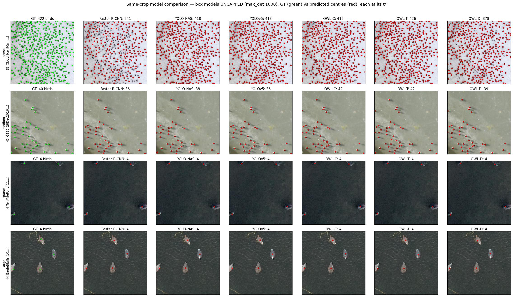

# Waterfowl Detection — Faster R-CNN, YOLO-NAS, YOLOv5, YOLO11, YOLO26 & MegaDetector-Overhead

Five model families share the same 512×512 COCO crops, prepared **once** for all of them
(`python -m pipeline.cli prepare --mirrors`):

- **Faster R-CNN** (Detectron2) — `faster_rcnn/`
- **YOLO-NAS** (super-gradients) — `yolo_nas/`
- **YOLOv5** (Ultralytics) — `yolov5/`
- **YOLO11 / YOLO26** (Ultralytics) — `yolo_ultralytics/` — two generations via
  `--model`; YOLO26 is end-to-end (NMS-free)
- **MegaDetector-Overhead / OWL** (Microsoft AI for Good) — `megadetector_overhead/`
  — three variants via `--model`: **OWL-C** (DLA-34), **OWL-T** (DLA-34 + Swin),
  **OWL-D** (DINOv3 ViT-H+)

The first four are **box** detectors compared on a single protocol (mAP30, IoU = 0.30).
The Ultralytics models (YOLOv5, YOLO11, YOLO26) share one mirror of the crops in the
Ultralytics YOLO layout; MegaDetector-Overhead mirrors them into a point-CSV layout
(both built automatically from the same crops).

Head-to-head numbers for all eight models are in [Results](#results).

Which data an experiment uses is chosen **once for all eight models**, by naming a folder
in `data_prep/config.py` rather than per package:
[`pipeline/`](#common-dataset-interface-pipeline) is the common dataset interface — one
adapter per survey programme (Missouri today, Arkansas when it arrives), canonical
records with measured coverage, and data selections that every model reads without a
code change (see [Choosing the data for an
experiment](#choosing-the-data-for-an-experiment--once-for-all-eight-models)).

Each model is additionally scored as a **pretrained checkpoint before fine-tuning**, so
every result has a documented "before"
([`baseline/`](#zero-shot-baselines-before-fine-tuning)).

**MegaDetector-Overhead is different in kind** — it is a *point* detector (formerly "OWL",
Overhead Wildlife Locator): it localises each bird as a point, not a box. It therefore
cannot use the box-IoU mAP30 protocol directly, and it needs its own Python 3.11
environment (vendored DINOv3, incompatible with the detectron2/super-gradients/ultralytics
stack). It is scored two ways — a native point precision/recall/F1 and a bridging
"pseudo-box" mAP30 — and runs in a separate interpreter. See
[Running the Pipeline (MegaDetector-Overhead)](#running-the-pipeline-megadetector-overhead).

## Terminal interface (`./waterfowl_detection.sh`)

```bash
./waterfowl_detection.sh
```

A menu-driven program for the whole workflow: import imagery, train and evaluate any of
the eight models, count birds in new survey photographs, review and correct those counts
bird by bird, and export count reports, corrected labels and model comparisons. It
launches the commands documented below as background jobs, so training survives closing
the terminal. Step-by-step usage is in the [user manual](WATERFOWL_DETECTION_MANUAL.md); design
notes are in [`workbench/README.md`](workbench/README.md).

## Data

The raw aerial imagery (ten sub-datasets, `Bird_A`–`Bird_J`) is too large for git and
is hosted on the Hugging Face Hub:
**[juliamonson/waterfowl-uav](https://huggingface.co/datasets/juliamonson/waterfowl-uav)**.
Fetch it into `dataset_full/` — the folder the pipeline reads by default — then prepare
the 512×512 crops and the COCO / YOLO / OWL layouts from it once (`crops/`,
`yolov5_data/`, `mdo_data/` are all derived and gitignored):

```bash
hf download juliamonson/waterfowl-uav --repo-type dataset --local-dir dataset_full/
python -m pipeline.cli prepare --mirrors
```

**To run on part of the data, put that part in a folder** and name it in
`data_prep/config.py` (`DATASET_FOLDER`); `dataset_full` is only the default. Every model
then reads that folder, with no command and no flag — see [Choosing the data for an
experiment](#choosing-the-data-for-an-experiment--once-for-all-eight-models).

Per-run **results** (metrics, configs, curves, example panels, logs) *are* committed
under `output/`; the exclusions are model weights (`*.pth`/`*.pt`) and the analysis
detection cache (`output/analysis/predictions/`, ~68 MB, regenerable). The trained **best
checkpoints** (plus a copy of the eval artifacts) are on the HF Hub:
**[juliamonson/waterfowl-uav-checkpoints](https://huggingface.co/juliamonson/waterfowl-uav-checkpoints)**.

### Dataset inventory and available metadata

[`dataset_full/DATASET_INVENTORY.md`](dataset_full/DATASET_INVENTORY.md) is a complete, measured
inventory of what metadata each of the ten sub-datasets actually carries — image, crop and
bird counts, annotation format, and per-dataset availability of species, sex, habitat,
altitude, date, site, camera and weather. Every value was read off the files; nothing is
inferred, and fields are recorded as unavailable rather than guessed.

The short version:

| | |
|---|---|
| Available everywhere | image/crop/bird counts, bounding boxes, **flight altitude** (100% coverage, 14–150 m), resolution |
| Available in part | species + sex (Bird_H, Bird_I — 7.4% of birds), habitat (G, H, J — 27% of images), weather (G, J), date + site (67% of images), camera + GPS (9% of images) |
| Not available at all | **decoy vs. real bird**, environmental conditions beyond sun/cloud, observer identity, bird behaviour |

It also determines which subgroup analyses the data can support: altitude is the only
covariate clean enough for a whole-corpus analysis, while habitat, species and weather are
confined to subsets and confounded with dataset identity.

The same coverage is available **measured from the files rather than from a document**,
for this corpus or any future one, via the dataset interface:

```bash
python -m pipeline.cli coverage --source mdc
```

> **Two loader bugs were found and fixed while compiling the inventory.** The loader
> guessed each image's label file by swapping the extension to `.txt`, which missed
> Bird_B and Bird_C — they name their label files differently — so 140 images and 3,138
> birds were skipped without an error. Separately, the annotation parser required every
> line to begin with a `bird,` label and silently discarded the shorter,
> coordinates-only lines used by 30 Bird_I images: those images entered the splits as **2,781
> background crops asserted to be empty**, while in fact holding 2,646 birds. Both are
> fixed, recovering 5,784 birds.
>
> **The committed results predate both fixes.** They were produced before Bird_B/Bird_C
> were readable and while those 30 images were labelled empty, so reproducing them exactly
> means not regenerating the splits.

### Are the splits fixed?

Yes — every model trains and evaluates on the same **75,664 / 24,374 / 25,708** crops,
and each run records those counts in its `run_info.json` so it can be checked after the
fact.

- **The test set is not random.** Every image arrives already marked as *training* or
  *testing* by the people who annotated it, in each dataset's `image_info.csv`. The
  pipeline honours that decision and never reshuffles it.
- **Train and validation are split 75/25** from the images marked for training, using a
  fixed random seed (42). It is reproducible because the pool of images is assembled in
  the same order every time: datasets are visited in sorted name order, and images within
  a dataset keep their original CSV row order.
- **One shared source.** Every package reads `output/crops_json/{train,val,test}/coco.json`;
  the Ultralytics and OWL mirrors are derived from those same files. Re-running
  `--prepare` regenerates identical splits rather than a new partition.
- **The split is derivable and checksummed.** `python -m pipeline.cli split --source mdc`
  re-derives the same assignment through the dataset interface and prints a SHA-256 of its
  membership; `python -m pipeline.verify` checks that it reproduces the committed
  train / val / test files exactly (1,252 / 417 / 426 photographs).

The seeded shuffle is only stable while the *input file set* is unchanged. Adding or
removing images under `dataset_full/`, or adding an entry to `EXCLUDED_DATASETS`
(currently empty), reorders the pool and reshuffles train/val membership for every
dataset — not only the one changed.

That is why `--prepare` today does **not** rebuild the split the committed results were
scored on. The two loader fixes above added images, and `Bird_I_complete/` was renamed to
`Bird_I/`, so the pool is reordered and the test set grows from 396 to 426 source images
(25,708 → 28,588 crops). The committed `output/crops_json/*/coco.json` files *are* the
published split; read them rather than re-deriving them.

---

## Results

Test split: **25,708 crops / 88,195 birds**, identical for every model (see
[Are the splits fixed?](#are-the-splits-fixed)). All numbers come from the committed
`output/checkpoints/<model>/<run>/eval_results.txt`.

Point metrics follow the OWL paper's protocol (τ = 40 px, B = 1,000 bootstrap); P/R/F1
are reported at each model's own optimal threshold t*.

| Model | mAP30 | point AP | P | R | F1 | MAE | RMSE | run |
|---|---|---|---|---|---|---|---|---|
| YOLO-NAS-m   | **77.46%** | **93.24%** | 90.79% | 88.12% | 89.44% | 0.500 | 1.746 | 2026-06-28 |
| YOLOv5m      | 76.79% | 92.59% | **92.59%** | 89.07% | **90.80%** | 0.434 | **1.593** | 2026-07-11 |
| YOLO11m      | 76.76% | 92.52% | 92.25% | **89.22%** | 90.71% | 0.436 | 1.635 | 2026-08-14 |
| YOLO26m      | 75.85% | 91.81% | 92.46% | 88.08% | 90.21% | 0.449 | 1.681 | 2026-08-15 |
| OWL-T        | 49.27%\* | 90.29% | 90.30% | 88.76% | 89.52% | 0.498 | 2.006 | 2026-07-24 |
| Faster R-CNN | 75.59% | 89.54% | 87.20% | 85.63% | 86.41% | 0.762 | 3.594 | 2026-06-27 |
| OWL-C        | 48.21%\* | 88.70% | 89.79% | 87.80% | 88.78% | 0.520 | 1.936 | 2026-07-21 |
| OWL-D        | 39.85%\* | 83.88% | 90.67% | 89.12% | 89.89% | **0.427** | 1.596 | 2026-07-26 |

\* OWL rows are the **pseudo-box** mAP30 bridge (points wrapped in 28 px boxes), not a
true box mAP — read it as an approximate cross-family comparison only. Rows are ordered by
point AP.

All models are scored at the same detection limit (`config.MAX_DETECTIONS_PER_IMAGE`,
500), which sits above the 422 birds in the densest crop so it cannot discard a real
detection from any model. For Faster R-CNN this governs both its post-NMS detection
budget *and* its RPN test-time proposal budget — the latter sits upstream and would
otherwise bound detections per crop on its own.

> **The mAP30 column above was scored under a 100-detection budget, and is understated.**
> Until 2026-09-16 every mAP30 implementation kept its library default of 100
> detections per crop — pycocotools' `COCOeval` (Ultralytics, OWL pseudo-boxes, Faster
> R-CNN's evaluator) and super-gradients' `DetectionMetrics` (YOLO-NAS). The 163
> densest test crops hold 13,576 birds beyond the 100th, so no model could reach an
> mAR30 above ~85%, and the limit bound every box model (committed mAR30 77.9–81.1%). All
> four now score up to `MAX_DETECTIONS_PER_IMAGE`; YOLO-NAS's metric also computes
> recall over all kept detections (score ≥ 0.05) instead of at score 0.1, so its mAR30
> means the same as everyone else's. Re-scoring the cached predictions on the current
> 28,588-crop split, the box models' mAP30 goes from 75.8–77.3% to 88.8–91.2%, and Faster
> R-CNN, which sat inside the YOLO range at 100 detections, falls 1.3 points below it:
>
> | | YOLO-NAS | YOLOv5 | YOLO11 | YOLO26 | Faster R-CNN | OWL-T\* | OWL-C\* | OWL-D\* |
> |---|---|---|---|---|---|---|---|---|
> | mAP30, 100 detections | 77.32 | 76.79 | 76.77 | 75.84 | 76.54 | 48.47 | 47.43 | 39.80 |
> | mAP30, 500 detections | **91.22** | 91.11 | 91.07 | 90.08 | 88.77 | 52.12 | 51.27 | 45.01 |
> | mAR30, 500 detections | **96.75** | 93.15 | 93.02 | 92.29 | 94.21 | 66.63 | 65.44 | 64.94 |
>
> Script and CSV: `output/analysis/architecture/code/map30_detection_limit.py` →
> `output/analysis/architecture/results/map30_detection_limit.csv`. The point metrics
> (AP, P/R/F1, MAE, RMSE) never had this limit and are unaffected. A new `--eval` writes
> the corrected mAP30; for Faster R-CNN and YOLO-NAS the fix also changes the mAP30 that
> early stopping watches during training.

Read the two metric families separately — they disagree, and the disagreement is the
interesting part. The YOLO family takes the top four AP slots (91–93%), yet **OWL-D has
the best MAE** (0.427) while placing last on AP at 83.88%, and its recall (89.12%) is
second only to YOLO11. It localises birds as well as anything in the table and still
trails by nine AP points, because AP penalises how it *orders* its detections rather than
its ability to find them. Pick the metric that matches the question: AP for "did it find
this bird", MAE/RMSE for "how many were there".

Counting is close at the top: OWL-D's MAE 0.427 and YOLOv5's 0.434 sit within each
other's bootstrap intervals, and YOLOv5 edges RMSE (1.593 vs 1.596). Treat the leading
four as tied on counting rather than ranked.

Faster R-CNN sits mid-table on AP but is clearly weakest on counting, with an RMSE about
1.8× the next worst — a dense-crop weakness rather than a uniform one.

### Same-crop qualitative comparison



Four density regimes (422 / 40 / 4 / 4 birds) × six models on identical crops, ground
truth in green and predicted centres in red, each model at its own t*. The sparse and large-bird rows are saturated — every model
gets them exactly right — so the whole spread in the table above is decided by the dense
row: Faster R-CNN finds 241 of 422, OWL-D 378, and the other four land within ±2.5%
(OWL-T 426, YOLO-NAS 418, YOLOv5 413, OWL-C 412). Note this grid predates YOLO11/YOLO26,
which are not in it.

### Where these numbers stop

One table per model, over the whole split, is not the whole picture, and two limits on it
are measured rather than assumed:

- **Precision above is understated, for every model.** 1,639 detections that all eight
  models place within the matching radius of one another match no annotated bird, over
  1,027 crops in all ten sub-datasets — 1.8% of the 89,884 annotated birds. A correct
  detection of an unlabelled bird scores as a false positive. See
  [Cross-Model Analysis](#cross-model-analysis-analysis).
- **Recall above is understated too, unevenly.** Greedy score-ordered matching loses
  120–663 true positives per model against an optimal assignment at the same radius —
  0.13–0.74 recall points, enough to reorder models separated by less than that. The
  published rule is kept for comparability; `analysis/matching_audit.py` measures it.

And the single ranking does not hold condition by condition: five different architectures
take first place in different habitats, and mean F1 moves 40.8 points between
sub-datasets against 4.7 for weather. The
[survey-condition analysis](#survey-condition-analysis-habitat-altitude-metadata-failures)
breaks all of it down.

### Zero-shot baselines

- **Zero-shot (before fine-tuning).** The pretrained checkpoints scored on this same test
  split — see [Zero-Shot Baselines](#zero-shot-baselines-before-fine-tuning).

---

## Project Layout

```
rebuild/
├── dataset_full/               # Raw aerial-image datasets, 10 (read-only; not in git)
│   ├── DATASET_INVENTORY.md    # Measured metadata inventory (versioned; the data is not)
│   ├── Bird_A/
│   ├── Bird_B/
│   └── ...  (C, D, E, F, G, H, I, J)
│
├── dataset_<name>/             # A data-selection folder: the collections one experiment
│   ├── Bird_G -> ../dataset_full/Bird_G     # uses, as symlinks (gitignored; made by
│   └── Bird_J -> ../dataset_full/Bird_J     # `pipeline.cli folder`, or by hand)
│
├── data_prep/                  # Shared data utilities (reusable by future models)
│   ├── config.py               # All hyperparameters (anchors, RPN, LR, crop size…)
│   └── prepare_data.py         # Crops images → 512×512 patches + COCO JSON
│
├── faster_rcnn/                # Faster R-CNN model package (Detectron2)
│   ├── dataset.py              # Registers COCO splits with Detectron2
│   ├── model.py                # Builds Detectron2 CfgNode (ResNet-50 + FPN)
│   ├── evaluator.py            # Custom MAP30Evaluator (IoU threshold = 0.30)
│   ├── train.py                # WaterfowlTrainer + EarlyStoppingHook
│   └── main.py                 # Entry point for this model
│
├── yolo_nas/                   # YOLO-NAS model package (super-gradients)
│   ├── dataset.py              # super-gradients dataloaders from the same COCO crops
│   ├── model.py                # YOLO-NAS model, PPYoloELoss, mAP30 metric, train params
│   ├── train.py                # Trainer wrapper + per-run checkpoints
│   └── main.py                 # Entry point for this model
│
├── yolov5/                     # YOLOv5 model package (Ultralytics)
│   ├── dataset.py              # Mirrors the COCO crops → Ultralytics YOLO layout
│   ├── evaluate.py             # mAP30 via pycocotools COCOeval (IoU = 0.30)
│   ├── train.py                # Ultralytics YOLO.train() wrapper + per-run checkpoints
│   └── main.py                 # Entry point for this model
│
├── yolo_ultralytics/           # YOLO11 + YOLO26 package (Ultralytics), one entry point
│   ├── train.py                # Parameterised Ultralytics YOLO.train() wrapper
│   └── main.py                 # Entry point; --model {yolo11,yolo26}
│                               # (reuses yolov5/dataset.py + yolov5/evaluate.py)
│
├── megadetector_overhead/      # MegaDetector-Overhead / OWL package (point detector)
│   ├── dataset.py              # Mirrors the COCO crops → OWL point-CSV layout (box centres)
│   ├── train.py                # Generates a Hydra config + drives the OWL repo's trainer
│   ├── _eval_owl.py            # Runs UNDER the OWL .venv: point metric + detections
│   ├── evaluate.py             # Pseudo-box mAP30 via the same COCOeval (IoU = 0.30)
│   └── main.py                 # Entry point (shells into the OWL Python 3.11 env)
│
├── baseline/                   # Zero-shot scores of the PRETRAINED checkpoints, before
│   ├── detect.py               #   fine-tuning — one adapter per family → COCO results
│   └── main.py                 # Entry point: --model/--all/--summary/--save
│
├── analysis/                   # Cross-model analysis: accuracy vs cost, size, density
│   ├── manifest.py             # Reads the model list (.docx/.txt/.csv/.md)
│   ├── registry.py             # Manifest names → checkpoint folders; box vs point
│   ├── collect.py              # Reads each run's stored metrics; comparability checks; metrics.csv
│   ├── figures.py              # Ranked dot plots with bootstrap CIs; shared plot styling
│   ├── predict.py              # Runs each model once; caches detections as .npz
│   ├── rescore.py              # Recomputes the point protocol from those detections
│   ├── strata.py               # Re-matching (records which detection claims each bird) + size / density bins
│   ├── pareto.py               # Non-dominated sets, best-under-budget picks
│   ├── efficiency.py           # Reads the efficiency benchmarks
│   ├── bench_extra.py          # Inference: batch-size sweep + end-to-end, all 8 models
│   ├── bench_train.py          # Training-step throughput vs batch size (Ultralytics + YOLO-NAS)
│   ├── tasks.py                # Orchestrates Tasks 2.1–2.4: Pareto picks, size and density summaries
│   ├── figures_tasks.py        # Pareto scatters, size and density curves
│   ├── metadata.py             # Crop → source image → habitat / altitude / weather / site
│   ├── subgroups.py            # Scores any subset of the split with the published protocol
│   ├── survey_conditions.py    # Habitat, altitude and survey-metadata analysis
│   ├── failure_library.py      # Failure-case library: selection rules, false-alarm breakdown, JSON record
│   ├── failure_render.py       # Draws one failure case: ground truth, false alarms, credit links
│   ├── matching_audit.py       # How far the greedy matching rule moves recall (swaps, lost true positives)
│   ├── figures_survey_conditions.py  # Habitat, altitude and error-source figures
│   └── main.py                 # Entry point; -m <manifest> --tasks --conditions
│
├── pipeline/                   # Common dataset interface: one adapter per survey programme
│   ├── records.py              # The canonical records (photograph, annotation, coverage)
│   ├── adapters/mdc.py         # Missouri: 10 collections, 7 spreadsheet layouts, 3 vocabularies
│   ├── adapters/arkansas.py    # AGFC deliveries, in the agreed format
│   ├── crosswalks/*.csv        # Raw label → canonical term, per programme
│   ├── cameras.py              # Optics and ground sample distance
│   ├── splits.py               # Split specifications (provider marks, site holdout, cross-source)
│   ├── crops.py                # Crop ↔ photograph, and the fields the tiler should carry
│   ├── conformance.py          # The suite every adapter must pass
│   ├── cli.py                  # describe / coverage / conform / split / metadata
│   └── verify.py               # Equivalence with data_prep + analysis (see below)
│
├── workbench/                  # Terminal interface (./waterfowl_detection.sh): menus, background jobs,
│                               #   survey detection, the reviewer, exports — see its README
│
├── third_party/                # Gitignored — cloned research repos
│   └── MegaDetector-Overhead/  # `git clone` + `uv sync` (.venv, vendored DINOv3, weights/)
│
├── crops/                      # Created automatically — crop images, organised by dataset
│   ├── Bird_A/
│   │   ├── A_DJI_0001_0_0.JPG
│   │   ├── A_DJI_0001_0_460.JPG
│   │   └── ...
│   ├── Bird_B/
│   └── ...  (one sub-folder per dataset)
│
├── yolov5_data/                # Created automatically — Ultralytics YOLO mirror of the crops
│   ├── data.yaml               # Dataset descriptor consumed by Ultralytics
│   ├── images/{train,val,test}/  # Symlinks back to crops/ (no images duplicated)
│   └── labels/{train,val,test}/  # YOLO txt labels (one "0 cx cy w h" line per box)
│
├── mdo_data/                   # Created automatically — OWL point-CSV mirror of the crops
│   └── {train,val,test}/
│       ├── images/             # Symlinks back to crops/ (flat; no images duplicated)
│       └── gt.csv              # Point labels: images,x,y,labels (box centre per bird)
│
└── output/                     # Created automatically — model artefacts only
    ├── crops_json/             # COCO annotation files (no images)
    │   ├── train/
    │   │   ├── coco.json               # Full training split (all datasets)
    │   │   └── coco_Bird_A_Bird_B.json # Filtered split (generated on demand)
    │   ├── val/
    │   │   ├── coco.json
    │   │   └── coco_Bird_A_Bird_B.json
    │   └── test/coco.json              # Test split is never filtered
    └── checkpoints/
        ├── fasterrcnn/                 # All Faster R-CNN runs live here
        │   └── 2026-06-23_14-36-59/   # One timestamped folder per training run
        │       ├── model_best.pth      # Best checkpoint (by val mAP30)
        │       ├── model_final.pth
        │       ├── metrics.json
        │       └── test_inference/     # Written by --eval
        ├── yolonas/                    # All YOLO-NAS runs live here
        │   └── 2026-06-28_10-30-00/   # One timestamped folder per training run
        │       └── RUN_<timestamp>/    # super-gradients nests checkpoints one level down
        │           ├── ckpt_best.pth   # Best checkpoint (by val mAP30)
        │           ├── ckpt_latest.pth
        │           └── average_model.pth
        ├── yolov5/                     # All YOLOv5 runs live here
        │   └── 2026-07-11_12-00-00/   # One timestamped folder per training run
        │       ├── weights/            # Ultralytics writes checkpoints here
        │       │   ├── best.pt         # Best checkpoint (by Ultralytics fitness)
        │       │   └── last.pt
        │       ├── run_info.json
        │       ├── results.csv         # Per-epoch Ultralytics metrics
        │       └── examples/           # Written by --eval
        ├── yolo11/, yolo26/            # Same layout as yolov5/ (yolo_ultralytics --model)
        └── mdo_owl_c/                  # MegaDetector-Overhead runs, one folder per model
            │                           # (mdo_owl_c / mdo_owl_t / mdo_owl_d — see --model)
            └── 2026-07-21_20-55-09/   # One timestamped folder per training run
                ├── weights/best.pth    # Best checkpoint (by val point-F1), stable handle
                ├── best_model.pth       # Raw checkpoint written by the OWL trainer
                ├── mdo_train_config.yaml # Generated Hydra config for this run
                ├── run_info.json
                └── eval/                # Written by --eval
                    ├── owl_eval.json    # Point metric + per-point detections
                    ├── metrics.json     # Point P/R/F1 + pseudo-box mAP30
                    └── ../examples/     # GT boxes | predicted points panels
    ├── experiments/<name>/      # One data selection: which data joins an experiment
    │   ├── selection.json      #   the choice, its checksum, and what it resolved to
    │   ├── crops_json/         #   COCO splits filtered from the committed ones
    │   ├── yolo/               #   Ultralytics mirror of the selection
    │   └── mdo/                #   OWL point-CSV mirror of the selection
    │                           #   (everything but selection.json is gitignored)
    ├── baselines/<model>/<timestamp>/  # Zero-shot scores of the PRETRAINED checkpoints
    │                                   # (baseline/main.py) — same eval_results.txt layout
    └── baselines/summary.txt           # Zero-shot vs fine-tuned table (--save)
```

Every run directory also carries `eval_results.txt` (the human-readable metric blocks)
and `paper_point_metrics.json` (the OWL-paper protocol), which is what the
[Results](#results) tables above are built from.

Each dataset sub-folder contains:

- JPEG or PNG aerial images
- A `.txt` annotation file per image (`bird,x1,y1,x2,y2` per line)
- `image_info.csv` marking each image as `train` or `test` (the annotators' own split)

---

## Environment

The five **box** models (Faster R-CNN, YOLO-NAS, YOLOv5, YOLO11, YOLO26) and the
zero-shot `baseline/` pipeline all run in a single conda environment, `waterfowl`. MegaDetector-
Overhead runs in its **own** Python 3.11 environment (`third_party/MegaDetector-Overhead/.venv`,
created by `uv`) — its vendored DINOv3 + geospatial stack cannot coexist with
detectron2/super-gradients/ultralytics. See
[Running the Pipeline (MegaDetector-Overhead)](#running-the-pipeline-megadetector-overhead)
for its setup.

| Package         | Version           | Used by       |
| --------------- | ----------------- | ------------- |
| Python          | 3.10.20           | box models    |
| PyTorch         | 2.1.2 + CUDA 12.1 | box models    |
| Detectron2      | 0.6               | Faster R-CNN  |
| super-gradients | 3.7.1             | YOLO-NAS      |
| ultralytics     | 8.4.82            | YOLOv5, YOLO11, YOLO26 |
| pycocotools     | 2.0.11            | all (mAP30)   |
| Pillow          | 12.2.0            | box models    |
| opencv-python   | 4.11.0.86         | all           |
| _(separate env)_ PyTorch | 2.5.1 + CUDA 12.1 | MegaDetector-Overhead |
| _(separate env)_ Python  | 3.11              | MegaDetector-Overhead |

Create and populate it with:

```bash
conda create -n waterfowl python=3.10 -y
conda activate waterfowl
pip install torch --index-url https://download.pytorch.org/whl/cu121
pip install super-gradients ultralytics pycocotools pillow opencv-python
# Detectron2 (for Faster R-CNN) — see the official install matrix for your torch/CUDA:
#   https://detectron2.readthedocs.io/en/latest/tutorials/install.html
```

Notes:
- **YOLOv5 (Ultralytics)** auto-downloads its COCO-pretrained weights (`yolov5mu.pt`,
  etc.) from GitHub on first use — no manual download required.
- **YOLO-NAS (super-gradients)** pretrained weights are normally fetched from Deci's
  model hub, which is offline; place `yolo_nas_s_coco.pth` in
  `~/.cache/torch/hub/checkpoints/` (mirror: `https://d2gjn4b69gu75n.cloudfront.net/models/`)
  so the download is skipped.

---

## Running the Pipeline (Faster R-CNN)

All commands are run from the `rebuild/` directory.

### Step 1 — Prepare data (one-time)

Crops all datasets into 512×512 patches with 20% overlap (stride = 460 px) and writes
COCO-format JSON files for train / val / test splits.

```bash
./faster_rcnn/main.py --prepare
```

- Images are split **train / val / test ≈ 60 / 20 / 20**. The test set is the one the
  annotators marked in each dataset's `image_info.csv`; their training images are then
  divided 75 / 25 into train and validation.
- Only needs to be run once. The resulting COCO JSONs are reused by all training runs.

> **Data preparation is shared, and the data is chosen by folder.** Cropping happens once
> for every model (`python -m pipeline.cli prepare --mirrors`); the `--prepare` flag in this
> section is the older per-model equivalent and still works. To run on part of the corpus,
> put it in a folder and name that folder in `data_prep/config.py` — see [Choosing the data
> for an experiment](#choosing-the-data-for-an-experiment--once-for-all-eight-models). No
> flag is needed here.


### Step 2 — Train

```bash
# Train on all datasets
./faster_rcnn/main.py --train

# Train on a subset of datasets by subfolder name
./faster_rcnn/main.py --train --datasets Bird_A Bird_B Bird_G
```

- **Backbone**: ResNet-50 + FPN, initialised from COCO-pretrained Faster R-CNN weights (`faster_rcnn_R_50_FPN_3x` from Detectron2 model zoo)
- **Anchor sizes**: 8, 16, 32, 64, 128 px
- **Epochs**: 100 (early stop if val mAP30 stalls for 30 consecutive evaluations)
- **Learning rate**: 0.001 (SGD + cosine decay)
- **Batch size**: 4
- Each run creates a new timestamped folder under `output/checkpoints/fasterrcnn/`
  (e.g. `2026-06-24_09-00-00/`). Previous runs are never overwritten.
- When `--datasets` is used, a filtered COCO JSON is written alongside the original
  (e.g. `coco_Bird_A_Bird_B_Bird_G.json`). The original `coco.json` is not modified.
  The test split is always the full set for a fair final evaluation.
- **`--datasets` only affects Faster R-CNN.** To run *all eight* models on the same subset,
  make a data selection instead — one choice, every model, train and test filtered
  consistently: see [Choosing the data for an
  experiment](#choosing-the-data-for-an-experiment--once-for-all-eight-models).

### Step 3 — Evaluate on test set

```bash
# Evaluate the most recent training run
./faster_rcnn/main.py --eval

# Evaluate a specific run by its timestamp
./faster_rcnn/main.py --eval --run 2026-06-23_14-36-59
```

Loads `model_best.pth` from the selected run and reports **mAP30** (mean Average
Precision at IoU threshold = 0.30, matching the paper's metric).

### All steps in one command

```bash
./faster_rcnn/main.py --prepare --train --eval
```

---

## Running the Pipeline (YOLO-NAS)

The YOLO-NAS entry point follows the **same `--prepare / --train / --eval`**
interface and reuses the **same crops** as Faster R-CNN. If you already ran
`--prepare` for Faster R-CNN, skip straight to `--train`.

> **Data preparation is shared, and the data is chosen by folder.** Cropping happens once
> for every model (`python -m pipeline.cli prepare --mirrors`); the `--prepare` flag in this
> section is the older per-model equivalent and still works. To run on part of the corpus,
> put it in a folder and name that folder in `data_prep/config.py` — see [Choosing the data
> for an experiment](#choosing-the-data-for-an-experiment--once-for-all-eight-models). No
> flag is needed here.


```bash
# Step 1 — prepare data (shared with Faster R-CNN; only needed once)
./yolo_nas/main.py --prepare

# Step 2 — train (saved to output/checkpoints/yolonas/<timestamp>/)
./yolo_nas/main.py --train

# Step 3 — evaluate best checkpoint on the test set
./yolo_nas/main.py --eval                       # latest run
./yolo_nas/main.py --eval --run 2026-06-28_10-30-00

# All-in-one
./yolo_nas/main.py --prepare --train --eval
```

- **Model**: YOLO-NAS (`yolo_nas_s` by default), initialised from COCO-pretrained weights
- **Epochs**: 100 (early stop if val mAP30 stalls for 30 consecutive epochs)
- **Learning rate**: 0.0005 (Adam + cosine decay), batch size 8
- **Evaluation**: mAP30 (IoU = 0.30), identical protocol to Faster R-CNN
- `--eval` also writes `N` side-by-side example panels (`--examples N`, default 40;
  left = ground truth, right = predictions). Each run gets its own timestamped folder
  under `output/checkpoints/yolonas/`.
- The variant and YOLO-NAS hyperparameters live in `data_prep/config.py`
  (`YOLONAS_MODEL`, `YOLONAS_BATCH_SIZE`, `YOLONAS_LR`, …).

---

## Running the Pipeline (YOLOv5)

The YOLOv5 entry point follows the **same `--prepare / --train / --eval`** interface
and reuses the **same crops** as the other models. Unlike Faster R-CNN / YOLO-NAS,
Ultralytics cannot read COCO JSON directly, so `--prepare` (and `--train`) also builds
a YOLO-format mirror of the crops under `yolov5_data/` (symlinked images + txt labels

+ `data.yaml`). This is automatic and idempotent — no images are duplicated.

> **Data preparation is shared, and the data is chosen by folder.** Cropping happens once
> for every model (`python -m pipeline.cli prepare --mirrors`); the `--prepare` flag in this
> section is the older per-model equivalent and still works. To run on part of the corpus,
> put it in a folder and name that folder in `data_prep/config.py` — see [Choosing the data
> for an experiment](#choosing-the-data-for-an-experiment--once-for-all-eight-models). No
> flag is needed here.

```bash
# Step 1 — prepare data: shared COCO crops + Ultralytics YOLO mirror
./yolov5/main.py --prepare

# Step 2 — train (saved to output/checkpoints/yolov5/<timestamp>/)
./yolov5/main.py --train

# Step 3 — evaluate best checkpoint on the test set (mAP30)
./yolov5/main.py --eval                       # latest run
./yolov5/main.py --eval --run 2026-07-11_12-00-00

# All-in-one
./yolov5/main.py --prepare --train --eval
```

- **Model**: YOLOv5 (`yolov5mu` by default — Ultralytics' anchor-free YOLOv5u variant),
  initialised from COCO-pretrained weights that Ultralytics auto-downloads.
- **Epochs**: 100 (early stopping, patience 30)
- **Learning rate**: 0.0005 (Adam), batch size 8, image size 512
- **Evaluation**: mAP30 (IoU = 0.30) computed by `yolov5/evaluate.py` with pycocotools
  `COCOeval`, the **identical protocol** to Faster R-CNN and YOLO-NAS.
- `--eval` also writes `N` side-by-side example panels (`--examples N`, default 40;
  left = ground truth, right = predictions). Each run gets its own timestamped folder
  under `output/checkpoints/yolov5/`, with weights in `weights/best.pt`.
- The variant and YOLOv5 hyperparameters live in `data_prep/config.py`
  (`YOLOV5_MODEL`, `YOLOV5_BATCH_SIZE`, `YOLOV5_LR`, `YOLOV5_DATA_DIR`, …).

> **Two protocol caveats** specific to YOLOv5:
>
> 1. **Early stopping watches Ultralytics' internal fitness** (a blend of mAP@0.50 and
>    mAP@0.50:0.95), not mAP30 — Ultralytics does not expose a single-IoU monitor.
>    Only the **final** test report (`--eval`) is computed at mAP30. Faster R-CNN and
>    YOLO-NAS watch mAP30 directly during training.
> 2. **mAP30 scores up to `MAX_DETECTIONS_PER_IMAGE` (500) detections per crop**, not
>    pycocotools' default of 100 (`coco_map30(..., max_dets=)`). Some crops hold 400+
>    birds, and the default made about 15% of all test birds unreachable. Runs evaluated
>    before 2026-09-16 used the default — see the note under [Results](#results).

---

## Running the Pipeline (YOLO11 / YOLO26)

Two newer Ultralytics generations, served by **one** entry point via `--model` (the same
pattern `megadetector_overhead/` uses for OWL-C/T/D). They read the **same
`yolov5_data/` mirror** YOLOv5 already builds, so `--prepare` is only needed once across
all Ultralytics models and no data is duplicated.

> **Data preparation is shared, and the data is chosen by folder.** Cropping happens once
> for every model (`python -m pipeline.cli prepare --mirrors`); the `--prepare` flag in this
> section is the older per-model equivalent and still works. To run on part of the corpus,
> put it in a folder and name that folder in `data_prep/config.py` — see [Choosing the data
> for an experiment](#choosing-the-data-for-an-experiment--once-for-all-eight-models). No
> flag is needed here.

```bash
# Step 1 — only if you have never run any --prepare (shared with YOLOv5)
./yolo_ultralytics/main.py --prepare

# Step 2 — train (saved to output/checkpoints/yolo11|yolo26/<timestamp>/)
./yolo_ultralytics/main.py --model yolo11 --train
./yolo_ultralytics/main.py --model yolo26 --train

# Step 3 — evaluate best checkpoint on the test set (mAP30 + OWL point metrics)
./yolo_ultralytics/main.py --model yolo11 --eval
./yolo_ultralytics/main.py --model yolo26 --eval --run 2026-08-14_09-00-00

# All-in-one
./yolo_ultralytics/main.py --model yolo11 --prepare --train --eval
```

- **Models**: `yolo11m` (20.1M params) and `yolo26m` (21.9M params), COCO-pretrained and
  auto-downloaded by Ultralytics. Medium variants chosen to match YOLOv5m / YOLO-NAS-m.
- **Hyperparameters deliberately match YOLOv5**: 100 epochs (patience 30), Adam at
  0.0005, batch 8, image size 512 — so this is a like-for-like comparison across
  generations, not a per-model tuned bake-off. All in `data_prep/config.py` under
  `ULTRALYTICS_MODELS`.
- **Evaluation**: identical mAP30 (`yolov5/evaluate.py`, pycocotools `COCOeval` at
  IoU = 0.30) plus the shared OWL-paper point metrics, so results drop straight into the
  same tables as every other model. Both YOLOv5 protocol caveats above apply here too.

> **YOLO26 is end-to-end (NMS-free).** Its head reports `end2end=True`, so the NMS `iou`
> argument is accepted but has **no effect** — it is kept only for symmetry. `max_det`
> is held identical across all Ultralytics models, and is set above the densest crop in
> the split so it cannot discard a real detection from any generation.
>
> YOLO26 also ships a different default optimiser upstream. We override it to Adam to
> match the rest of the project — a fairness choice, not an oversight. If you want
> YOLO26 at its intended best rather than matched, change `optimizer` in
> `yolo_ultralytics/train.py`.

Naming: Ultralytics calls these **YOLO11** and **YOLO26** (no "v"); the OWL paper writes
"YOLOv11" for the same model. The paper benchmarks YOLOv11n and YOLOv11l — we use the
medium variant, so the paper's numbers are not directly comparable to ours.

---

## Running the Pipeline (MegaDetector-Overhead)

MegaDetector-Overhead / OWL is a **point** detector, so it does not fit the box-IoU
protocol the same way. Its entry point still follows the **same `--prepare / --train /
--eval`** interface and reuses the **same crops**, but it runs in a **separate Python
3.11 environment** and is scored two ways.

### One-time setup (separate environment + weights)

```bash
# 1. Clone the repo into third_party/ (gitignored)
mkdir -p third_party && cd third_party
git clone https://github.com/microsoft/MegaDetector-Overhead
cd MegaDetector-Overhead

# 2. Build its Python 3.11 GPU environment (installs torch 2.5.1+cu121, animaloc,
#    vendored DINOv3). Needs `uv` (curl -LsSf https://astral.sh/uv/install.sh | sh)
uv sync --no-default-groups --group gpu

# 3. Download the pretrained weights from Zenodo into weights/ — either per model via
#    the pipeline (recommended):
cd ../..
./megadetector_overhead/main.py --fetch-weights --model OWLC     # OWL-C.pth  (~216 MB)
./megadetector_overhead/main.py --fetch-weights --model OWLT     # OWL-T.pth  (~355 MB)
./megadetector_overhead/main.py --fetch-weights --model OWLD_H   # OWL-D.pth  (~3.5 GB)
#    or manually:
#    curl -L -o weights/OWL-C.pth "https://zenodo.org/records/20802844/files/OWL-C.pth?download=1"
```

Paths for all of the above live in `data_prep/config.py` (`MDO_REPO_DIR`, `MDO_PYTHON`,
`MDO_PRETRAINED`, `MDO_MODELS`). The main entry point runs under the `waterfowl` env like
the others and shells into `MDO_PYTHON` (`.venv/bin/python`) for training and inference.

### OWL model variants (`--model`)

Three OWL architectures are wired up. Each fine-tunes from its released overhead-benchmark
checkpoint (Zenodo [record 20802844](https://zenodo.org/records/20802844), **CC BY-NC-SA
4.0** — non-commercial) and writes to its **own** checkpoint folder, so runs never mix:

| `--model` | Architecture | Start checkpoint | Params (trainable) | Runs folder |
|---|---|---|---|---|
| `OWLC` *(default)* | HerdNet detection branch, DLA-34 | `OWL-C.pth` | 18M (18M) | `output/checkpoints/mdo_owl_c/` |
| `OWLT` | DLA-34 + Swin multiscale residual | `OWL-T.pth` | 30M (30M) | `output/checkpoints/mdo_owl_t/` |
| `OWLD_H` | DINOv3 ViT-H+/16 + DPT decoder | `OWL-D.pth` | 855M (15M) | `output/checkpoints/mdo_owl_d/` |

Notes:

- All three share the same data, losses, LMDS post-processing, and both evaluation metrics —
  only the network (and its start weights) differs.
- `OWLD_H`'s checkpoint bundles its **frozen** DINOv3 backbone, so it needs no separate
  (license-gated) Meta DINOv3 download; only the DPT decoder + head (~15M params) train.
  A training step at batch 8 peaks at ~8.3 GiB GPU memory, but the big backbone makes it
  markedly slower per epoch than OWL-C/T.
- The registry (`MDO_MODELS` in `data_prep/config.py`) defines each variant's constructor
  kwargs, start checkpoint, and folder; `megadetector_overhead/fetch_dinov3_weights.py`
  exists only for the advanced case of training an OWL-D variant from scratch.

### Run

> **Data preparation is shared, and the data is chosen by folder.** Cropping happens once
> for every model (`python -m pipeline.cli prepare --mirrors`); the `--prepare` flag in this
> section is the older per-model equivalent and still works. To run on part of the corpus,
> put it in a folder and name that folder in `data_prep/config.py` — see [Choosing the data
> for an experiment](#choosing-the-data-for-an-experiment--once-for-all-eight-models). No
> flag is needed here.

```bash
# Step 1 — prepare: shared COCO crops + OWL point-CSV mirror (mdo_data/)
./megadetector_overhead/main.py --prepare

# Step 2 — fine-tune from pretrained weights (output/checkpoints/mdo_owl_{c,t,d}/<timestamp>/)
./megadetector_overhead/main.py --train                      # OWL-C (default)
./megadetector_overhead/main.py --train --model OWLT         # OWL-T
./megadetector_overhead/main.py --train --model OWLD_H       # OWL-D (ViT-H+)

# Step 3 — evaluate best checkpoint on the test set (point P/R/F1 + pseudo-box mAP30)
./megadetector_overhead/main.py --eval                       # latest OWL-C run
./megadetector_overhead/main.py --eval --model OWLT          # latest OWL-T run
./megadetector_overhead/main.py --eval --run 2026-07-21_20-55-09

# All-in-one
./megadetector_overhead/main.py --prepare --train --eval
```

- **Model**: selected with `--model` (see the variants table above; default `OWLC`),
  fine-tuned from its pretrained overhead-benchmark weights. Each box in the shared crops
  becomes one **point** at the box centre (`megadetector_overhead/dataset.py`).
- **Epochs**: 100 cap; the OWL trainer keeps the best checkpoint by **validation point-F1**
  and decays the LR on plateau (`auto_lr`) — this plays the role Faster R-CNN's
  early-stopping hook plays for the other models.
- **Learning rate**: 0.0005 (Adam), batch size 8, image size 512 — matched to YOLO-NAS/YOLOv5.
- **Two evaluation metrics** (`--eval` prints both and writes `eval/metrics.json`):
  1. **Point precision / recall / F1** — a prediction is a true positive when it lands
     within `MDO_POINT_RADIUS` of a ground-truth point (≈20 px full-res at `down_ratio` 2).
     This is the honest metric for a point model, computed by the OWL repo's own evaluator.
  2. **Pseudo-box mAP30** — each detected point is wrapped in an `MDO_PSEUDO_BOX`-px box and
     run through the **identical** `COCOeval`@IoU=0.30 as the other three, so OWL lands in
     the same table. Read it as an approximate bridge: a point has no real extent, so the
     absolute value depends on the (fixed) pseudo-box size.
- `--eval` also writes `N` example panels (`--examples N`, default 40; left = GT **boxes**,
  right = predicted **points**).
- OWL hyperparameters live in `data_prep/config.py` (`MDO_MODEL`, `MDO_MODELS`,
  `MDO_BATCH_SIZE`, `MDO_LR`, `MDO_POINT_RADIUS`, `MDO_PSEUDO_BOX`, `MDO_LMDS_*`, …).

> **Protocol caveats** specific to MegaDetector-Overhead:
>
> 1. **It is a point detector.** The point metric (1 above) is the faithful score; the
>    pseudo-box mAP30 (2) exists only to place it on the same axis as the box models and
>    is sensitive to `MDO_PSEUDO_BOX`. Don't read the two models' mAP30 as strictly
>    like-for-like.
> 2. **Separate environment.** Unlike the other three, its weights, deps, and interpreter
>    live under `third_party/MegaDetector-Overhead/` (all gitignored). The `waterfowl` env
>    is untouched.
> 3. **License.** The OWL pretrained weights are **CC-BY-NC-SA 4.0 (non-commercial)** —
>    stricter than the other models' weights; check before any commercial use.

---

## Fine-tuning from a trained run, and testing a chosen checkpoint (all models)

Every entry point above takes two more flags:

```bash
# A new run that starts from an earlier run's weights instead of the public pretrained ones
./yolo_ultralytics/main.py --model yolo11 --train \
    --init-from output/checkpoints/yolo11/2026-08-27_19-48-46/weights/best.pt

# Score a run's last checkpoint instead of its best
./yolo_ultralytics/main.py --model yolo11 --eval --run 2026-08-27_19-48-46 --checkpoint last
```

- **`--init-from CHECKPOINT`** (with `--train`) builds the network from that checkpoint.
  It is a new timestamped run: the optimiser, learning-rate schedule and epoch count start
  afresh, and early stopping applies as usual. The run records `init_from` in
  `run_info.json` and the checkpoint as `pretrained` in `experiment.json`, so its lineage
  is traceable. For OWL it replaces the released Zenodo checkpoint (`load_from`), and it
  cannot be combined with `--resume`. YOLO-NAS, Faster R-CNN and OWL resume at their
  parent's level. The Ultralytics models dip for the first few epochs (mosaic augmentation
  restarts and BatchNorm re-adapts) before recovering, so judge a fine-tune by its best
  checkpoint — measurements in `workbench/README.md`.
- **`--checkpoint {best,last}`** (with `--eval`): `best`, the default, behaves exactly as
  before. `last` loads the end-of-training weights: `weights/last.pt`, `ckpt_latest.pth`,
  `model_final.pth` (else the newest periodic `model_<iter>.pth`) or `latest_model.pth`.
  It writes everything to `<run>/eval_last/`, so a run's own scores are never overwritten.

## OWL-Paper Point Metrics (all models)

Every model's `--eval` additionally reports the evaluation protocol of the OWL paper
(Chacón et al., Section 4.3), implemented once in `data_prep/point_metrics.py` and
shared by every pipeline — Faster R-CNN, YOLO-NAS, YOLOv5, YOLO11, YOLO26 and the three
OWL variants — so the numbers are directly comparable:

| Block | Metrics |
|---|---|
| **Counting** | MAE, RMSE over per-image counts; total predicted vs GT count with signed % error |
| **Detection** | AP (threshold-free, primary), AUC-PR, and precision / recall / F1 at the counting threshold `t*` |
| **Confidence** | Bootstrap 95% CIs (B = `PAPER_BOOTSTRAP` = 1,000 image-level resamples) for MAE, RMSE, AP |

Protocol details (matching the paper):

- A prediction is a **TP** if within `PAPER_TAU` = **40 px** of an unmatched GT point;
  greedy one-to-one nearest-neighbour matching (score-ordered, COCO-style).
- Box models participate through their **box centres** (score = box confidence);
  OWL scores its native points (score = heatmap peak). Ground truth for everyone is
  the box centre of the shared test COCO annotations.
- The counting threshold `t*` minimises MAE **on the test set** — the paper does the
  same and flags the optimistic bias; it is uniform across models, so relative
  comparisons stand.
- Background-only crops count toward MAE/RMSE, as in the paper.

Results are printed at the end of `--eval` and saved to
`<run_dir>/paper_point_metrics.json` (for OWL: inside `eval/metrics.json` under
`paper_point_metrics`).

---

## Zero-Shot Baselines (before fine-tuning)

Every model here is fine-tuned from a public checkpoint, so each reported number mixes
two contributions: what the released weights already knew, and what the waterfowl crops
added. `baseline/` separates them by scoring the **starting** checkpoints on the same
test split, under the same mAP30 + OWL-paper point protocols, changing nothing but the
weights.

```bash
# One model, or every registered baseline
./baseline/main.py --model yolo26
./baseline/main.py --all

# Before/after table across all models
./baseline/main.py --summary

# ...and save it (default: output/baselines/summary.txt; a directory is accepted)
./baseline/main.py --save
./baseline/main.py --save path/to/somewhere.txt

# Diagnostic: keep all 80 COCO classes instead of just "bird"
./baseline/main.py --model yolo26 --any-class

# Smoke run — verify the pipeline on N crops in seconds (box models only;
# excluded from --summary, since the subset is biased toward annotated crops)
./baseline/main.py --model yolo26 --limit 40
```

Two kinds of baseline, and the table has to be read with the difference in mind:

- **COCO-pretrained box models** (YOLOv5/11/26, YOLO-NAS, Faster R-CNN) have never seen
  an overhead crop, and COCO's only relevant label is `bird` — a category built from
  large, side-on, ground-level birds. Detections are filtered to that class and remapped
  to category 1. Low scores are the honest result, not a broken pipeline; `--any-class`
  tests the alternative hypothesis that the birds are being found under some *other*
  COCO label.
- **Overhead-pretrained point models** (OWL-C/T/D) were trained on aerial wildlife and
  are already single-class animal point detectors — no class remap, no category
  mismatch. This is a genuine domain-transfer baseline, and the one that best answers
  "how much did fine-tuning actually add".

Faster R-CNN runs from the **stock** COCO config here, not `faster_rcnn/model.py`: that
builder retunes anchors to `[8,16,32,64,128]` and sets `NUM_CLASSES=1`, which is right
for fine-tuning but would leave the pretrained RPN reading weights learned against the
default anchors. A baseline has to run the released model as released.

Results land in `output/baselines/<model>/<timestamp>/` with the same `eval_results.txt`
/ `paper_point_metrics.json` layout every other `--eval` produces, plus `metrics.json`
(mAP30 + provenance) and `examples/`. `--save` writes the comparison to
`output/baselines/summary.txt`, footed with the run directory each side of every arrow
was read from so a saved snapshot can be traced back to its sources.

`--summary` reports every metric the project computes, split into two blocks because one
row carrying all of them as `before → after` pairs is unreadably wide:

| Block | Columns |
|---|---|
| **Detection** | mAP30, mAR30, point AP, AUC-PR, precision, recall, F1 |
| **Counting** | MAE, RMSE, signed count error %, t* |

AP and AUC-PR rank the full score sweep; precision/recall/F1 and every counting column
are read at each model's own optimal threshold t*, so a model can lead one block and
trail the other.

Requires the shared crops (any model's `--prepare`); the pipeline never re-prepares data
itself, since a baseline that rebuilt the splits would no longer compare like with like.

---

## Cross-Model Analysis (`analysis/`)

Every `--eval` above scores one model. `analysis/` compares them all: **accuracy against
cost**, performance broken down by **apparent bird size** and **bird density**, and — with
`--conditions` — by the **survey conditions** each crop was flown under (habitat,
altitude, weather, site, date) plus a structured **failure-case library**. It reads finished runs — it never trains anything.

Which models are compared is decided by a **manifest document**, not by code, so a new
generation of runs needs a new manifest rather than an edit.

### Quick start

```bash
./analysis/main.py --tasks
```

One command: reads `models_v1.docx`, runs inference for any model without a cached
prediction set, re-scores everything on one test split, and writes every table and
figure to `output/analysis/models_v1/`. With caches warm this takes ~25 s; on a cold
cache it runs inference for all eight models (~2 h 50 min — see *Runtimes*).

### The manifest

A two-column list of `model, run_timestamp`, one per line:

```
Fasterrcnn, 2026-06-27_16-56-51
owl_c,      2026-07-21_22-59-50
yolo11,     2026-08-14_00-25-32
...
```

`.docx` is parsed with the standard library only (a .docx is a zip holding
`word/document.xml`) — no `python-docx`, no `pandoc`. Plain `.txt`, `.csv` and `.md`
work too; blank lines, `#` comments, a header row and markdown table rules are skipped.
The timestamp is the checkpoint folder name under `output/checkpoints/<model>/`.

Names are case-insensitive and accept aliases:

| Write any of | Resolves to |
|---|---|
| `fasterrcnn`, `faster_rcnn`, `faster-rcnn`, `frcnn` | `fasterrcnn` |
| `yolonas`, `yolo_nas`, `yolo-nas` | `yolonas` |
| `owl_c` / `owl_t` / `owl_d` (also `owlc`, `owl-c`, `owld_h`, …) | `mdo_owl_c/t/d` |
| `yolov5`, `yolo11`, `yolo26` | unchanged |

An unknown name, a malformed timestamp, a duplicate model, or a run directory that does
not exist **fails with the manifest line number and exit code 2**. A silently dropped
model would quietly shrink the comparison table.

### Commands

| Flag | Meaning |
|---|---|
| *(none)* | Accuracy comparison only, from each run's **stored** metrics. Fast, no GPU. |
| `--tasks` | Also run Tasks 2.1–2.4. Runs inference for any model lacking a cached prediction set. |
| `--conditions` | Also run the survey-condition analysis: habitat, altitude, other metadata, and failure-case library. |
| `-m, --manifest PATH` | Which model list to use. Default `models_v1.docx`. |
| `-o, --out DIR` | Output directory. Default `output/analysis/<manifest stem>/`. |
| `--no-figures` | Skip the 15 plots; tables only. |
| `--force` | With `--tasks` or `--conditions`: discard prediction, score and matching-audit caches and recompute from scratch. |

```bash
./analysis/main.py                             # accuracy only
./analysis/main.py --tasks                     # Tasks 2.1-2.4
./analysis/main.py --conditions                # habitat, altitude, metadata, failures
./analysis/main.py --tasks --conditions        # everything
./analysis/main.py -m models_v2.txt --tasks    # a different set of runs
```

The benchmarks are separate commands, and **must run on an idle GPU** — anything else
using the card corrupts the timings:

```bash
python -m data_prep.efficiency     # params, checkpoint size, peak GPU, ms/crop, throughput
python -m analysis.bench_extra     # inference: batch-size sweep + end-to-end, all 8 models
python -m analysis.bench_train     # training-step throughput vs batch size (optional)
```

`data_prep/efficiency.py` covers the batch sweep and full-frame timing for Ultralytics
models only; `analysis/bench_extra.py` covers the other five (Faster R-CNN and YOLO-NAS
natively, the OWL variants through their own Python 3.11 interpreter). Each writes a
timestamped run under `output/analysis/bench_extra/`, and `--tasks` picks up the newest
complete benchmark run automatically.

`analysis/bench_train.py` measures a different workload and feeds nothing else — it is
run on demand, and its JSON under `output/analysis/bench_train/<timestamp>/` is read by
hand. Training adds a backward pass and a parameter update, so whether batching helps is
a separate question from the inference sweep. It times
`forward → loss → backward → optimiser step` on a resident tensor, deliberately
excluding data loading and the detector's real loss, so the figures are a *compute*
ceiling rather than an epoch-time estimate. Only models whose module takes a plain image
tensor are covered — the three Ultralytics generations and YOLO-NAS; Faster R-CNN needs
annotated `Instances` in training mode and the OWL variants live in another interpreter,
so both are reported as skipped rather than silently omitted.

```bash
python -m analysis.bench_train --batch-sizes 1 2 4 8 16 32 --steps 12 --repeats 3
```

### Outputs

Everything lands in `output/analysis/<manifest stem>/`.

| File | Contents |
|---|---|
| `metrics.csv` | Accuracy comparison from each run's **stored** metrics |
| `accuracy_efficiency.csv` | Per-model accuracy **and** cost, one row per model |
| `pareto_frontiers.csv` | Per trade-off × model: whether the model is non-dominated |
| `budget_picks.csv` | Highest-AP model under each GPU-memory, latency, checkpoint and parameter budget |
| `by_size.csv` | Per-model × size bin: recall, FNR, precision, F1, count ratio |
| `size_degradation.csv` | Per model: smallest-bin deficit, size below which recall drops > 5 points, largest-bin loss |
| `by_density.csv` | Per-model × density bin: recall, precision, F1, MAE, RMSE, signed error |
| `density_trend.csv` | Per model: family, recall slope across density bands, count error in the densest band |
| `coverage.csv` | Share of crops and birds each metadata field covers, and its source |
| `by_habitat.csv` / `by_altitude.csv` | Per-model × subgroup: AP, precision, recall, F1, MAE, RMSE, count bias |
| `by_weather.csv` / `by_site.csv` / `by_date.csv` / `by_dataset.csv` | The same columns for the remaining partitions |
| `habitat_rankings.csv` / `habitat_datasets.csv` | Model order within each habitat with Kendall tau vs the whole split; sub-datasets behind each habitat |
| `arkansas_analogues.csv` | Per-model F1 on MDC habitats grouped into the proposal's Arkansas environments |
| `altitude_chain.csv` | Per ladder height: median bird size, mean recall, MAE, count bias, training-bird share |
| `altitude_within_dataset.csv` | Mean recall per height inside each dataset that varies altitude, with curve shape |
| `weather_by_dataset.csv` | Sun vs cloud mean F1 within Bird_G and Bird_J |
| `error_sources.csv` | Each factor's mean F1 range and standard deviation across usable groups |
| `failure_library.json` | Nine failure types, each with crop, ground truth, prediction, confidence, metadata and false-alarm breakdown |
| `matching_audit.csv` | Per model: false alarms, matching swaps, true positives lost to greedy matching, recall under greedy and optimal matching |
| `figures/` | 21 PNGs: ranked dot plots with CIs, 6 Pareto trade-off scatters, size and density curves, 6 survey-condition figures |
| `failures/` | Nine rendered failure-case panels, one per failure type |

**Two scorings, two test splits — on purpose.** The published runs in
[Results](#results) were scored on an
older **25,708-image** test split that can no longer be reproduced: the data-bug fix in
`742b7fa` reorganised `Bird_I_complete/` into `Bird_I/`, so 3,264 of its crops are gone
from disk. Tasks 2.2–2.4 need accuracy and per-bird outcomes measured on the *same*
images, so they are recomputed on today's **28,588-crop** split. Expect AP to differ by a
few tenths (YOLO11: 92.52 published → 92.33 recomputed). Every CSV carries `n_images` /
`test_images` inline so the two generations cannot be mixed by accident.

### Survey-condition analysis (habitat, altitude, metadata, failures)

`--conditions` asks what the *survey* was rather than what the image contained: which
habitat was flown, from what height, in what weather. It reuses the same cached
predictions as Tasks 2.1–2.4, so every table describes the same runs on the same images.

**Where the metadata comes from.** The pipeline deliberately forgets a crop's origin, so
[`analysis/metadata.py`](analysis/metadata.py) rebuilds the link: a crop named `G_Cloud_WaterSubVeg_15m_test2_0_0`
is parsed back to its dataset, source stem and tile offset, then joined to that dataset's
`image_info.csv` and its filename tokens. The join resolves **100% of the 28,588 test
crops** to their 426 source photographs.

Coverage is uneven, and `coverage.csv` records it:

| Field | Source | Coverage on the test split |
|---|---|---|
| Altitude | `height` column, all ten datasets | 100% of crops, 100% of birds |
| Habitat | `background_info` column (Bird_H); filename token (Bird_G, Bird_J) | 38.1% of crops, 67.3% of birds |
| Weather | filename token (Bird_G, Bird_J) | 26.0% of crops, 61.4% of birds |
| Site / date | filename (Bird_D, Bird_E, Bird_H) | 39.7% of crops |
| **Decoy vs. real** | **nothing records it** | **0% — reported as unanalysable** |

**Three decisions that make the numbers comparable.** Detections are matched once over the
whole split *before* subsetting, so a crop's outcome does not depend on which subgroup it
is counted in. The operating threshold t\* stays at each model's global value, so a
comparison of habitats is not secretly a comparison of thresholds. And subgroups holding
fewer than 200 birds or fewer than 3 source photographs stay in the CSVs with
`sufficient = 0` but are excluded from every ranking. Scoring the *whole* split through this path reproduces the
published AP, F1 and MAE exactly, which is the check that the subsetting is sound.

**Confounding is reported, not waved at.** Habitat, weather and site vary far more between
sub-datasets than within them — 7 of 13 habitats occur in a single dataset — so
`habitat_datasets.csv` records the dataset composition behind every habitat. Altitude, the one field that varies *inside*
six datasets, additionally gets a within-dataset comparison that no between-dataset
difference can explain.

**The headline results.** Mean F1 spread across each factor's groups: sub-dataset 40.8
points, habitat 20.1, density 16.8, altitude 14.6, date 12.0, site 10.1, weather 4.7 —
domain shift between surveys dominates every survey variable measured. No single model wins
everywhere: five different architectures take first place in different habitats. And recall
*peaks in the middle* of the altitude range rather than falling with height, tracking the
training split's altitude mix (44% at 90 m, 12.5% at 15 m) more closely than altitude
itself. Seven of the eight models show that low-altitude deficit; Faster R-CNN does not,
and is the strongest model at 15 m, so the deficit belongs to specific architectures
trained on this mix rather than to low-altitude imagery.

**Failure cases, and what reading them turned up.** The library selects one crop per
failure type by a stated rule over the whole split, so it rebuilds itself against new
runs. Each panel draws annotated birds as circles (green found, red missed), false alarms
as crosses, and a dashed line wherever the protocol credited a bird to a detection that is
not on it. Every false alarm is also classified by cause: a true duplicate (box overlap with
the detection credited for the same bird), a matching swap (see below), a detection every
model agrees on, or one no other model reports. Two findings about the *evaluation*, not the
models, came out of this:

- **The test annotations are incomplete.** 1,639 detections that all eight models place
  together match no annotated bird, over 1,027 crops in all ten sub-datasets — 1.8% of the
  89,884 annotated birds. Precision is understated wherever this happens. The extreme case
  (`Bird_D/D_G281_6Jan2017_0106_1380_2760.JPG`) has 11 annotated birds and 33 more that
  every model finds.
- **The matching rule understates recall.** The protocol takes detections in order of
  confidence and lets each claim the nearest unclaimed bird within τ = 40 px, about 2.3×
  the width of a bird here. A higher-scoring detection on a neighbouring object can take a
  bird ahead of the detection sitting on it, which then scores as a false alarm and looks
  like a double detection in a panel — a *swap*. Against an optimal one-to-one assignment
  (Hungarian, same radius), greedy matching loses 120–663 true positives per model,
  understating recall by 0.13–0.74 points and reordering models whose recall differs by
  less than that. The published rule is kept for comparability;
  [`analysis/matching_audit.py`](analysis/matching_audit.py) reports how far it moves each
  model.

### Caches and runtimes

| Path | Holds |
|---|---|
| `output/analysis/predictions/*.npz` | Every detection: image id, x, y, score, w, h |
| `output/analysis/predictions/*__owl_eval.json` | Raw OWL-variant output, as their own evaluator emits it |
| `output/analysis/scores/*.json` | Re-scored point metrics with bootstrap CIs |
| `output/analysis/scores/*__matching.json` | Matching audit: swaps, greedy vs. optimal true positives |
| `output/analysis/bench_extra/<timestamp>/` | One inference-benchmark run |
| `output/analysis/bench_train/<timestamp>/` | One training-throughput run |

`predictions/` is **gitignored**: ~68 MB, and regenerable from the checkpoints by
re-running the commands above. Everything else here is versioned — the re-scored metrics
are small, and the benchmark runs need an idle GPU, so they cannot be reproduced on
demand. So do the tables, CSVs and figures under `output/analysis/<manifest stem>/`.

Re-running one model is much cheaper than `--force`:

```bash
rm output/analysis/predictions/yolo11__2026-08-14_00-25-32.npz
rm output/analysis/scores/yolo11__2026-08-14_00-25-32.json
rm output/analysis/scores/yolo11__2026-08-14_00-25-32__matching.json
./analysis/main.py --tasks --conditions   # re-runs only YOLO11
```

Caches are keyed by `<model>__<run_id>`, so manifests that share a run share its cache.
Inference over the 28,588-crop test split on an RTX 4080 SUPER: OWL-C and YOLO-NAS ~5 min,
YOLO11 6, YOLO26 7, OWL-T 11, YOLOv5 15, Faster R-CNN 25, **OWL-D 96** — ≈ 2 h 50 min
for a cold cache. Ultralytics inference deliberately runs one image per `predict()` call:
batching trips Ultralytics' cumulative per-batch NMS time budget, which silently returns
*zero* detections for dense crops.

### Method notes

- **Point protocol.** Every model is scored with the shared OWL-paper protocol described
  above (τ = 40 px, greedy one-to-one nearest-neighbour). It is the only basis on which
  box detectors and point detectors are directly comparable. The greedy order is by
  confidence, not distance, so it understates recall slightly and unevenly across models;
  `matching_audit.csv` gives the size of the effect per model.
- **mAP30 is kept apart.** The OWL variants have no boxes; their "mAP30" comes from
  inflating predicted points to fixed 28 px boxes. It is reported in a separate table so
  it is never ranked against the box detectors' real COCO mAP30.
- **Apparent size** = √(bounding-box area) — the side of the equivalent square, in crop
  pixels. One comparable number per box, from annotations that already exist.
- **Bins come from the observed distribution.** Size bins hold equal counts of the 89,884
  ground-truth birds. Density bins are quantile-based but weighted towards the dense tail
  — plain quartiles put every crop from 18 to 422 birds in one bucket, which is the
  regime the density task asks about. Background (0-bird) crops are a separate bin: they
  can only ever contribute false positives.
- **Precision by size is box-only.** A false positive from a point detector has no
  extent, so it cannot be assigned a size bin. Recall and FNR are reported for all models;
  precision and F1 by size only where detections carry a box.
- **Comparability is checked, not assumed.** Every run is verified to share one τ, one
  test-set size and one ground-truth count. A mismatch prints a warning and puts a banner
  in the report rather than silently producing a wrong table.

### Troubleshooting

| Symptom | Cause and fix |
|---|---|
| `unknown model 'x' (known: ...)` | Manifest name not in the registry — see the alias table above |
| `'2026-8-14' is not a run timestamp` | Timestamps must be `YYYY-MM-DD_HH-MM-SS` |
| `run directory missing: .../<run_id>` | The manifest points at a run that was never created |
| `ModuleNotFoundError: torch` from an OWL subprocess | The MDO venv is missing — rebuild with `uv sync --no-default-groups --group gpu` |
| `crops directory does not exist ... refusing` | `build_mdo_dataset` was given a wrong crops root; it refuses rather than creating dangling links |
| OWL inference fails on missing crops | `mdo_data/test/images` was wiped — rebuild with `python -m megadetector_overhead.dataset` |
| Timings look inconsistent | Another job was using the GPU; re-run the benchmark on an idle card |
| Efficiency table shows a merge warning | No single benchmark run covered all models; per-model provenance is in `accuracy_efficiency.csv`'s `eff_source_run` |
| `WATERFOWL_EXPERIMENT=x but .../experiments/x does not exist` | The selection was never materialised — run `python -m pipeline.cli select --name x ...` |
| `refusing to prepare data into experiment 'x'` | `--prepare` would overwrite a selection's filtered splits with the whole corpus; unset `WATERFOWL_EXPERIMENT`, prepare, then re-run `select` |
| `conform --source mdc` exits 1 | Expected today: one Bird_E annotation lies outside its tile (see [What the suite found](#what-the-suite-found-on-first-run)). Every other check passes |
| `unknown source 'x' (known: ...)` | The programme has no adapter yet — add one under `pipeline/adapters/` and register it |
| A model trains on more data than you expected | `DATASET_FOLDER` in `data_prep/config.py` still names the whole corpus — set it to your folder, or prefix one command with `WATERFOWL_DATASET=<folder>` |
| A model rebuilds its data every run | Something in the data folder changes between runs (a file being rewritten, a mount re-linking); the rebuild is triggered by the folder's photograph list changing |
| `WATERFOWL_DATASET=x: .../x is not a folder` | The data folder does not exist — create it with `python -m pipeline.cli folder --name x --collections ...`, or give a path relative to the repository |
| A data folder yields fewer photographs than expected | Only files actually present are used. A collection copied without its `image_info.csv` is still read, but its photographs carry no altitude, habitat or train/test mark (they join train/validation) |

---

## Key Hyperparameters (from the paper, Section 4.1)

| Parameter             | Paper value                                   | Location                |
| --------------------- | --------------------------------------------- | ----------------------- |
| Anchor sizes          | [8, 16, 32, 64, 128]                          | `data_prep/config.py` |
| RPN batch size        | 512                                           | `data_prep/config.py` |
| RPN positive fraction | 0.8                                           | `data_prep/config.py` |
| Training epochs       | 100                                           | `data_prep/config.py` |
| Early-stop patience   | 30                                            | `data_prep/config.py` |
| Learning rate         | 0.001                                         | `data_prep/config.py` |
| Batch size            | 4                                             | `data_prep/config.py` |
| Crop size             | 512 × 512 px                                 | `data_prep/config.py` |
| Crop overlap          | 20% total / 52 px each side (stride = 460 px) | `data_prep/config.py` |
| Evaluation IoU        | 0.30 (mAP30)                                  | `data_prep/config.py` |

---

## Adding a New Model

The `data_prep/` package is model-agnostic — `yolo_nas/` and `yolov5/` are worked
examples of adding **box** models alongside `faster_rcnn/`, and `megadetector_overhead/`
is a worked example of a **point** model that needs its own environment and a second
(point-based) metric alongside the shared mAP30. To add another:

1. Create a new package folder (e.g. `retinanet/`)
2. Import `data_prep.config` and `data_prep.prepare_data` as needed
3. Reuse the same COCO JSON files in `output/crops_json/` — no need to re-run `--prepare`.
   If the framework can't read COCO directly (as with Ultralytics), add a converter
   that mirrors the crops into its expected layout, like `yolov5/dataset.py`.
   **Read `config.CROPS_JSON_DIR` (and any mirror directory) at call time, never cached at
   import**: that is what makes the new model honour data selections automatically
4. Add a `main.py` entry point following the same `--prepare / --train / --eval` pattern
5. Add a `<MODEL>_CKPT_DIR` to `data_prep/config.py` so checkpoints land under
   `output/checkpoints/<model>/`, one timestamped folder per run
6. Evaluate with the same mAP30 protocol (IoU = 0.30) for fair comparison across models.
   `yolov5/evaluate.py` is a reusable pycocotools implementation if the framework
   doesn't compute mAP at a single IoU threshold natively
7. Report the shared OWL-paper point metrics too (`data_prep/point_metrics.py`)
8. Register it in `analysis/registry.py` — one `ModelSpec` giving its display label,
   framework family, and whether it is a `box` or `point` detector. Until it is there,
   a manifest naming it fails with `unknown model`, and it cannot appear in any
   cross-model comparison. If it needs its own inference path (a new framework rather
   than a new variant), add one branch to `analysis/predict.py`

**Adding a variant of a framework you already have?** Don't copy a package. Put the
variant in a registry and select it with `--model`, as `megadetector_overhead/` does for
OWL-C/T/D (`config.MDO_MODELS`) and `yolo_ultralytics/` does for YOLO11/YOLO26
(`config.ULTRALYTICS_MODELS`). `yolo_ultralytics/` also shows the other half of that
rule: it imports `yolov5/dataset.py` and `yolov5/evaluate.py` rather than duplicating
them, so all three Ultralytics generations share one data mirror and one mAP30
implementation.

---

## Common Dataset Interface (`pipeline/`)

Survey programmes reach the pipeline through an **adapter** — the only place that knows a
programme's folder layout, file naming, spreadsheet columns, annotation format, label
vocabulary and cameras. Adapters yield canonical records, and everything above them works
with fields:

```
dataset_full/      ->  MdcAdapter       \
                                          ->  Photograph / Annotation records
<AGFC delivery>/   ->  ArkansasAdapter  /            |
                                                     v
                        splits, tiling, COCO, models, evaluation, analysis
```

The rule that makes the boundary testable: **above the interface, no code parses a file
name and no code names a collection or a programme.**

```bash
python -m pipeline.cli describe  --source mdc      # provider, counts, crosswalks
python -m pipeline.cli coverage  --source mdc      # what this source actually records
python -m pipeline.cli conform   --source mdc      # the acceptance suite
python -m pipeline.cli split     --source mdc      # a checksummed split specification
python -m pipeline.cli metadata  --source mdc      # survey conditions of a COCO split
python -m pipeline.cli prepare   --source mdc --mirrors   # crops + COCO + every mirror
python -m pipeline.cli folder    --name g_and_j --collections Bird_G Bird_J   # build a data folder
python -m pipeline.cli select    --from dataset_g_and_j --mirrors   # read it

python -m pipeline.cli conform   --source arkansas --root <delivery>
```

**Coverage is measured, not claimed.** On the Missouri corpus: altitude 100% of
photographs, habitat 27%, weather 19%, site and date 57%, camera 9% (EXIF rarely
survives), decoy status 8% (one collection, from the published description). Fields the
data cannot support at all are listed with the reason rather than quietly omitted.

**Vocabularies are crosswalk files, not code.** `pipeline/crosswalks/mdc_habitat.csv`
maps the corpus's 16 raw habitat labels onto six canonical terms — including the
`WaterSubVeg`/`WaterSubVege` spelling pair and `Dense`, which describes bird density and
therefore maps to nothing. `arkansas_habitat.csv` is the template AGFC's labels drop into.

**The interface is verified against the pipeline it replaces**, with no GPU and without
regenerating anything:

```bash
python -m pipeline.verify        # A/B/C/D below;  --quick skips B and C
```

| Check | What it proves |
|---|---|
| A | The MDC adapter sees exactly the photographs, train/test roles, annotation files and box counts that `data_prep.prepare_data` sees — 2,095 photographs, 1,669/426, 317,387 boxes |
| B | The split derived through the interface reproduces the committed `output/crops_json/*/coco.json` membership — 1,252 / 417 / 426 photographs |
| C | Survey conditions match `analysis/metadata.py` crop for crop on the test split (altitude, habitat, weather, site, date, tile offsets), so every condition table comes out identical |
| D | The Arkansas adapter reads a delivery in the specified format, crosswalks its habitats, computes ground sample distance, holds out whole sites, and passes conformance — with nothing above the interface changed |
| E | A data selection filters the committed crops exactly — right crops, no foreign collections, unique ids, no photograph moved between splits, and the survey metadata travels with each crop |
| F | Tiling driven by the interface reproduces the committed crops of a collection — same crop names, same boxes per crop — so the shared preparation command replaces the five per-model `--prepare` flags without changing the data |
| H | Naming a data folder is enough: a model gets that folder's data ready with no command at all, the whole corpus costs nothing, a second run reuses the cache, and changing the folder rebuilds |
| G | A folder resolves to exactly the photographs it holds, with the train/validation membership the full corpus already gave them, whether named with `--from` or `WATERFOWL_DATASET`; a hand-filled folder with no index file is read too |

### Preparing the data — once, for all models

Cutting photographs into crops is one job, not five. It reads whatever a dataset adapter
yields, so the same command prepares Missouri today and Arkansas later:

```bash
python -m pipeline.cli prepare --source mdc --mirrors
```

- **Crops + COCO splits** — 512 × 512 px, stride 460, written with the provider's
  train/test marks and the project's seeded train/validation split.
- **Every framework's mirror** with `--mirrors` — the Ultralytics YOLO tree and the OWL
  point-CSV tree. Detectron2 and super-gradients read the COCO files directly and need no
  mirror, which is why only three of the five model packages ever built one.
- **Survey conditions travel with each crop.** Photograph id, collection, site, date,
  altitude, ground sample distance, habitat and weather are written into every COCO image
  record, so nothing downstream parses a file name.
- **It will not overwrite the published split.** With the COCO files already in place it
  leaves them alone and says so; `--force` re-cuts everything, which changes the split the
  committed results were scored on (see [Are the splits fixed?](#are-the-splits-fixed)).

The per-model `./<model>/main.py --prepare` flags still work and call the same cropper —
they predate this command and remain for compatibility. The difference is that each one
builds only its own framework's mirror, so using them means remembering which model builds
what; the shared command builds all of it.

`python -m pipeline.verify` checks (F) that tiling through the interface reproduces the
committed crops of a collection exactly — same crop names, same boxes per crop.

### Choosing the data for an experiment — once, for all eight models

Data preparation used to be per model: `--prepare` re-cropped everything, each framework
built its own mirror, and only Faster R-CNN could restrict a run to part of the corpus
(`--datasets Bird_A Bird_B`). "Train all eight models on Bird_G + Bird_J" was not
expressible — the other seven would have trained on everything.

**Put the data you want in a folder, and name that folder once** — in
`data_prep/config.py`:

```python
DATASET_FOLDER = "dataset_g_and_j"      # default: "dataset_full" (the whole corpus)
```

Then run any model the way you always would. There is no data command, no flag and no
environment variable:

```bash
./yolov5/main.py --train --eval          # trains on Bird_G + Bird_J, nothing else
./faster_rcnn/main.py --train --eval     # same data, same splits
```

Each model makes that folder ready when it starts: it reads the folder, and if what it
holds differs from the committed splits it filters the crops to match (tiling anything not
yet cut) and caches the result under `output/experiments/<folder>/`. The first run on a new
folder takes a few seconds; every run after that is instant. **Change what is in the folder
and the next run notices and rebuilds.**

To build the folder, either use the helper or do it by hand — symlinks, copies, drag and
drop, whatever you like:

```bash
python -m pipeline.cli folder --name g_and_j --collections Bird_G Bird_J
#   or:  mkdir dataset_g_and_j && ln -s ../dataset_full/Bird_G dataset_g_and_j/
```

**What the folder may contain:**

| You put in the folder | What happens |
|---|---|
| Whole collections, as symlinks or copies | Used entirely, keeping each photograph's original train/test mark |
| Part of a collection — some images plus its `image_info.csv` | Only the images actually present are used; the rest of the index is simply not matched |
| Loose images and label files, no `image_info.csv` | Read anyway: every image takes part, with altitude and habitat reported as *not recorded* and no invented train/test mark — those photographs join train/validation |
| Photographs with no crops cut yet | Tiled on the first run, then cached like everything else |

**Without editing the config**, `WATERFOWL_DATASET=<folder>` names the folder for a single
command:

```bash
WATERFOWL_DATASET=dataset_g_and_j ./yolov5/main.py --train --eval
```

**Optional**, if you would rather not wait for the first model run to build it — this does
the same work up front, including the framework layouts, and lists what exists:

```bash
python -m pipeline.cli select --from dataset_g_and_j --mirrors
python -m pipeline.cli experiments
```

Either way the result is `output/experiments/<name>/`:

```
selection.json                 what was chosen, its checksum, and what it resolved to
crops_json/{train,val,test}/coco.json   the COCO splits, filtered from the committed ones
yolo/                          Ultralytics mirror   (--mirrors)
mdo/                           OWL point-CSV mirror (--mirrors)
```

Every model reads it without a line of model code changing: `data_prep/config.py` points
`CROPS_JSON_DIR`, `YOLOV5_DATA_DIR` and `MDO_DATA_DIR` at the active data, and every
framework reads those at call time. Each run's `experiment.json` records which data it
used and its checksum, so a checkpoint can always be traced back to it.

**There is one way to choose data: the folder.** No habitat, altitude or collection
flags, and nothing to remember on the command line — the data is whatever the folder
holds, which is why two people with the same folder get the same experiment, checksum
included (`pipeline/verify.py` checks G and H). To cut the data some other way, build the
folder that way.

Two properties keep a subset experiment comparable with the published results:

- **Crops are filtered, never re-cut.** A selection takes a subset of the committed crops,
  so the pixels and boxes are the ones every published number was computed on.
- **Train/validation membership is inherited.** The project's split is a seeded shuffle
  over the assembled pool, so filtering first would reshuffle every remaining photograph.
  Each photograph stays in the split it is already in; `--fresh-split` derives a new split
  over the subset instead, and the summary then reports how many crops moved.

`--prepare` refuses to run while an experiment is active, since it would replace the
filtered view with the whole corpus and every model would silently train on excluded data.

### Adding a survey programme

1. Write `pipeline/adapters/<name>.py` with a `DatasetAdapter` subclass: `collections()`,
   `photographs()`, `annotations()`, `describe()`.
2. Add its crosswalk files under `pipeline/crosswalks/`.
3. Register it in `pipeline/adapters/__init__.py` (one line).
4. Run `python -m pipeline.cli conform --source <name> --root <delivery>`.

Nothing else changes — no tiling, training, inference, scoring, table or figure.

### What the suite found on first run

`conform --source mdc` passes every check except one, and the exception is a real data
defect rather than a false alarm: **one Bird_E annotation sits at x = 600–601 on a
512-pixel-wide tile**, entirely outside its image. The tiler already discards it (it
intersects no crop), so no published result is affected, but it is invalid and is now
reported instead of hidden. A further 1,236 boxes (0.39%) overhang a frame edge by a
pixel or two, which the tiler clips; those are reported as a warning, not a failure.
