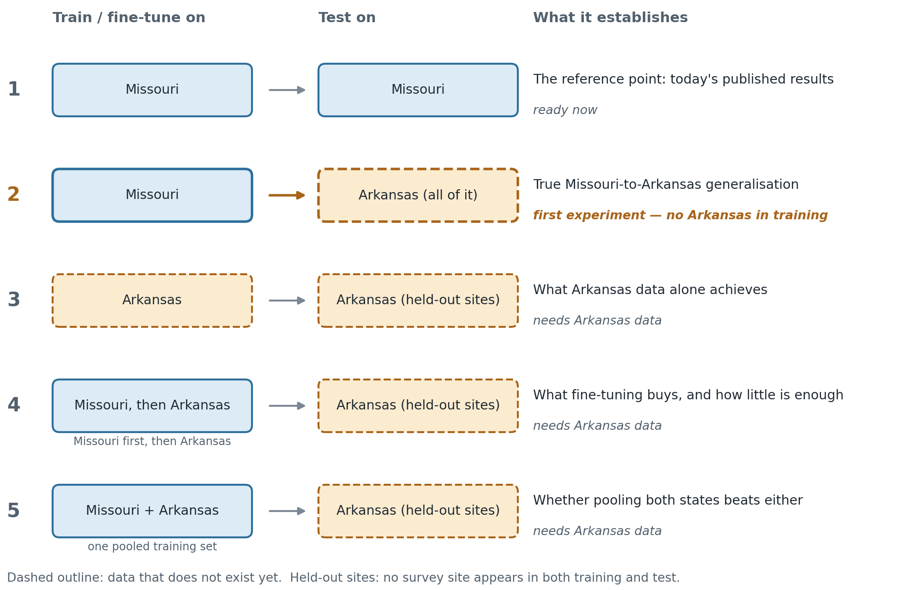
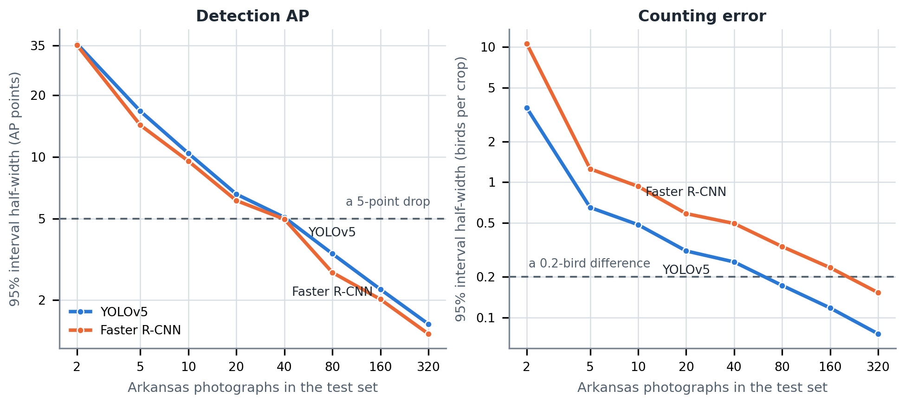

# Summary

Task 4.4 asks what the framework expects of Arkansas data before any arrives, and what should be requested or preserved when AGFC provides imagery. Task 4.5 asks for the experimental protocol to be fixed now, with the first experiment being a Missouri-trained model tested directly on held-out Arkansas imagery. This report answers both: Part I is the specification, written so that Appendix A can be sent to AGFC as a data request; Part II is the protocol, written to be agreed before any Arkansas result exists.

Two parts of it are quantitative rather than declarative, because "how much data do we need" and "how big a drop would we believe" can be answered from the Missouri corpus today.

**What the analysis shows**

1. **A useful Arkansas test set needs roughly 80 photographs; 40 is the minimum for anything.** Resampling Missouri photographs shows that an AP measured on 80 photographs carries a 95% interval of about ±3.4 points, on 40 photographs ±5, and on 10 photographs ±10. A Missouri-to-Arkansas drop smaller than that interval cannot be distinguished from sampling noise (Figure 2, Table 5).
2. **The published confidence intervals are the wrong ones for this question.** They resample crops and give ±0.4 to ±0.6 AP points. Crops from one photograph share a habitat, an altitude, a flock and an annotator, so for the question "what would another survey give", the honest interval is three to four times wider — ±1.5 points even at 320 photographs.
3. **The comparison must be threshold-transferred, or it is not zero-shot.** The project's counting threshold t\* is chosen to minimise error *on the set being scored*. Left as it is, a "Missouri to Arkansas" number would quietly use Arkansas labels to tune itself. The protocol fixes t\* on Missouri validation data and transfers it.
4. **The Missouri side of a matched comparison is thin in exactly the habitat Arkansas cares about most.** Bottomland hardwood's Missouri analogue (forest) holds 13 photographs and 1,784 birds, against 29 photographs for cropland and 21 for moist soil (Table 6). Matched comparisons in forest will be imprecise, and that is worth knowing before the flights are planned.
5. **A large drop should be expected, and it must not be attributed to "Arkansas" without checks.** Within Missouri alone, collection identity moves mean F1 by 40.8 points, habitat by 20.1 and altitude by 14.6. Ground sample distance, bird size in pixels and annotation style are the first things to check before concluding that a drop is geographic.

**What this report proposes**

- A specification with 12 required fields per photograph and 9 desirable ones, plus delivery rules that protect the information that cannot be recovered later (Tables 1–3).
- Flight guidance derived from the project's own flight-height equation, so Arkansas birds land at the pixel size the detectors were trained for.
- Five experiments, with the Missouri → Arkansas zero-shot test defined precisely enough to be run the week the data lands (Figure 1, Table 4), plus seven rules that keep the number honest (Section 6).
- Decision rules agreed in advance: what a drop of a given size means and what is done about it (Table 7).
- A rehearsal that can be run now, on Missouri data alone: hold out one collection, treat it as if it were Arkansas, and run the whole protocol end to end (Section 9).

# 1. Why specify before the data arrives

Two things are lost by waiting.

**Information that cannot be recovered later.** Flight altitude, camera model, site identity, survey date and whether birds were decoys exist at the moment of the flight and in the pilot's records. Once photographs have been re-encoded, renamed, cropped or stripped of EXIF, that information is gone, and no amount of processing recovers it. The Missouri corpus already shows the cost: EXIF survives for 9% of its photographs, so camera and sensor are unavailable for the rest, and decoy status is recorded in no file at all.

**Credibility that cannot be recovered later.** A protocol chosen after seeing the result is not a test. Fixing the experiment now — which checkpoints, which threshold, which metric, which comparison, what counts as success — is what makes the first Arkansas number evidence rather than an anecdote.

This report assumes the dataset interface of Task 4.3: Arkansas data will reach the pipeline through an Arkansas adapter that produces the same canonical records as the Missouri adapter. The specification below is what that adapter needs to be able to fill in.

# Part I — Task 4.4: the Arkansas dataset specification

## 2. Delivery

### 2.1 Image organisation

- One folder per survey site, and within it one folder per survey date: `<site>/<YYYY-MM-DD>/`. If a site was flown twice in a day, a third level names the flight.
- One file per photograph, as it came off the drone. **Original JPEGs, not re-encoded, not resized, not cropped, with EXIF and XMP intact.**
- Any orthomosaic or stitched product is a separate delivery, clearly labelled, and does not replace the individual frames. The pipeline tiles individual frames; a mosaic has different geometry and its own scale.
- Photographs with no birds are part of the data and must be delivered with the rest. They are the only evidence of false alarms, and the Missouri corpus is weaker for having few of them.

### 2.2 Image identity

- File names stable for the life of the project: a photograph's name never changes between deliveries, and a name is never reused for different pixels.
- Name pattern `<site>_<YYYYMMDD>_<flight>_<frame>.jpg`, e.g. `BayouMeto_20270118_F02_0137.jpg`. Any consistent pattern works provided it is documented and unique; the pipeline forms its own identifier as `arkansas/<site>/<file stem>`.
- A manifest listing every file with its SHA-256 checksum accompanies each delivery, so a corrupted or partial transfer is detected rather than analysed.

### 2.3 Annotation format

- One annotation file per photograph, named after it (`<stem>.csv`), in the same folder or a mirrored `labels/` tree.
- One row per bird, with a header:

```
x1,y1,x2,y2,species,sex,decoy,notes
```

- `x1,y1,x2,y2` are integer pixel coordinates of the bounding box in the **full-resolution delivered photograph**, origin at the top-left corner, x to the right, y down, `x2 > x1` and `y2 > y1`.
- Points instead of boxes are acceptable if that is how AGFC annotates: deliver `x,y` columns and say so once, globally. The framework scores points natively; it cannot invent a box that was never drawn.
- `species`, `sex`, `decoy` and `notes` may be empty. An empty column is honest; a guessed one is not.
- **A photograph with no birds gets an annotation file containing only the header**, which is how "no birds" is distinguished from "not yet annotated".
- Each delivery states whether annotation is *exhaustive* (every bird in the frame is marked) or *partial*. This matters: in Missouri, 1,639 detections that all eight models agree on match no annotation, which depresses measured precision.

### 2.4 Coordinate system

- Pixels of the delivered photograph, as above. If AGFC's annotation tool works on a rotated, resized or contrast-adjusted copy, deliver **the copy that was annotated**, or the exact transform between it and the original.
- Geographic coordinates (a georeferenced flight log, or per-frame latitude, longitude and heading) are welcome, and are the only route to per-site density maps later, but they are not required for detection work.

### 2.5 Train, validation and test designation

- AGFC may mark photographs, but the framework needs only **site and date**; it will form splits itself.
- The rule the protocol imposes (Section 6): **splits are made at the site level**, so no survey site appears in both training and test. A random split over photographs would put frames of the same flock, the same water body and the same day on both sides, and would overstate performance badly.
- If AGFC has its own train/test convention, it is recorded and honoured as an additional named split, exactly as the Missouri annotators' marks are.

### 2.6 Per-photograph metadata

One table for the whole delivery, `photographs.csv`, one row per photograph.

**Table 1.** Required fields. Without these the data can still be used for detection, but it cannot enter the condition analyses that motivate the Arkansas work.

| Field | Type / unit | Example | Why it is needed |
|----|---|---|--------|
| `file` | path relative to the delivery root | `BayouMeto/2027-01-18/..._0137.jpg` | Identity |
| `site` | text, stable across deliveries | `BayouMeto` | Site-level splits; site is a condition in its own right |
| `date` | ISO-8601 date | `2027-01-18` | Season and repeat surveys |
| `flight_altitude_m` | metres, numeric | `90` | The strongest predictor of apparent bird size |
| `altitude_reference` | text, one of `above_takeoff`, `above_ground`, `above_sea_level` | `above_takeoff` | Missouri's altitudes are barometric above take-off; mixing references silently shifts every size comparison |
| `drone_platform` | text | `DJI Mavic 3` | Identifies the optics when EXIF is absent |
| `sensor` | text | `Hasselblad L2D-20c` | As above |
| `focal_length_mm` | mm, numeric | `12.29` | Needed for ground sample distance |
| `sensor_width_mm` | mm, numeric | `17.4` | As above |
| `image_width_px` | pixels | `5280` | As above |
| `image_height_px` | pixels | `3956` | Frame geometry |
| `habitat` | text, from AGFC's own vocabulary | `bottomland hardwood` | The primary experimental variable |

**Table 2.** Desirable fields. Each one that is present widens what can be analysed; each one that is absent is recorded as not recorded, never guessed.

| Field | Type / unit | Why it is useful |
|----|---|--------|
| `gimbal_pitch_deg` | degrees, `-90` for straight down | Missouri is entirely nadir; oblique frames are a different problem |
| `weather` | text (`sun`, `cloud`, `overcast`, …) | A measured condition in Missouri, small in effect but cheap to record |
| `wind_speed_ms`, `temperature_c` | numeric | Not available anywhere in Missouri; would be new information |
| `water_level` | text or numeric | Drives where birds are, and unavailable in Missouri |
| `time_of_day` | ISO-8601 time, local | Sun angle and shadow length |
| `decoys` | `real`, `decoy`, `mixed` | Decoys differ systematically in size and posture |
| `annotation_batch` | text | Annotation style shows up as a size bias; see Section 3.3 |
| `observer` | text or code | Lets annotator effects be estimated rather than assumed away |
| `flight_speed_ms`, `shutter_speed_s` | numeric | Motion blur becomes relevant only at slow shutters |

### 2.7 Survey-level metadata

One short document per delivery, or a `survey.md`: the survey's purpose, the flight plan (altitudes flown, overlap, transect or grid), the annotation instructions given to annotators, the species expected, the licence and contact, and any known problems (frames dropped, a camera changed mid-season, a site re-flown).

### 2.8 What to preserve, and what not to do

**Please preserve:** original JPEGs; EXIF and XMP; the flight logs; the raw altitude values as recorded, not rounded; the annotation files exactly as produced; empty (bird-free) frames.

**Please avoid:** re-encoding or compressing images; resizing or cropping; renaming files between deliveries; stripping metadata during transfer (cloud sync tools often do); merging multiple flights into one folder without dates; delivering only the frames that contain birds.

## 3. What the framework assumes, and what Arkansas should match

### 3.1 Processing defaults

These are properties of the pipeline, not requests: photographs are tiled into 512 × 512 crops with a 460-pixel stride; detections are matched to birds within 40 pixels; at most 500 detections are kept per crop; box overlap for mAP30 is 0.30. Arkansas imagery does not need to be prepared for any of this — the pipeline does it — but the annotation coordinate convention in Section 2.3 must hold, since every one of these operates in photograph pixels.

### 3.2 Flight altitude, and why the specification asks for the optics

A detector sees pixels, not metres. A bird's size in pixels is set by its real size, the altitude, and the camera's focal length, sensor width and image width. In this corpus, detection rate peaks when a bird's bounding box is about **18 pixels** across, and the project's flight-height equation converts that into a height for a given camera and species.

For the Mavic 2 Pro used for most Missouri data (10.26 mm focal length, 13.2 mm sensor, 5,472 pixels wide), that gives roughly 55 m for green-winged teal and 78 m for drake mallard, and detection stays within one point of its best between about 0.7 and 1.1 times those heights. Most Missouri data was flown at 90 m.

Two consequences for Arkansas:

- If AGFC flies a different aircraft, the equivalent heights differ — sometimes by a lot. That is why `focal_length_mm`, `sensor_width_mm` and `image_width_px` are required fields rather than nice-to-haves: with them, the framework computes ground sample distance and can compare Missouri and Arkansas birds on equal terms.
- If AGFC's flight heights are fixed by other considerations (disturbance, airspace, survey speed), that is fine and should simply be recorded. The analysis can then attribute part of any performance difference to apparent size rather than to geography — which is exactly the confound Section 8 warns about.

### 3.3 Species, sex and annotation style

Species and sex labels exist for two Missouri collections only, so any Arkansas species labels are a strict gain, and the specification asks for them wherever the annotators recorded them. Two cautions carried over from the Missouri analysis:

- **Annotation style is measurable and differs between batches.** Fitting the relationship between altitude and box size, the extra margin annotators leave around a bird was 7.3 pixels in one Missouri collection and 1.3 to 4.2 in others. A size comparison across batches is partly a comparison of annotators, which is why `annotation_batch` is on the desirable list.
- **Decoys are not birds.** One Missouri collection is entirely decoys; its boxes run 8–26% larger than real birds of the same species. If any Arkansas imagery contains decoys, recording it costs nothing now and cannot be recovered later.

## 4. Acceptance: what happens when a delivery arrives

Each delivery is run through the conformance suite of the Task 4.3 design before it is used for anything.

**Table 3.** Acceptance checks, and what each one prevents.

| Check | Prevents |
|----|---------|
| Every file in the manifest exists, and its checksum matches | Silent partial transfers |
| Every photograph opens, and its pixel size matches `image_width_px` / `image_height_px` | Re-encoded or resized copies going unnoticed |
| Every annotation file parses; every box lies inside the frame with positive area | Coordinate-order and origin mistakes |
| Bird totals per site match the totals AGFC states | The class of silent-skip bug that cost the Missouri corpus 5,784 birds before it was found |
| Every photograph has all required fields, or is listed as incomplete | Thin fields quietly entering tables |
| Every habitat label maps to a canonical term or is listed as unmapped | Vocabulary drift between states |
| No site appears in more than one split role | Train and test contamination |
| A coverage report is produced and archived with the delivery | Overstated claims about what the data supports |

The output of acceptance is a coverage report — how many photographs and birds carry each field — and a signed-off data version. Only then does the data enter an experiment.

# Part II — Task 4.5: the domain-shift protocol

## 5. The experiments

{width=6.5in}

**Figure 1.** The five experiments. Experiment 2 is the one Task 4.5 names as first and is the only one that measures generalisation with no Arkansas data involved at all. Experiments 3–5 require enough Arkansas data to train on, and hold out whole sites.

**Table 4.** The same five experiments, stated precisely enough to run.

| # | Train / fine-tune on | Test on | What varies | Prerequisite |
|--|-----|-----|-----|-----|
| 1 | Missouri training split | Missouri test split | Nothing; the reference point | Ready — the published runs, recomputed with the transferred threshold (Section 9) |
| 2 | Missouri training split (the existing frozen checkpoints) | **All annotated Arkansas photographs** | Everything about the survey | ~80 Arkansas photographs (Section 7) |
| 3 | Arkansas training sites | Arkansas held-out sites | Only that training is local | Enough sites to split: at least 4 |
| 4 | Missouri, then fine-tuned on Arkansas training sites | Arkansas held-out sites | How much local data is needed | As above, plus a fine-tuning budget |
| 5 | Missouri + Arkansas training sites pooled | Arkansas held-out sites | Whether pooling helps or dilutes | As above |

Experiment 2 uses the checkpoints that already exist: the eight trained detectors, unchanged. Nothing is retrained, so it can be run the week the data arrives.

Experiment 4 is run as a **learning curve** rather than a single point: fine-tune on 1, 2, 4, 8, … sites (or photographs, if sites are few) and plot performance against the amount of Arkansas data. That curve, not a single fine-tuned number, is what tells AGFC how much annotation a new state actually costs.

## 6. Seven rules that keep the number honest

1. **No Arkansas data touches anything in experiment 2** — not training, not validation, not model selection, and not the operating threshold. The last is the easy one to get wrong: the published counting threshold t\* is chosen to minimise error on the set being scored, so applied naively it would fit itself to Arkansas labels. **t\* is fixed on Missouri validation data and transferred.** Both numbers are reported — the transferred-threshold result as the headline, and the oracle-threshold result alongside — because their difference is itself informative about calibration drift.
2. **Splits are made at the site level**, and crops from one photograph never straddle a split. A site contributes to exactly one of training, validation and test.
3. **Everything is frozen and recorded before the run**: the eight checkpoints with their checksums, the split specification with its checksum, the code commit, and the inference settings. The run record written by the pipeline already carries these fields.
4. **Uncertainty is photograph-level.** Intervals come from resampling photographs, not crops (Section 7). The crop-level intervals in the current results answer a different question and are not used for this comparison.
5. **The comparison is matched as well as raw.** The headline is Missouri-test versus Arkansas-test. Beside it, a *matched* comparison restricts the Missouri test set to the habitat groups, altitude bands and ground sample distances that the Arkansas data actually covers. The difference between raw and matched is the part of the drop attributable to the mix of conditions rather than to the state.
6. **The metric set is the Missouri one, unchanged**: detection AP, precision, recall and F1 at the transferred threshold, MAE and RMSE of counts, mAP30 at the corrected 500-detection limit for box models, pseudo-box mAP30 for the point models, and the same breakdowns by habitat, altitude and density. No new metric is invented for Arkansas.
7. **All eight models are run, not the best one.** Within Missouri, five different architectures take first place in different habitats; a single-model Arkansas result would not distinguish a domain effect from an architecture effect.

## 7. How much Arkansas data is needed

An Arkansas result is one number per model on a new survey, and it carries sampling error. The sampling unit is the photograph: crops cut from one frame share its habitat, altitude, flock and annotator.

Figure 2 measures this on the Missouri test split. Photographs are resampled with replacement, and the metric is recomputed on each draw; the spread across draws is the uncertainty a survey of that size would carry.

{width=6.5in}

**Figure 2.** How precise an Arkansas result would be, against the number of annotated Arkansas photographs, assuming Arkansas frames resemble Missouri ones (about 210 birds per photograph). Left: detection AP. Right: counting error at the transferred threshold. Both axes are logarithmic. Two detectors are shown to make the point that the curve is a property of the test set, not of a model.

**Table 5.** The same numbers, for YOLOv5. "Half-width" is half the 95% interval: a Missouri-to-Arkansas drop must exceed it to be distinguishable from sampling noise.

| Arkansas photographs | Birds (typical) | AP half-width | Counting-error half-width |
|--:|--:|--:|--:|
| 5 | 600 | ±16.7 points | ±0.65 birds/crop |
| 10 | 1,300 | ±10.4 | ±0.49 |
| 20 | 3,200 | ±6.6 | ±0.31 |
| 40 | 7,700 | ±5.1 | ±0.26 |
| 80 | 17,200 | ±3.4 | ±0.17 |
| 160 | 32,500 | ±2.3 | ±0.12 |
| 320 | 66,400 | ±1.5 | ±0.08 |

Read from this:

- **Headline result: at least 80 annotated photographs**, giving ±3.4 AP points. A 5-point drop is then unambiguous, and a 10-point drop is beyond argument.
- **Per-condition results: about 40 photographs in each habitat or altitude band** that is to be reported separately, giving ±5 points within that band.
- **Below 20 photographs, only very large effects are measurable.** A 10-photograph pilot can confirm that the pipeline runs end to end and that the annotations parse, and it should be requested early for exactly that purpose — but it cannot establish a generalisation baseline.
- These assume Arkansas frames hold birds at Missouri-like densities. Sparser frames need more photographs for the same precision, which is another reason the specification asks for flight plans and expected species.

**The Missouri side of the comparison has its own limits.** The matched comparison of rule 5 is only as precise as the Missouri subset it uses.

**Table 6.** Missouri test-set capacity by canonical habitat group and by altitude, with the photograph counts that set the precision of a matched comparison.

| Missouri group | Photographs | Birds | Matched comparison |
|-----|--:|--:|------|
| Moist soil | 21 | 16,521 | Usable |
| Open water (incl. ice) | 19 | 19,262 | Usable |
| Cropland (corn, harvested) | 29 | 11,480 | Usable |
| Emergent / submerged vegetation | 24 | 8,563 | Usable |
| **Forest (trees, wooded)** | **13** | **1,784** | **Weak — the analogue of bottomland hardwood** |
| Bare ground / levee | 11 | 2,867 | Weak |
| 90 m altitude | 242 | 55,204 | Strong |
| 15 m / 30 m / 60 m | 80 / 39 / 29 | 9,765 / 11,919 / 10,603 | Usable |
| Every other height | 1–11 each | < 600 each | Not usable alone |

If Arkansas flights concentrate on bottomland hardwood, as the proposal anticipates, the Missouri comparator in that habitat rests on 13 photographs and will carry an interval of roughly ±9 points. Two responses are available, and both are cheap if decided now: ask AGFC for more forested sites, and consider annotating additional forested Missouri frames to strengthen the comparator.

## 8. What to expect, and the decision rules

Within Missouri alone, mean F1 moves **40.8 points between collections**, 20.1 across habitats, 16.8 across bird densities and 14.6 across altitudes, while weather moves it 4.7. A different state, flown with different equipment by different people and annotated to a different convention, is at minimum a new collection. **A large drop in experiment 2 is the expected outcome, not a surprise, and on its own it does not identify a cause.**

Before a drop is attributed to Arkansas, three checks are run, all of which the specification's required fields make possible:

- **Apparent size.** Compare the distribution of bird sizes in pixels, and of ground sample distance, between the two test sets. If Arkansas birds are much smaller or larger in pixels, the drop is partly an altitude-and-optics effect, and the flight-height equation says what altitude would fix it.
- **Annotation style.** Compare the box-size-versus-altitude relationship. A systematic margin difference indicates an annotation convention, not a detection failure.
- **Completeness.** Check whether detections that every model agrees on match no annotation, as 1,639 did in Missouri. Incomplete annotation depresses precision without any model being wrong.

**Table 7.** Decision rules, agreed before the result exists. "Gap" is the Missouri-to-Arkansas difference in F1 at the transferred threshold, after the matched comparison of rule 5.

| Gap | Reading | Action |
|---|------|--------|
| Within the interval (< ~3 points at 80 photographs) | Generalisation holds at survey scale | Report it; proceed to a deployment trial; no Arkansas fine-tuning needed for counting work |
| 3–10 points | Real but moderate shift | Run experiment 4's learning curve; report how many Arkansas photographs recover the gap |
| 10–25 points | Substantial shift | Run the three checks above first; then fine-tune, and report which conditions carry the loss |
| Over 25 points | Suspect a data or convention problem before a domain problem | Re-run acceptance checks, inspect failure cases by hand, verify coordinates and completeness before drawing any scientific conclusion |

In every case the report gives both the raw and the matched comparison, the per-habitat and per-altitude breakdowns, and the same failure-case panels the Missouri analysis produces, so that a number is always accompanied by the images behind it.

## 9. What can be done now, before any data arrives

Five things, in order. None needs Arkansas data.

1. **Freeze the Missouri baseline.** Archive the eight checkpoints with checksums, record the split specification, and compute experiment 1 with the *transferred* threshold so that experiment 2 has a like-for-like comparator.
2. **Rehearse the whole protocol on Missouri data.** Hold out one collection entirely — train on the other nine, test on it — and run experiments 1 and 2 as if that collection were Arkansas. This is a real leave-one-collection-out domain-shift study, it is runnable today, and it gives an empirical prior for how large the Arkansas gap is likely to be. It also exercises every piece of protocol machinery on data whose answer can be checked.
3. **Build the split-specification mechanism** from the Task 4.3 design, including site-level splitting and cross-source specifications.
4. **Write the Arkansas adapter against this specification**, with the conformance suite, using a handful of synthetic photographs. When the real delivery lands, acceptance is then a command, not a project.
5. **Send Appendix A to AGFC**, and ask for a 10-photograph pilot delivery in the agreed format before the main one, so that format problems surface while they are still cheap to fix.

The rehearsal in step 2 is the one with scientific value on its own, and it is the natural next piece of work.

# Appendix A. Data request for AGFC

*This appendix is written to be sent as it stands.*

**What we are asking for.** Aerial photographs of waterfowl with bounding-box (or point) annotations, and a small amount of information about how each photograph was taken. Our aim is to test whether detection models trained on Missouri imagery work on Arkansas imagery, and to measure what has to change if they do not.

**Please send, for each delivery:**

1. **Photographs** — original files from the drone, unaltered: no resizing, cropping, re-encoding or renaming, with EXIF/XMP intact. Organised as `<site>/<date>/`. Please include frames with no birds.
2. **Annotations** — one file per photograph, `<stem>.csv`, one row per bird: `x1,y1,x2,y2,species,sex,decoy,notes`, in pixels of the delivered photograph, origin top-left. A header-only file means "no birds present". Points instead of boxes are fine if that is your convention — tell us once.
3. **A photograph table** — `photographs.csv`, one row per photograph, with: file, site, date, flight altitude in metres, what the altitude is measured from, drone platform, sensor, focal length (mm), sensor width (mm), image width and height in pixels, habitat.
4. **Also valuable if you have it** — gimbal angle, weather, wind, temperature, water level, time of day, whether any birds are decoys, who annotated each batch, flight speed and shutter speed.
5. **A short survey note** — flight plan (altitudes, overlap, pattern), annotation instructions given to your annotators, species expected, licence and a contact, and anything that went wrong.
6. **A checksum manifest** for the files.

**A pilot first, please.** Ten photographs with their annotations and table rows, in this format, before the main delivery. We will run them through our acceptance checks and confirm everything parses within a few days.

**Two questions that shape the study.**

- Roughly how many annotated photographs, at how many distinct sites, do you expect to be able to share? Eighty photographs across at least four sites would let us measure generalisation precisely; fewer still helps, but we would report wider intervals.
- Do your surveys concentrate on bottomland hardwood, rice and soybean? Our Missouri data is thin in forested habitat, so if forest is your priority we will plan the comparison accordingly.

**What we will send back.** For each delivery: an acceptance report (what parsed, what is missing, coverage per field), and, once analysed, the detection and counting results by habitat and altitude, with the failure cases shown as images.

# Appendix B. The photograph table, as a template

```
file,site,date,flight_altitude_m,altitude_reference,
drone_platform,sensor,focal_length_mm,sensor_width_mm,
image_width_px,image_height_px,habitat,
gimbal_pitch_deg,weather,wind_speed_ms,temperature_c,
water_level,time_of_day,decoys,annotation_batch,observer,
flight_speed_ms,shutter_speed_s
```

The first twelve columns (through `habitat`) are required (Table 1); the rest are desirable (Table 2) and may be left empty. Empty means "not recorded", and is reported as such.

# Appendix C. Reproducing the numbers in this report

- **Test-set precision** (Figure 2, Table 5): `output/analysis/architecture/code/domain_shift_precision.py`, which resamples photographs from the cached Missouri predictions and writes `results/domain_shift_precision.csv`. It needs no GPU and runs in a few minutes.
- **Missouri capacity by habitat and altitude** (Table 6): the condition tables produced by the survey-condition analysis, grouped with the canonical habitat crosswalk proposed in the Task 4.3 report.
- **Spread figures** (40.8, 20.1, 16.8, 14.6, 4.7 F1 points): the error-source summary of the survey-condition analysis.
- **Flight heights and the 18-pixel optimum**: the flight-height report and its calculator.
