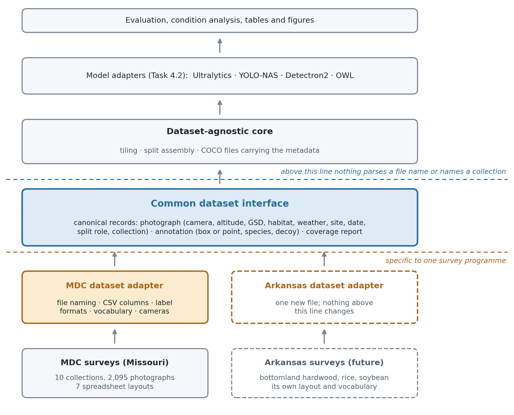
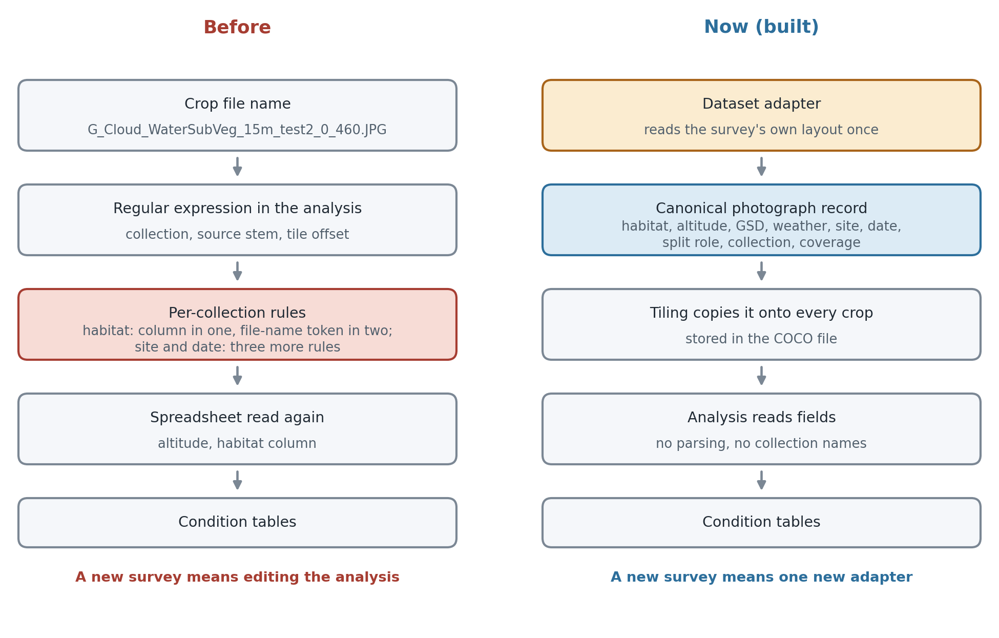

# Summary

Task 4.3 asks for dataset-specific logic to be separated from model-specific logic, with each survey programme reaching the pipeline through its own adapter: an MDC adapter today, an Arkansas adapter later. Nothing above that layer should need to know which state the imagery came from. This report audits where dataset knowledge lived before the work, specifies the interface and the adapter contract, and reports the implementation built from that design.

**Status, 20 September 2026: the interface is built and verified.** It is about 2,800 lines in `pipeline/`, it reproduces the existing pipeline exactly where the two overlap, and the data an experiment uses is now chosen by putting that data in a folder — no commands, no flags. Sections 2 to 4 describe the design and the problems that motivated it; Section 5 reports what exists, what it was checked against, and what is deliberately not done yet.

**What the audit found**

1. **Tiling discards the survey context, and the analysis reconstructs it afterwards.** A crop's COCO record keeps only an identifier, a file name and a size. Habitat, altitude, weather, site and date are recovered later by parsing the crop's file name with a regular expression and re-reading the source spreadsheet.
2. **Reconstruction requires naming individual collections.** Habitat comes from a spreadsheet column in one collection and from a file-name token in two others; site and date follow three further rules, one per collection. Roughly forty references to specific collection names sit in the analysis and configuration code — above the line Task 4.3 wants drawn.
3. **The ten MDC collections are not uniform, so an adapter has real work to do.** They use seven different spreadsheet layouts, two annotation-file naming conventions, three image extensions, two annotation line formats, and three habitat vocabularies with thirteen labels between them. One collection is distributed already tiled.
4. **The Arkansas mapping already exists, in the wrong place.** The analysis contains a hard-coded table that groups MDC habitats into the six environments the Arkansas proposal names. That table is exactly the crosswalk an adapter should own.
5. **Camera geometry lives outside the pipeline.** The flight-height work established which camera each collection used and the resulting ground sample distance, but those constants live in that report's scripts. Ground sample distance, not altitude, is what makes two surveys comparable, so it belongs with the data.

**What this report proposes**

- A `DatasetAdapter` contract: list collections, yield photographs, yield annotations, declare coverage and provenance. One adapter per survey programme.
- **Canonical records** as the interface: a photograph record carrying camera, altitude, ground sample distance, habitat, weather, site, date, split role, collection and source; an annotation record carrying box or point, species, sex and decoy status; and a coverage report stating what each source actually records.
- **Canonical vocabularies with crosswalk files.** Each adapter maps its own labels into a shared vocabulary and keeps the raw label beside it. The Arkansas table moves here.
- **Metadata travels with the data.** Tiling copies each photograph's record onto its crops and writes it into the COCO file, so the analysis reads fields instead of parsing names. Above the interface, no code may parse a file name or mention a collection.
- **A conformance suite** every adapter must pass. Two of its checks would have caught the two loader bugs that silently dropped 5,784 birds from this project's results earlier this year.

**What was built (Section 5)**

- `pipeline/` — canonical records, the adapter contract, the MDC adapter, an Arkansas adapter written against the specification of Task 4.4, crosswalk files, camera geometry, split specifications, one adapter-driven tiler, the conformance suite, and a command line.
- **Verified in eight groups of checks**, none of which needs a GPU: the adapter sees exactly what the old loader saw (2,095 photographs, 1,669/426 train/test, 317,387 boxes); the split derived through the interface reproduces the committed train/validation/test membership; the survey conditions match the old reconstruction crop for crop on all 28,588 test crops; and the tiler reproduces a collection's committed crops box for box.
- **Choosing data is now a folder.** Put the collections (or the images) an experiment should use in a folder, name it once in the configuration, and every model reads it. The first run on a new folder filters the crops to match — tiling anything not yet cut — and caches the result; later runs are instant, and changing the folder's contents rebuilds it.
- **The suite found a real defect on its first run**: one annotation in the pre-tiled collection lies outside its own image. No published result is affected, because the tiler already discards it.

Three decisions remain open (Section 6), the first being who fixes the canonical habitat vocabulary.

# 1. What Task 4.3 asks

The task states the shape directly:

> MDC Dataset Adapter → Common Dataset Interface, and eventually: Arkansas Dataset Adapter → Common Dataset Interface. The models and evaluation software above this layer should not need to know whether the imagery originated in Missouri or Arkansas.

Two working definitions, used throughout:

- **Dataset-specific logic** is anything true of one survey programme: its folder layout, file naming, spreadsheet columns, annotation format, label vocabulary, cameras and split marks.
- **Dataset-agnostic logic** is everything the pipeline does regardless of origin: tiling, split assembly, training, inference, scoring, and breaking results down by habitat or altitude.

The test of success is negative and easy to check: if an Arkansas adapter is added and any file above the interface has to change, the boundary is in the wrong place.

This is the third task in a series. Tasks 4.1 and 4.2 drew the boundary on the *model* side, so that YOLO, Faster R-CNN and OWL enter one evaluation. Task 4.3 draws the matching boundary on the *data* side. Figure 1 shows both.

{width=6.5in}

**Figure 1.** The two boundaries. Below the lower line sits everything specific to one survey programme, inside its adapter. Between the lines sit the canonical records. Above the upper line, the pipeline works with fields, never with file names or collection names. The model adapters of Task 4.2 sit higher still, so neither layer knows about the other.

# 2. Where dataset knowledge lived

*This section describes the code as it stood before the interface was built — the problems
that motivated the design. Section 5 reports which of them are now closed.*

## 2.1 Ten collections, no two alike

The MDC corpus is ten collections (`Bird_A` … `Bird_J`), 2,095 photographs and 317,387 annotated birds. Each collection carries a spreadsheet, `image_info.csv`, listing its images. The pipeline reads five columns from it, but the ten files do not agree on what columns exist: the ten spreadsheets use **seven distinct layouts**.

**Table 1.** What varies between the ten collections, and therefore what an adapter must absorb.

| What varies | How it varies today |
|------|------------|
| Spreadsheet layout | Seven distinct column sets among ten files. `background_info` exists only in Bird_H; `classification_name` in Bird_H and Bird_I; `segmentation_name` in Bird_B; `split` in Bird_G and Bird_J; Bird_I's first column has no name at all |
| Split marking | A column named after the person who made the split, `bbox_split_Robert`. Three sibling columns (`altitude_split_Robert`, `category_split_Robert`, `background_info_split_Robert`) hold splits for other tasks and are ignored |
| Annotation file names | `<stem>.txt` everywhere except Bird_B and Bird_C, which use `<stem>_bird_box.txt` |
| Annotation line format | `bird,x1,y1,x2,y2` in most files; bare `x1,y1,x2,y2` in part of Bird_I |
| Image format | `.jpg`, `.JPG` and `.png`; Bird_I mixes two of them |
| Species and sex | A separate `<stem>_class.txt` per photograph: 171 files in Bird_H, 171 in Bird_I, one stray file in Bird_G, none elsewhere |
| Habitat | A curated column in Bird_H; the second file-name token in Bird_G and Bird_J; not recorded in the other seven |
| Habitat vocabulary | Thirteen labels reach the analysis tables, only partly overlapping between the three collections. Bird_H alone uses both `Trees` and `Wooded`; Bird_G spells one habitat `WaterSubVeg` and `WaterSubVege`; Bird_J's token position holds `Dense`, which describes bird density, not habitat |
| Weather | The first file-name token, `Sun` or `Cloud`, in Bird_G and Bird_J only |
| Site and date | Three different file-name conventions: site then date (Bird_H), plot code then date (Bird_D), month and a site identifier elsewhere in the name (Bird_E) |
| Tiling state | Bird_E arrives already cut into 512 × 512 tiles; the other nine are whole photographs |
| Camera | EXIF survives for 9% of photographs. Two camera models appear, with different focal lengths and sensor sizes, and three photographs in Bird_I use the second one |

None of this is a defect of the data: it is what a decade of field collection by different people looks like. It is, however, exactly the knowledge that must sit in one place rather than be spread through the pipeline.

## 2.2 Problem 1: the survey context is thrown away, then reconstructed

When a photograph is tiled, each crop's COCO record keeps four things: an identifier, a file name, a width and a height. Everything about the survey is dropped.

The condition analysis needs it back, so it rebuilds the link afterwards: it parses the crop file name with a regular expression to recover the collection, the source photograph and the tile offset, then re-opens that collection's spreadsheet and applies per-collection rules for habitat, weather, site and date (Figure 2, left).

{width=6.5in}

**Figure 2.** How a crop's survey conditions reach a table. Before, the pipeline discarded them at tiling time and the analysis reconstructed them from the file name and the spreadsheet. Now the adapter reads them once and they travel with the crop — the right-hand column is built and produces the same values as the left, crop for crop (Section 5.1, check C).

The reconstruction works — it resolves all 28,588 test crops to their 426 source photographs — but it has three costs. It makes the crop file name a load-bearing data structure, so any change to crop naming breaks the analysis. It puts collection-specific rules above the interface. And it means a new survey programme cannot be analysed until someone writes new parsing rules for it.

## 2.3 Problem 2: the analysis names collections

Because the rules live above the line, the collections are named there. The condition analysis and the configuration hold more than forty references to specific collection names, including:

- habitat read from a column for Bird_H, from a file-name token for Bird_G and Bird_J;
- site and date parsed by three collection-specific rules;
- weather attempted only for Bird_G and Bird_J;
- the within-collection weather comparison hard-coded to Bird_G and Bird_J, and the site and date tables restricted to Bird_H;
- the altitude ladder documented in terms of which collections fly which heights;
- two vocabulary fixes (`WaterSubVege`, `Dense`) applied by name.

Each is individually reasonable and carefully documented. Together they are the layer Task 4.3 asks to be removed.

## 2.4 Problem 3: the Arkansas mapping is already hard-coded, above the line

The analysis contains a table that groups MDC habitat labels into the six environments the Arkansas proposal names, for example forested and bottomland hardwood from `Trees` and `Wooded`, and a row-crop group from `StandingCorn`, `HarvestedCrop` and `WaterCorn`. It exists because no MDC label matches an Arkansas environment verbatim.

This is the right idea in the wrong place. It is a *crosswalk* between one programme's vocabulary and a shared one, which is adapter work. When the Arkansas adapter arrives it will need its own crosswalk — rice and soybean fields into the row-crop group, bottomland hardwood into the forested group — and neither table should sit in the analysis.

## 2.5 Problem 4: provider conventions decide the split

Which photographs are for training and which for testing is decided by a column named `bbox_split_Robert`, read directly by the data preparation code. The project rightly honours the annotators' own decision rather than reshuffling it. But the *name of a column in one programme's spreadsheet* is currently a pipeline-level fact, and a second programme will not have that column.

The same section of code decides what counts as a dataset at all: a directory is a collection if it contains a file called `image_info.csv`.

## 2.6 Problem 5: camera geometry lives outside the pipeline

Comparing two surveys means comparing what a bird looks like in pixels, which depends on the camera as much as the flight height: a given altitude yields a different bird size on a different sensor. The flight-height study established the constants for this corpus — focal length, sensor width and image width for the main camera, the exceptions that used a second camera, and the resulting ground sample distance in centimetres per pixel.

Those constants live in that report's own scripts under `output/`, not in the pipeline. Nothing in the data preparation or analysis code can currently answer "how many centimetres does one pixel cover in this photograph", which is the question any cross-programme comparison needs. Altitude alone will not answer it for Arkansas imagery flown with different equipment.

## 2.7 What already works, and should be kept

Three habits in the current code are better than what most pipelines have, and the design keeps them:

- **"Not recorded" is a value, not a blank.** The metadata module records `None` for a field that no file contains, never a guess, and it names the source of every field it does fill.
- **Coverage is reported with the numbers.** The analysis computes what fraction of crops and birds each field actually covers on the split being scored, so a habitat table states its own basis rather than implying corpus-wide support.
- **Fields the data cannot support are stated explicitly**, with the reason, rather than quietly omitted.
- **Confounding between collection and condition is measured, not assumed.** Mean F1 moves 40.8 points between collections, against 20.1 for habitat and 4.7 for weather, which is why the design keeps `source` and `collection` as first-class fields: any pooled Missouri–Arkansas result must remain stratifiable.

# 3. The design

## 3.1 Two boundaries

The interface is the canonical record set in the middle of Figure 1:

- **Below it, one adapter per survey programme.** The adapter knows folder layout, file naming, spreadsheet columns, annotation formats, vocabularies, cameras and split marks. Nothing else in the project does.
- **Above it, the dataset-agnostic core**: tiling, split assembly, COCO writing with the metadata attached, and then the model adapters and evaluation of Tasks 4.1 and 4.2.

The rule that makes the boundary testable: *above the interface, no code parses a file name and no code mentions a collection or a programme by name.*

## 3.2 The canonical records

**Table 2.** The photograph record. "Required" fields must be supplied by every adapter; the rest are recorded when the programme has them and reported as not recorded when it does not.

| Field | Required | Meaning and convention |
|-----|:--:|-------------|
| `photo_id` | yes | `<source>/<collection>/<stem>`, unique across programmes |
| `source` | yes | Survey programme, e.g. `mdc`, `arkansas` |
| `collection` | yes | Sub-collection within the programme, e.g. `Bird_G` |
| `path` | yes | Image file, plus width and height in pixels |
| `split_role` | yes | `train` or `test` as the provider marked it, or `unassigned` |
| `pre_tiled` | yes | Whether the image is already a tile (true for Bird_E) |
| `altitude_m` | no | Flight height in metres, with `altitude_ref` naming what it is measured from (`above_takeoff_barometric` for this corpus) |
| `camera` | no | Model, focal length in mm, sensor width in mm, image width in px |
| `gsd_cm_px` | no | Centimetres of ground per pixel; computed by the core from camera and altitude when both exist |
| `habitat` | no | Canonical habitat term, with `habitat_raw` and `habitat_source` (`column` or `filename`) |
| `weather` | no | Canonical weather term, with the raw label |
| `site`, `date` | no | Site identifier; date as ISO-8601 |
| `decoys` | no | Whether the birds are decoys, real, or a mixture |
| `notes` | no | Free text kept for provenance, never parsed |

**Table 3.** The annotation record.

| Field | Meaning |
|-----|--------------|
| `photo_id` | The photograph it belongs to |
| `geometry` | `box` (x1, y1, x2, y2) or `point` (x, y), in source-image pixels |
| `category` | Canonical class, `bird` for this corpus |
| `species`, `sex` | Canonical terms where recorded (Bird_H and Bird_I only) |
| `decoy` | Per-bird override of the photograph-level value |
| `batch` | Annotation batch identifier |
| `complete` | Whether the photograph is exhaustively annotated |

Two fields deserve comment. `batch` matters because annotation style, not nature, explains why box sizes differ between collections: the blur margin fitted in the flight-height study was 7.3 px for one collection and 1.3–4.2 px for others, and mixing batches silently mixes those conventions. `complete` matters because the failure-case analysis found 1,639 detections that every model agrees on but no annotation covers, so "the model was wrong" and "the photograph was not fully annotated" must be distinguishable.

Alongside these, each adapter supplies a **source card** (programme, provider, licence, contact, date received, checksums) and a **coverage report** (per field: how many photographs and birds carry it, and how it was recorded). The coverage report is the machine-readable version of what the analysis already prints.

## 3.3 The adapter contract

```python
class DatasetAdapter(ABC):
    source: str                  # "mdc", "arkansas"

    def collections(self) -> list[Collection]: ...
    def photographs(self, c: Collection) -> Iterator[Photograph]: ...
    def annotations(self, photo: Photograph) -> list[Annotation]: ...

    # what this source records; provider, licence, checksums
    def coverage(self) -> CoverageReport: ...
    def describe(self) -> SourceCard: ...

    # raw label -> canonical term, one per vocabulary
    # (habitat, weather, species)
    def crosswalks(self) -> dict[str, Crosswalk]: ...
```

Six rules govern it:

1. **The adapter never writes crops, splits or COCO files.** It yields records; the core does the rest. This is what keeps tiling and split logic identical for every programme.
2. **The adapter never drops data silently.** If a photograph has no readable annotation file, it is yielded with a reason attached, not skipped. The two loader bugs in this project's history — 140 photographs and 3,138 birds lost to an unexpected annotation file name, and 2,646 boxes lost to an unexpected line format — were both silent skips.
3. **Raw labels are always retained.** Canonical terms are added beside them, never in place of them, so a harmonisation mistake stays visible and reversible.
4. **Units and references are declared, not assumed.** Altitude carries what it is measured from; geometry carries its coordinate space; dates carry a format.
5. **Identity is stable.** `photo_id` is derived from source, collection and file stem, so the same photograph keeps its identity across regenerations, and two programmes cannot collide.
6. **Everything the programme knows is offered once.** If a spreadsheet holds a column the pipeline does not use today, the adapter still exposes it in `notes` rather than discarding it.

## 3.4 Canonical vocabularies and crosswalks

A canonical vocabulary is a short, fixed list of terms with definitions. Each adapter ships a crosswalk file — a small CSV, versioned with the code — mapping its raw labels onto it.

|-----|---------|---------|

| Canonical term | MDC raw labels | Arkansas labels expected |
|-----------|--------------------------|------------------------|
| `forest` | `Trees`, `Wooded` | bottomland hardwood |
| `cropland` | `StandingCorn`, `HarvestedCrop`, `WaterCorn` | rice, soybean |
| `moist_soil` | `MoistSoil` | moist-soil units |
| `open_water` | `OpenWater`, `Ice` | open water, reservoirs |
| `emergent_vegetation` | `WaterVegetation`, `WaterSubVeg`, `Lotus`, `ShrubScrub` | emergent marsh |
| `bare_ground` | `Land`, `Rocks` | levees, bare fields |

Three rules keep harmonisation honest:

- **A raw label with no canonical term maps to nothing, and says so.** Bird_J's `Dense` describes density, not habitat, and becomes a density note rather than a habitat.
- **Spelling variants are crosswalk rows**, not code branches: `WaterSubVege` and `WaterSubVeg` are two rows with the same canonical term.
- **Tables can be produced at either level.** Analyses group by the canonical term by default and can still group by raw label within one programme, which is how a comparison stays honest about what was actually observed. Ice is a good example: grouping it under open water is defensible, but its crops hold 29.4 birds on average against 2.6–8.2 elsewhere, so a pooled row would mix two very different counting regimes.

## 3.5 Splits, and experiments across programmes

The adapter declares each photograph's `split_role` from whatever the programme uses — for MDC, the `bbox_split_Robert` column, a fact that then appears nowhere else in the project. The core takes it from there:

- derives train and validation deterministically from the training pool, with the seed and fraction it already uses;
- writes a **split specification**: which sources, which collections, which roles, the seed, and a checksum of the resulting file list;
- refuses to evaluate a prediction set whose split checksum does not match, which is the check proposed in the Task 4.1–4.2 report.

Cross-programme experiments then become split specifications rather than code. "Train on Missouri, test on Arkansas" is a specification naming one source for training and another for testing; so is "train on both, test on Arkansas". No model, metric or analysis module changes to support them, which is the practical pay-off of Task 4.3 — the generalisation question the project will eventually be asked can be answered by writing a specification file.

## 3.6 What deliberately stays out

- **Framework layouts.** The Ultralytics label mirror and the OWL point-CSV mirror are model-side concerns, and belong to the model adapters of Task 4.2. A dataset adapter stops at canonical records.
- **Tiling parameters.** Crop size, stride and overlap are pipeline settings, identical for every programme, except for the `pre_tiled` declaration.
- **Analysis policy.** Which subgroups are large enough to rank, and how confounding is reported, stay in the analysis. The interface supplies facts and coverage, not judgements.

# 4. Conformance: how an adapter is known to be correct

Each adapter must pass one shared suite before its data enters any result. The suite is run by the core, not written per programme.

|------|------|

| Check | What it prevents |
|---|---|
| Every photograph resolves to a readable file whose size matches the recorded width and height | Broken paths, stale spreadsheets |
| Parsed bird totals match the totals the source itself declares, per collection | The two silent-skip bugs in this project's history, which cost 5,784 birds between them |
| Every annotation lies inside its image, with positive area | Coordinate-order and unit mistakes |
| Identifiers are unique within a source and stable across two runs | Collisions when two programmes are pooled |
| Every canonical term appears in the vocabulary; every raw label is retained | Silent vocabulary drift |
| Altitude, geometry and dates declare their reference and units | Comparing barometric with above-sea-level altitudes |
| The coverage report matches measured coverage, field by field | Tables that overstate their basis |
| Every photograph has exactly one split role | Train and test contamination |
| Running the adapter twice produces byte-identical records | Non-reproducible splits |

For the MDC adapter there is a stronger check available, and it is required: **the adapter must reproduce the current crops and splits exactly** — the same number of photographs per collection, the same crop file names, the same COCO identifiers and the same annotation counts. That check makes the migration provably behaviour-preserving, since every published result depends on those splits. It passes (Section 5.1).

The suite as implemented runs thirteen checks and takes about two minutes over the whole corpus. Its `bird_totals` check compares parsed totals against the counts the corpus itself publishes, per collection; that is the check that would have caught both historical loader bugs.

# 5. What was built

The design above is implemented in `pipeline/`, about 2,800 lines, with no change to any
model package and without regenerating a single committed file.

**Table 6.** The package.

| Module | What it does |
|-------|--------------|
| `records.py` | The canonical records: photograph, annotation, camera, source card, coverage report |
| `adapters/base.py` | The contract, and the coverage report every adapter gets for free |
| `adapters/mdc.py` | Missouri: ten collections, seven spreadsheet layouts, two annotation naming conventions, two line formats, three vocabularies. It *wraps* the project's existing loader rather than reimplementing its parsing, so it cannot drift from the code every published result came from |
| `adapters/arkansas.py` | AGFC deliveries in the format Task 4.4 specifies, written before the data exists |
| `crosswalks/*.csv` | Raw label to canonical term, per programme and per vocabulary |
| `cameras.py` | EXIF, ground sample distance, and the flight-height equation |
| `splits.py` | Split specifications: provider marks, site holdout, cross-programme; each checksummed |
| `tiling.py` | One adapter-driven tiler, writing the survey conditions into every crop record |
| `selection.py`, `auto.py` | A folder is the data of an experiment; models make it ready when they start |
| `conformance.py` | The thirteen-check suite |
| `cli.py`, `verify.py` | The commands, and the equivalence checks below |

## 5.1 What it was checked against

Nothing here needs a GPU, and nothing regenerates the committed data. `python -m
pipeline.verify` runs all of it in a few minutes.

**Table 7.** Verification, with the result in each case.

| Check | What it proves | Result |
|--|------|----|
| A | The MDC adapter sees exactly what `data_prep.prepare_data` sees | 2,095 photographs, 1,669 train / 426 test, same annotation files, 317,387 boxes |
| B | The split derived through the interface reproduces the committed one | 1,252 / 417 / 426 photographs, exactly |
| C | Survey conditions match the old reconstruction, crop for crop | All 28,588 test crops: altitude, habitat, weather, site, date, tile offsets |
| D | The Arkansas adapter reads a delivery in the specified format | Habitats crosswalked, ground sample distance computed, whole sites held out, conformance passed |
| E | A data selection filters the committed crops exactly | Right crops, no foreign collection, unique ids, nothing moved between splits |
| F | The shared tiler reproduces a collection's committed crops | 2,496 crops, 2,582 boxes, identical |
| G | A folder resolves to exactly the photographs it holds | Same membership and checksum however the folder is named |
| H | Naming a folder is enough — no command of any kind | Whole corpus costs nothing; a subset builds once and caches; changing the folder rebuilds |

Checks A, B, C and F are the ones that matter for trust: they say that moving to the
interface changes no number anyone has published.

## 5.2 What the conformance suite found on its first run

Twelve of the thirteen checks pass on the Missouri corpus. The thirteenth fails, and the
failure is a real defect rather than a false alarm: **one annotation in the pre-tiled
collection sits at x = 600–601 on a 512-pixel-wide tile**, entirely outside its own image.
The tiler already discards it — it intersects no crop — so no published result is
affected, but it was invisible until a check looked for it.

A further 1,236 boxes (0.39% of the corpus) overhang a frame edge by one to three pixels,
which the tiler clips. Those are reported as a warning, not a failure, and the two cases
are separated by a tolerance relative to the frame: a box a few pixels outside is an
annotator touching the border, while a box hundreds of pixels outside means the
annotations belong to a different image size.

## 5.3 Choosing the data: a folder

This goes beyond what Section 3 designed, and it is the part that changes daily work.
Before, data preparation was per model, and only one of the eight could be restricted to
part of the corpus — so "train all eight models on Bird_G and Bird_J" was not expressible.

Now the data an experiment uses **is a folder**. Put the collections (or the images) in it,
name it once in the configuration, and run the models as usual:

```
DATASET_FOLDER = "dataset_g_and_j"      # default: "dataset_full"
```

Each model makes that folder ready when it starts. It fingerprints what the folder holds:
if that matches the committed splits, they are used untouched and nothing is written; if
not, the crops are filtered to match — tiling anything not yet cut — and cached under
`output/experiments/<folder>/`. The first run on a new folder takes seconds; later runs are
instant; changing the folder's contents rebuilds it. A run's experiment record stores which
data it used and that data's checksum, so a checkpoint can always be traced back to it.

The folder may hold whole collections (symlinks are enough), part of a collection, or
loose images with their label files and no index at all — in the last case the photographs
carry no recorded altitude or habitat and no train/test mark, which is reported rather than
invented, and they join training and validation.

For Task 4.5 this is what makes the domain-shift experiments practical: "train on
Missouri, test on Arkansas" is two folders and a split specification, not a code change.

## 5.4 What is deliberately not done

- **The analysis still reconstructs metadata from crop names.** `analysis/metadata.py`
  works and is untouched; the interface reproduces its output exactly (check C), so the
  switchover is safe whenever the splits are next regenerated. Until then the committed
  COCO files carry no survey fields — only experiment folders do.
- **No merge back to the photograph.** A crop knows its photograph and offsets, and
  converting a coordinate is one call, but nothing yet merges detections across the
  overlap bands, so there is still no count per photograph.
- **The Arkansas adapter has no real data.** It is exercised against a synthetic delivery
  in the specified format; the first real delivery is its acceptance test.
- **The committed crops were not regenerated.** Every published number still rests on the
  files it was computed from.

# 6. Decisions and risks

**Decisions**

1. **Who fixes the canonical vocabulary.** Table 4 is a proposal, not an authority, and it is now a file: the Missouri crosswalk maps sixteen raw labels onto the six environments the Arkansas proposal names. Changing the vocabulary means editing that file and re-running the condition tables, not editing code — but the terms should still be agreed with whoever defines the Arkansas classes.
2. **Whether decoy status is recorded — provisionally yes, and it needs confirming.** No file in the corpus records it, but the group's 2024 paper identifies Bird_H as decoys, and decoys run 8–26% larger than real birds of the same species. The adapter therefore records that collection as decoys, marked as coming from the published description rather than from data. If that reading is wrong, one line changes.
3. **What form Arkansas data will arrive in.** Whole photographs with per-image annotation files, or pre-tiled imagery as in Bird_E; boxes or points; one spreadsheet or many. The adapter handles all of these, but the answer decides how much work the first delivery is, and it is worth asking the Arkansas collaborators now.

**Risks**

- **Crop file names are load-bearing.** The cached predictions and every committed result are keyed to them, so the implementation *adds* fields and keeps the naming scheme. Renaming crops would invalidate the caches and the published splits.
- **Two descriptions of the same metadata exist for now.** `analysis/metadata.py` reconstructs survey conditions from crop names, and the interface reads them from the adapter. They agree exactly today (check C), and a test keeps them agreeing; the duplication ends when the splits are next regenerated.
- **Harmonisation can hide real differences.** Grouping Ice under open water makes Missouri and Arkansas comparable, and also hides that ice crops are an order of magnitude denser than the rest. Keeping raw labels and reporting at both levels is the mitigation, and it must be used in the analysis, not merely available in principle.
- **Pooling programmes is not automatically valid.** Collection identity already moves F1 by 40.8 points within Missouri alone. The interface makes pooling *possible*; whether a pooled number is meaningful stays a question the analysis must answer by stratifying, which is why `source` and `collection` are required fields.
- **Coverage will be worse, not better, for a new programme at first.** A new adapter typically starts with altitude and little else. The coverage report keeps that visible instead of letting a thin field quietly enter a table.

|-----|-------|-------|

| Field | Today | After |
|---|-------|-------|
| Collection, source stem, tile offset | Regular expression on the crop file name, in the analysis | Fields on the crop record, written at tiling time |
| Altitude | `height` column, re-read by the analysis | Adapter, with its reference declared |
| Habitat | `background_info` column (one collection) or file-name token (two), with two vocabulary fixes by name | Adapter crosswalk; canonical term plus raw label |
| Weather | File-name token, two collections | Adapter crosswalk |
| Site, date | Three collection-specific file-name rules | Adapter |
| Species, sex | `<stem>_class.txt`, read by a verification script | Adapter, as annotation fields |
| Decoy status | Not recorded anywhere; stated in a published paper | Adapter, at collection level |
| Camera, ground sample distance | Constants in the flight-height report's scripts | Adapter camera table; the core computes the ground sample distance |
| Split role | `bbox_split_Robert` column, read by data preparation | Adapter; the core writes a split specification |
| Whether a collection is pre-tiled | Implicit — a 512 px image simply yields one tile | Declared by the adapter |

# Appendix B. What an Arkansas adapter's author must supply

1. A folder layout and how to enumerate photographs and their annotations.
2. For each photograph: the split role, and whatever of altitude, camera, habitat, weather, site and date the programme records.
3. A crosswalk from its habitat and weather labels to the canonical terms, with any label that has no canonical term listed and explained.
4. The camera table: model, focal length, sensor width, image width.
5. A source card: provider, licence, contact, date received.
6. A declared expectation of totals — photographs and birds per collection — for the conformance check.

Nothing else. No change to tiling, training, inference, scoring, or any table or figure in the analysis.
