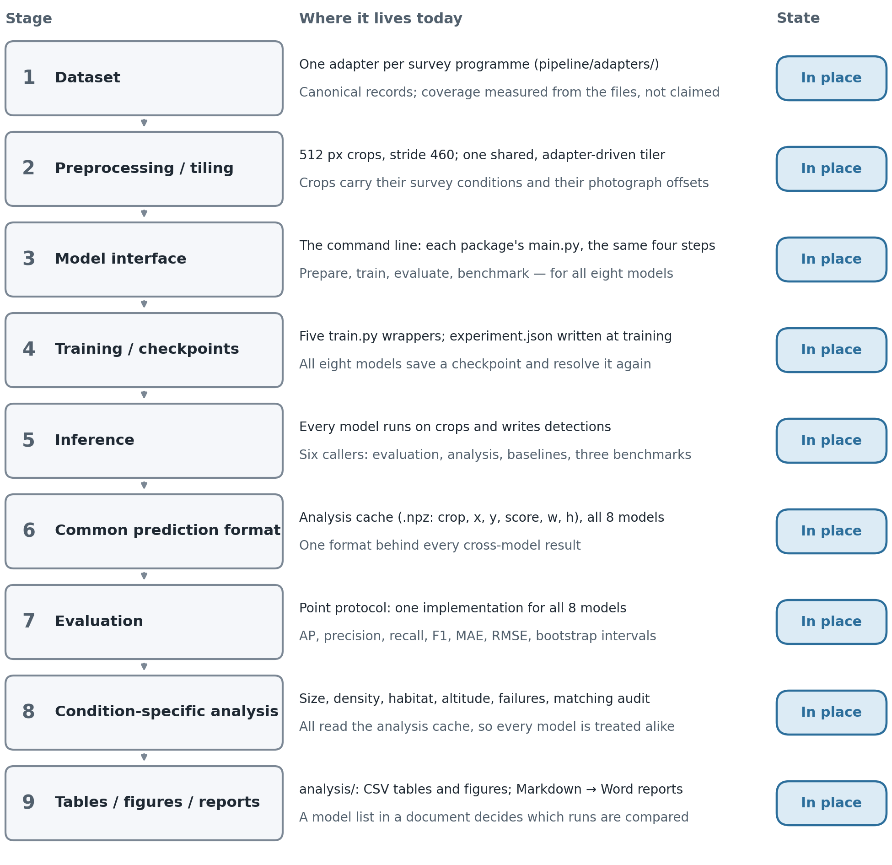
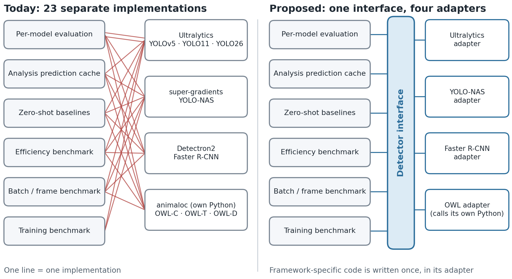

# Summary

Task 4.1 asks for the benchmark code to be organised as one workflow, from the dataset through tiling, training, inference, a common prediction format, evaluation and analysis to the final tables. Task 4.2 asks for every detector to sit behind a standard interface, so that YOLO, Faster R-CNN and OWL outputs enter the same evaluation. This report compares the current code with that workflow stage by stage, and it designs the interface and the migration.

**Status, 21 September 2026.** All nine stages of Task 4.1 run today, for all eight detectors, and the six operations of Task 4.2 are reachable from each package's command line. What this report designs is therefore a consolidation of working code behind one Python interface, not a replacement for a missing stage: the `Detector` class described here does not exist yet, and the workflow does not depend on it. Two things have changed since the report was written, and both are marked where they appear. The evaluation bug found during the audit is fixed (finding 4). And the *dataset* side of the workflow — Task 4.3, the companion report — has been built and verified: stages 1 and 2 are now served by one adapter-driven layer, each crop carries the survey conditions it was flown under, and the data an experiment uses is chosen by naming a folder. That work does not touch the model side, which is what this report is about.

**What the audit found**

1. **The second half of the workflow is already shared.** One scoring protocol scores all eight detectors: a detection counts if it lies within 40 pixels of an annotated bird, and it comes with counting error and bootstrap confidence intervals. The cross-model analysis saves every model's detections in one file format, and the size, density, habitat, altitude and failure-case results are all computed from those files.
2. **The first half is organised by software library, not by stage.** Each of the five model packages has its own script that prepares data, trains, finds the checkpoint, runs inference and scores the result, all in one place. Those scripts are the working interface to the models, and they expose the same four commands; what they do not share is the code behind them.
3. **The same model-specific code is written many times.** Six parts of the project need to run a model: per-model evaluation, the analysis prediction cache, the zero-shot baselines, and three benchmarks. Each has its own code for every library, so "load a model and run it" exists 23 times. Checkpoint lookup is written 7 times, and the OWL-C model has three different names. All 23 work; the cost is the effort of adding the twenty-fourth, and the risk that the copies drift apart.
4. **mAP30 was computed four different ways, and all four counted at most 100 detections per crop.** The densest test crops hold up to 422 birds, so 15% of all test birds could never be found and no model could reach an mAR30 above 85%. **This is now fixed**: all four implementations score up to the project's 500-detection limit and agree to two decimal places. On the current test split, the box detectors' mAP30 rises from 75.8–77.3% to 88.8–91.2%, and Faster R-CNN, which had sat inside the YOLO range, falls 1.3 points below it (Table 2). The point metrics never had the limit and do not change.
5. **The one capability the workflow lacks is the photograph level.** Tiling works in one direction only. Photographs are cut into overlapping 512-pixel crops. Nothing maps crop detections back onto the photograph or removes the duplicates where crops overlap, so the pipeline cannot yet produce a count per photograph.

**What this report proposes**

- A `Detector` interface with the six operations Task 4.2 lists, so that the six callers of finding 3 stop implementing them separately. The operations themselves are not new: each is already available from the command line. Four *adapters*, one per library, implement the interface by wrapping the existing code. An adapter is a thin layer that translates between the interface and one library. The native libraries stay.
- One prediction record, `Detections`, extending the file format the analysis already uses. Box and point detectors share it; point detectors leave the box size empty.
- One evaluation function that reads only `Detections`, one model registry instead of five, and one place that finds runs and checkpoints.
- A five-step migration, plus an optional sixth step for photographs. After each step, the saved predictions and scores of all eight models must be reproduced exactly before any old code is removed.

Three decisions are needed before implementation starts (Section 6).

# 1. What Tasks 4.1 and 4.2 ask

Task 4.1 lists nine stages:

> Dataset → preprocessing / tiling → model interface → training / checkpoint management → inference → common prediction representation → evaluation → condition-specific analysis → tables / figures / reports

The task does not require rewriting any model, and native libraries may still be used. What it asks for is standard interfaces around them. Task 4.2 names the operations every model should offer where practical:

- initialise or load the model;
- load a checkpoint;
- train or fine-tune;
- run inference;
- convert predictions into the common format;
- report model metadata and efficiency measurements.

YOLO, Faster R-CNN and OWL outputs must end up in the same evaluation pipeline.

The project has eight detectors from four libraries:

- **Ultralytics:** YOLOv5, YOLO11, YOLO26.
- **super-gradients:** YOLO-NAS.
- **Detectron2:** Faster R-CNN.
- **animaloc:** OWL-C, OWL-T, OWL-D.

The first five are *box* detectors. The three OWL models are *point* detectors: they mark each bird with a point, not a box, and they need their own Python environment.

# 2. The workflow today

{width=6.5in}

**Figure 1.** The nine stages of Task 4.1, where each lives in the current code, and its state. "In place" means the stage works today for all eight models. Every stage does: the workflow runs end to end, from the dataset to the final tables, for every detector in the comparison. What differs between stages is not whether they work but how many times each is implemented, which is the subject of Sections 2.2 to 2.5.

## 2.1 What already works

All nine stages run today, for all eight detectors. The workflow has no missing step: a model can be trained, its checkpoint found, run over the test crops, scored, broken down by survey condition and written into the report tables, and this is how every number in the benchmark was produced. The stages carrying the most shared machinery are these:

- **Dataset and tiling (stages 1–2).** Photographs are cut into 512 × 512 crops with a 460-pixel stride, so neighbouring crops overlap by at least 52 pixels. The train, validation and test splits are written once as COCO files, and every package reads them. Ultralytics and OWL need their own on-disk layouts, which are generated from those same files rather than prepared separately.
- **Common prediction format (stage 6).** The cross-model analysis runs each model once over the test split. It saves every detection in one file per model, as the crop, the centre (*x*, *y*), the score and the box width and height. That is already a common prediction representation, but only the analysis uses it (Section 2.4).
- **Evaluation (stage 7).** A single implementation of the point protocol scores all eight models: 40-pixel matching, AP, precision, recall and F1 at each model's best threshold, MAE and RMSE of counts, and bootstrap intervals. Box detectors enter it through their box centres.
- **Model interface, training and inference (stages 3–5).** Each model package exposes the same four commands through its own `main.py`: prepare the data, train, evaluate a checkpoint, benchmark it. That command line is the interface the detectors are driven through today, and it covers the six operations Task 4.2 names. Every detector trains, saves a checkpoint, resolves it again, runs over crops and writes detections from it. What is written per library rather than once is the code behind those commands, which Section 2.2 quantifies.
- **Analysis and reporting (stages 8–9).** The size, density, habitat, altitude, weather and failure-case analyses all read the saved predictions. A model list in a document decides which runs are compared, so a new set of runs needs no code change.

The rest of Section 2 is about how the working stages are built, not whether they work. Four capabilities are implemented more than once or recorded in more than one place; consolidating them is what Section 3 designs, and none of it changes what the workflow can do today. Section 2.6 is the exception: the photograph level is functionality the workflow does not have yet.

## 2.2 Consolidation 1: model-specific code is written many times

Six parts of the project load a model and run it on crops. Each one contains its own code for each library (Figure 2, Table 1).

{width=6.5in}

**Figure 2.** Left: the parts of the project that load and run models (grey) and the libraries they call. Each line is a separate implementation. Right: the same callers going through one interface, with each library's code written once, in its adapter.

**Table 1.** Where "load a model and run it" is implemented today.

| Caller | Ultralytics | YOLO-NAS | Faster R-CNN | OWL |
|------|--------|------|------|--------|
| Per-model evaluation | `yolov5/main.py`, `yolo_ultralytics/main.py` | `yolo_nas/main.py` | `faster_rcnn/main.py` | `megadetector_overhead/main.py` |
| Analysis prediction cache | `analysis/predict.py` | same file | same file | same file |
| Zero-shot baselines | `baseline/detect.py` | same file | same file | `baseline/main.py` |
| Efficiency benchmark | `data_prep/efficiency.py` | same file | same file | same file |
| Batch-size / full-frame benchmark | `analysis/bench_extra.py` | same file | same file | same file |
| Training-step benchmark | `analysis/bench_train.py` | same file | not covered | not covered |

Each "same file" is still a separate function per library. In total there are 23 implementations.

Each copy must apply the same library-specific precautions, sometimes through a shared helper and sometimes written out again. Four examples:

- **Ultralytics:** one image per prediction call. Batching trips the library's time limit on non-maximum suppression and silently returns no detections for dense crops.
- **YOLO-NAS:** `fuse_model=False`, which avoids re-fusing the network on every call.
- **Detectron2:** a raised limit on both detections and region proposals.
- **OWL:** point coordinates scaled from heatmap space back to pixels.

Adding a detector today means writing code in at least six files outside its own package. The project's own instructions for adding a model cover only three of them.

Run handling is duplicated in the same way:

- The helpers that create and find timestamped run folders are copied into six scripts.
- Checkpoint lookup is written seven times.
- The copies disagree about which run to use. The analysis uses the run named in the model list, while the efficiency benchmark takes the newest run in each folder. The published efficiency figures are unaffected, because they were measured before newer runs existed. Re-running the benchmark today, however, would time different checkpoints from the ones whose accuracy is reported.

## 2.3 Consolidation 2: model identity is spread over five registries

What a model *is* (its display name, library, box or point output, pretrained weights and checkpoint folder) is recorded in five places:

1. the analysis registry;
2. the Ultralytics settings in the configuration file;
3. the OWL settings in the configuration file;
4. the zero-shot baseline settings in the configuration file;
5. the efficiency benchmark's own tables.

The fine-tuning settings of YOLOv5, YOLO-NAS and Faster R-CNN are loose constants rather than registry entries. The keys disagree too. OWL-C is `mdo_owl_c` in the analysis and the checkpoint folders, `owl_c` in the benchmarks and baselines, and `OWLC` in the OWL settings, and three files translate between the names.

## 2.4 Consolidation 3: predictions are kept in three formats

The evaluation scripts produce detections in three different forms:

- **COCO result lists:** Ultralytics, the baselines and Faster R-CNN.
- **Point lists in JSON:** OWL.
- **An in-memory dictionary:** YOLO-NAS.

Three of the five evaluation scripts (YOLOv5, YOLO11/26 and YOLO-NAS) discard their detections once the metrics are computed. The analysis therefore has to run inference again for all eight models to build its common file, which takes about 2 hours 50 minutes on a cold cache. YOLO-NAS's evaluation runs inference twice itself: once through the library's test loop for mAP30, and once more for the point metrics.

Stored metrics are also read from two file layouts. Box detectors write them in the run folder, OWL writes them in an `eval/` subfolder, and the analysis reads box-model mAP30 by parsing a text report.

## 2.5 Consolidation 4: four mAP30 implementations, and a detection limit (fixed)

mAP30 (box average precision at IoU 0.30) was computed four ways, plus a fifth implementation that is never called:

- pycocotools, in two identical copies: Ultralytics models and OWL pseudo-boxes;
- Detectron2's evaluator, subclassed: Faster R-CNN, during training and evaluation;
- super-gradients' metric: YOLO-NAS, during training and evaluation.

All four kept their library's default of **100 detections per crop**. A crop with more annotated birds than that cannot have them all matched, and the test split has 163 such crops. Together they hold 13,576 birds beyond the 100th: 15.1% of all test birds on the current split, and 15.4% on the split behind the published results. The mAR30 ceiling was therefore about 85%, and every box model sat just under it: published mAR30 ranged from 77.9% to 81.1%. The project documentation had described this as a slight understatement.

A second difference affected YOLO-NAS alone. super-gradients reports recall at a confidence of 0.1, while pycocotools reports recall over every kept detection (confidence ≥ 0.05). As a result, YOLO-NAS's mAR30 did not mean the same thing as the other models'.

**The fix (September 16, 2026).**

- All three pycocotools implementations now score up to the project's detection limit, `MAX_DETECTIONS_PER_IMAGE` = 500. That limit is above the 422 birds in the densest crop.
- The YOLO-NAS metric uses the same limit, and computes recall over all kept detections.
- The shared function takes the limit as an argument, so the old numbers can still be reproduced.

The fix was checked in three ways, all on the saved test-split predictions:

1. At a limit of 100, the new code reproduces the old code's mAP30 and mAR30 exactly for all eight models.
2. Detectron2's evaluator class, run itself on Faster R-CNN's saved detections, returns 88.77 / 94.21, the same as the shared function.
3. super-gradients' metric, run itself on YOLO-NAS's saved detections, returns 91.22 / 96.75 after the fix, again identical to pycocotools. Before the fix it returned 77.32 / 80.88.

**Table 2.** mAP30 and mAR30 (%) before and after the fix, re-scored from the saved predictions on the current 28,588-crop test split. OWL values are pseudo-box scores (each point wrapped in a 28-pixel box) and are not comparable with the box detectors.

| Model | mAP30, 100 detections | mAP30, 500 detections | mAR30, 100 detections | mAR30, 500 detections |
|------|-----:|-----:|-----:|-----:|
| YOLO-NAS | 77.32 | **91.22** | 81.78 | **96.75** |
| YOLOv5 | 76.79 | 91.11 | 78.76 | 93.15 |
| YOLO11 | 76.77 | 91.07 | 78.68 | 93.02 |
| YOLO26 | 75.84 | 90.08 | 77.93 | 92.29 |
| Faster R-CNN | 76.54 | 88.77 | 80.37 | 94.21 |
| OWL-T (pseudo-box) | 48.47 | 52.12 | 58.65 | 66.63 |
| OWL-C (pseudo-box) | 47.43 | 51.27 | 57.64 | 65.44 |
| OWL-D (pseudo-box) | 39.80 | 45.01 | 56.54 | 64.94 |

Three consequences follow:

- **The published mAP30 column is understated by 12–14 points for every box model.** Faster R-CNN's position also changes. Under the old limit it sat inside the YOLO range. Under the new one it is 1.3 points below the lowest YOLO, which agrees with its weaker counting on dense crops.
- **The published results were scored on an older 25,708-crop split that can no longer be regenerated.** Table 2 therefore uses today's split, and the published table will be corrected when the models are re-evaluated.
- **Early stopping changes for future training.** Faster R-CNN and YOLO-NAS choose their best checkpoint by validation mAP30, so future runs of those two may stop at a different epoch.

## 2.6 The one missing capability: from crops to photographs

Tiling was one-way when this report was written: a crop's position in its photograph was encoded only in its file name, and the analysis parsed it back out to recover habitat and altitude. **Half of that is now fixed** (Task 4.3): a crop record carries its photograph's identity, offsets and survey conditions, and converting crop coordinates to photograph coordinates is one call. What is still missing is the other half — no stage merges the duplicates created where crops overlap, so there is still no count per photograph. Any bird inside an overlap band is annotated in two or four crops, and can be detected in each. Every metric is therefore a crop-level metric, and the pipeline cannot report what a survey needs: the number of birds in a photograph.

The full-frame benchmark does tile a real 5,120 × 3,584 photograph, but it only times the crops and throws the detections away.

## 2.7 Metadata and efficiency

Model metadata and efficiency, the last operation in Task 4.2, are also recorded unevenly:

- **Run records.** Every training script writes a structured run record (`experiment.json`: code version, data checksums, hardware, settings). Of the evaluation scripts, only the YOLO11/YOLO26 one adds to it. Of the eight runs in the current comparison, only one carries a record, because the others predate it.
- **Efficiency.** Measurements come from three scripts with different model coverage. The main benchmark measures all eight models, but runs batch-size and full-frame timing for Ultralytics only. A second script covers those two measurements for the other five models. A third measures training speed for four models.

# 3. Proposed design

Nothing in this section adds a stage to the workflow. All nine already run (Section 2.1); what follows gives the four duplicated capabilities of Sections 2.2 to 2.5 a single implementation each, and adds the one capability the workflow does not have, the photograph level (Section 3.6). The test of the design is therefore not whether it makes something possible, but whether it reproduces what the current code already produces, which is why every migration step in Section 5 is gated on exact reproduction.

## 3.1 Layout

The existing framework packages stay as they are and become the *native layer* the adapters call: their model builders, training wrappers and data mirrors. The new code sits beside them:

```
pipeline/
  data.py           stages 1-2: splits, crops, crop <-> photo
  registry.py       one ModelSpec per model (replaces 5 registries)
  runs.py           stage 4: run folders, checkpoints, run records
  detections.py     stage 6: the Detections record + converters
  evaluate.py       stage 7: point protocol + one mAP30
  benchmark.py      one timing harness for all models
  adapters/
    base.py         stage 3: the Detector interface
    ultralytics.py  YOLOv5, YOLO11, YOLO26
    yolonas.py      YOLO-NAS
    fasterrcnn.py   Faster R-CNN
    owl.py          OWL-C/T/D, in the OWL Python environment
  cli.py            prepare / train / predict / evaluate / benchmark

faster_rcnn/  yolo_nas/  yolov5/  yolo_ultralytics/
megadetector_overhead/
                    native code, unchanged; main.py -> thin wrapper
analysis/           stages 8-9, unchanged; reads Detections
```

## 3.2 The standard model interface (Task 4.2)

Task 4.2's six operations are already available for every detector from its package's command line, which is how all eight were trained, evaluated and benchmarked. What they are not is available to *other code* in one form: the six callers of Section 2.2 each reach past the command line into the libraries and implement the operations again. The interface below is that same set of operations given one Python entry point, so those callers can share it.

**Table 3.** The six operations of Task 4.2 and how the interface provides them.

| Task 4.2 operation | Interface method | Returns | Existing code it wraps |
|-----|------|------|-------|
| Initialise / load model | `Detector.pretrained(spec)` | Model with its released weights | loaders in `baseline/detect.py` |
| Load checkpoint | `Detector.from_run(spec, run)` | Model with fine-tuned weights | `checkpoint_for` + loaders in `analysis/predict.py` |
| Train / fine-tune | `detector.train(run, **overrides)` | Best checkpoint, epochs run, best epoch, time, peak GPU memory | the five `train.py` wrappers |
| Run inference | `detector.predict(images, settings)` | `Detections` | `_run_*` functions in `analysis/predict.py` |
| Convert to common format | `detector.to_detections(raw, images)` | `Detections` | `dets_from_coco_results`, `dets_from_owl_points` |
| Metadata and efficiency | `detector.describe()`, `detector.benchmark(...)` | Model card; efficiency record | `data_prep/efficiency.py`, `analysis/bench_extra.py` |

In outline (types abbreviated):

```python
@dataclass(frozen=True)
class InferenceSettings:
    conf: float = 0.05           # low: AP sees the whole PR curve
    max_det: int = 500           # project-wide detection limit
    nms_iou: float | None = 0.7  # None for NMS-free models
    imgsz: int = 512

class Detector(ABC):
    spec: ModelSpec   # key, label, library, box/point, environment

    @classmethod
    def pretrained(cls, spec) -> "Detector": ...
    @classmethod
    def from_run(cls, spec, run: Run) -> "Detector": ...

    def train(self, run: Run, **overrides) -> TrainResult: ...
    def predict(self, images: ImageSet,
                settings: InferenceSettings) -> Detections: ...
    def to_detections(self, raw, images: ImageSet) -> Detections: ...

    # metadata: parameters, checkpoint size, input size,
    # pretrained source, capabilities
    def describe(self) -> ModelCard: ...

    # efficiency: a bare forward pass, timed by one shared harness
    def run_batch(self, batch) -> None: ...
    def benchmark(self, images, batch_sizes) -> EfficiencyRecord:
        return benchmark.time_detector(self, images, batch_sizes)
```

Six rules govern the interface:

1. **Library quirks live only in adapters.** The precautions listed in Section 2.2 are written once, in the adapter for their library, and every caller inherits them.
2. **Inference settings are an explicit argument and are saved with the detections.** A score can then always be traced to the confidence threshold, detection limit and suppression setting that produced it.
3. **Callers never see the OWL environment boundary.** `OwlDetector.predict` writes the image list, runs the helper in OWL's Python 3.11 environment and reads back a `Detections` file. The file format can be written and read in both environments. Training and timing cross the boundary the same way; `OwlDetector.benchmark` overrides the shared harness and delegates to its environment.
4. **Capabilities are declared, not discovered by failure.** A model card states whether a model can be trained, batched, or timed per training step, and whether it outputs boxes. The training-step benchmark then skips Faster R-CNN and OWL with a stated reason.
5. **Runs are named explicitly.** The analysis, baselines and benchmarks always receive a run ID from the model list. "Latest run" is only a command-line convenience; it is resolved once and recorded.
6. **Timing uses one harness.** The same warm-up, GPU synchronisation, repeats and batch sizes apply to every model, so the efficiency figures are measured identically.

## 3.3 The common prediction record

`Detections` extends the file the analysis already writes, so the analysis modules keep working unchanged.

**Table 4.** Fields of the `Detections` record.

| Field | Type | Meaning |
|---|--|---------|
| `image_id` | integer | Crop ID in the test split's COCO file |
| `x`, `y` | float | Detection centre, crop pixels |
| `score` | float | Confidence (box score, or heatmap peak for OWL) |
| `w`, `h` | float | Box width and height; empty (NaN) for point detectors |
| `n_images` | integer | Crops processed, so a crop with no detections is distinct from a missing crop |
| provenance | header | Model key, run ID, checkpoint checksum, split-file checksum, inference settings, code version, date |

The native outputs convert as follows:

- **Ultralytics and YOLO-NAS:** corner coordinates and confidences become centre, size and score.
- **Faster R-CNN:** Detectron2's boxes and scores convert the same way.
- **OWL:** points in heatmap space are multiplied by the down-sampling ratio, and the box size is left empty.

The OWL pseudo-boxes used for mAP30 are made at evaluation time, and labelled as such. They are not part of the prediction record.

## 3.4 One evaluation

`evaluate(detections, split) → metrics` is the only scoring entry point. It runs in five steps:

1. Refuse to score if the record's split checksum differs from the split being scored. This makes it impossible to mix the old and new test splits.
2. Compute the point protocol, the existing single implementation, for every model.
3. Compute mAP30 and mAR30 with one pycocotools implementation, at the project's detection limit, for box detectors.
4. Compute pseudo-box mAP30 for point detectors, in a separate, labelled field.
5. Write one `metrics.json` in one layout for every model. The text report is generated from it for reading, and is never parsed.

The mAP30 used for early stopping during training stays inside Detectron2 and super-gradients, because it runs within their training loops. Section 2.5 showed that both now match the shared implementation. A test in the migration keeps them that way.

## 3.5 One registry and one run store

A single `ModelSpec` per model carries everything the five registries hold today:

- key and aliases (the old names still resolve, so existing model lists and checkpoint folders keep working);
- display label, library, and box or point output;
- the adapter class and its native variant (for example `yolo11m` or `OWLD_H`);
- pretrained weights and checkpoint-file patterns;
- training settings and the Python environment.

`runs.py` creates run folders, resolves a run ID to its checkpoint using those patterns, and opens the run record. The seven checkpoint lookups and six copies of the run-folder helpers become calls to it.

## 3.6 Mapping detections back to the photograph

Each crop's COCO entry now records its source photograph and offset (built, Task 4.3), and `crops.to_frame()` converts a crop coordinate to a photograph coordinate. What remains is the merge: `data.to_photograph(detections)` adds the offset to each detection and merges duplicates in overlap bands:

- **Point detectors:** detections from different crops within the 40-pixel matching radius are merged.
- **Box detectors:** suppression runs across crop boundaries.

Scoring against the original per-photograph annotations then gives per-photograph counts, the quantity a survey reports. The same function turns the full-frame benchmark into a real end-to-end run with real outputs. This is the one piece of new functionality in the design; everything else restructures code that already exists.

# 4. How each library fits

**Table 5.** What each adapter wraps.

| | Ultralytics (YOLOv5, YOLO11, YOLO26) | YOLO-NAS | Faster R-CNN | OWL-C, OWL-T, OWL-D |
|---|-----|-----|-----|-----|
| Native library | `ultralytics` | `super-gradients` | `detectron2` | `animaloc`, own Python 3.11 environment |
| `train` wraps | `YOLO.train` via `yolo_ultralytics/train.py` | `Trainer.train` via `yolo_nas/train.py` | `WaterfowlTrainer` via `faster_rcnn/train.py` | Generated Hydra config + the OWL repository's trainer, via `megadetector_overhead/train.py` |
| `predict` wraps | `YOLO.predict`, one image per call | `model.predict` in chunks of 64, `fuse_model=False` | `DefaultPredictor`, one crop per call | `_eval_owl.py` in the OWL environment |
| Native output → `Detections` | corner boxes + confidence → centre, size, score | same | same | points × down-sampling ratio; size empty |
| Checkpoint pattern | `weights/best.pt` | `RUN_*/ckpt_best.pth` | `model_best.pth` | `weights/best.pth` |
| Special handling | YOLO26 is NMS-free, so the suppression setting is ignored | stdout must be line-buffered | proposal limit tied to the detection limit | point output; mAP30 only as pseudo-box |

# 5. Migration plan and checks

Every step keeps the old path working until a check shows the new path reproduces it. The saved predictions and scores of the eight compared runs are the reference.

**Table 6.** Migration steps, each with the check that must pass before old code is removed.

| Step | Work | Check before removing old code |
|---|-------|-------|
| 1. Record and evaluation (no GPU) | Move the prediction file format and converters into `detections.py`; write `evaluate()` | Re-scoring the 8 saved prediction sets reproduces the saved scores exactly, and mAP30 matches Table 2 |
| 2. Registry and run store | One `ModelSpec` per model; `runs.py` | Every model-list entry resolves to the same checkpoint file as before (8 of 8); the efficiency benchmark now uses listed runs |
| 3. Inference adapters (GPU) | `predict()` for the four libraries; switch the analysis cache, baselines and benchmarks over | On a fixed 500-crop sample that includes the 20 densest crops, adapter output equals the saved predictions (same detections and scores, up to floating-point rounding) |
| 4. Training adapters | `train()` wrapping the five training scripts | A one-epoch run on a small subset per library writes the expected run folder and a complete run record; no full retraining is needed |
| 5. Entry points | One command line; the old `main.py` scripts become thin wrappers | Evaluating each listed run writes a `metrics.json` identical to the scores from step 1 |
| 6. Photograph level (optional) | `to_photograph()`, per-photograph counts | Photograph counts from ground-truth crops reproduce the original annotation counts |

The migration is complete when these four conditions hold:

1. A new detector needs one adapter and one registry entry, and nothing in the analysis, baselines or benchmarks.
2. Every reported number comes from a saved `Detections` file with provenance.
3. Each metric has exactly one implementation (the two training-loop mAP30s excepted, and tested against it).
4. All eight models reproduce their current saved predictions and scores.

# 6. Decisions needed and risks

**Decisions**

1. **Re-publishing mAP30.** The published mAP30 and mAR30 are understated by the 100-detection limit. Recommendation: re-evaluate all eight models on the current split with the corrected code, and publish those numbers as the reference table. Keep the old table only as a historical record, labelled with its limit and split.
2. **Test split.** The published split cannot be regenerated, because some of its crops no longer exist. Recommendation: standardise on the current 28,588-crop split for all future results, and enforce it through the split checksum in each prediction record (Section 3.4).
3. **Photograph-level stage.** Recommendation: record the crop offsets now (a small change at tiling time). Duplicate merging and per-photograph evaluation can follow as a separate step, because they are new functionality rather than restructuring.

**Risks**

- **The OWL environment boundary.** Starting its interpreter costs a model load per call, so the OWL adapter should process a whole image set per call, not one crop at a time.
- **Retraining changes.** Early stopping for Faster R-CNN and YOLO-NAS now watches the corrected mAP30. Retrained models may pick a different best epoch from the published runs.
- **Hidden behaviour in the copies.** The 23 implementations may differ in small ways not yet noticed. The step 3 check compares outputs detection by detection for this reason, rather than comparing summary metrics.
- **Training benchmark coverage.** Timing training steps for Faster R-CNN and OWL still needs a different harness. The model card records them as not covered rather than silently omitting them.

# Appendix A. Current files and their role after the migration

| Current file | After migration |
|------|------|
| `data_prep/prepare_data.py` | **Done** — its cropper is called by `pipeline/tiling.py`, which records crop offsets and survey conditions |
| `data_prep/config.py` | Global constants only; per-model settings move into `ModelSpec`. (The data folder an experiment uses is already a single setting here) |
| `data_prep/point_metrics.py` | Called by `pipeline/evaluate.py` (unchanged) |
| `data_prep/experiment_record.py` | Called by `pipeline/runs.py` (unchanged) |
| `data_prep/efficiency.py`, `analysis/bench_extra.py`, `analysis/bench_train.py` | Replaced by `pipeline/benchmark.py` + `Detector.benchmark` |
| `yolov5/evaluate.py`, `megadetector_overhead/evaluate.py` | mAP30 moves into `pipeline/evaluate.py`; pseudo-box conversion stays with OWL |
| `faster_rcnn/evaluator.py`, `yolo_nas/model.py` metric | Kept for early stopping inside training; tested against `pipeline/evaluate.py` |
| `faster_rcnn/evaluate.py` | Unused; removed |
| `*/train.py`, `*/model.py`, `*/dataset.py` | Kept as the native layer the adapters call |
| `*/main.py` (five scripts) | Thin wrappers around `pipeline/cli.py` |
| `baseline/detect.py` | Replaced by `Detector.pretrained(...).predict(...)` |
| `analysis/registry.py` | Replaced by `pipeline/registry.py` |
| `analysis/predict.py` | Replaced by `Detector.from_run(...).predict(...)`; cache files keep their names |
| `analysis/` (all other modules) | Unchanged; read `Detections` |

# Appendix B. Reproducing the mAP30 correction

- **Re-scoring script.** `output/analysis/architecture/code/map30_detection_limit.py` re-scores the saved predictions at both detection limits and writes `results/map30_detection_limit.csv` (Table 2). It needs no GPU and runs in under two minutes.
- **Code changes.** The fix itself changed four places:
  - `yolov5/evaluate.py` and `megadetector_overhead/evaluate.py`: `coco_map30(..., max_dets=)`, defaulting to the project's detection limit;
  - `faster_rcnn/evaluator.py`: the detection limit set on COCOeval;
  - `yolo_nas/model.py`: `top_k_predictions` and the recall threshold set on super-gradients' metric.
