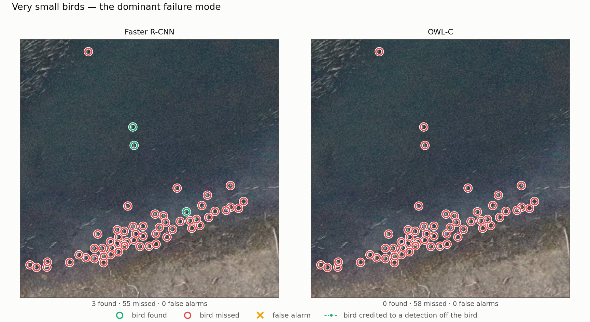
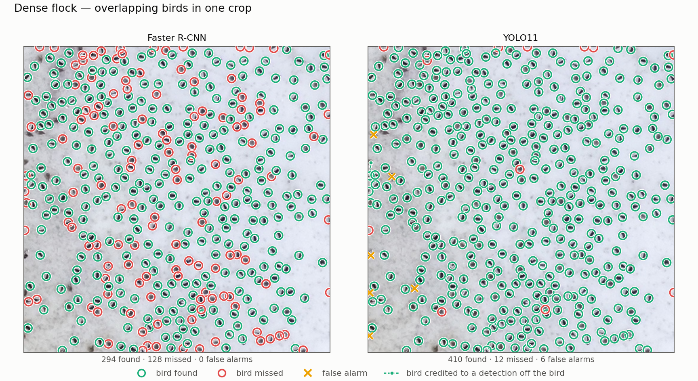
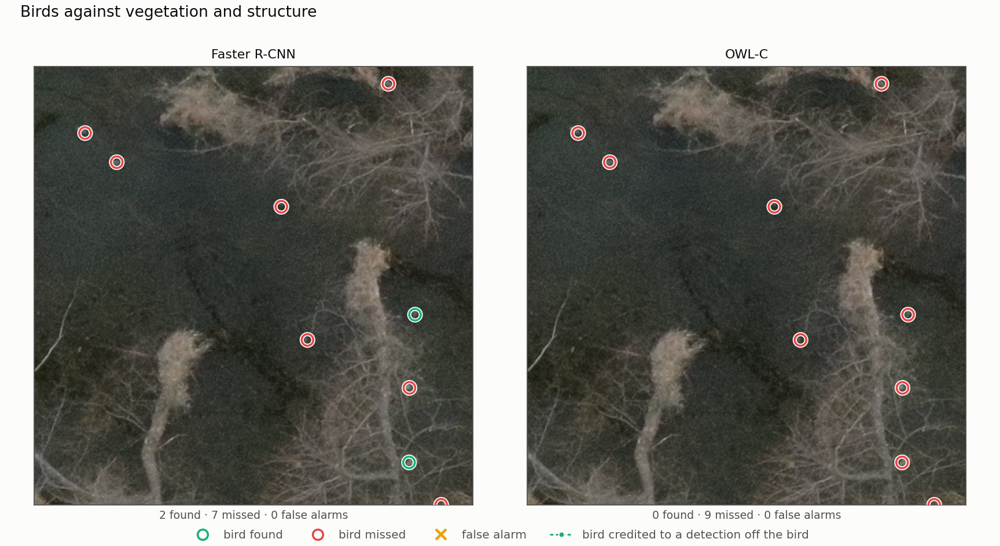
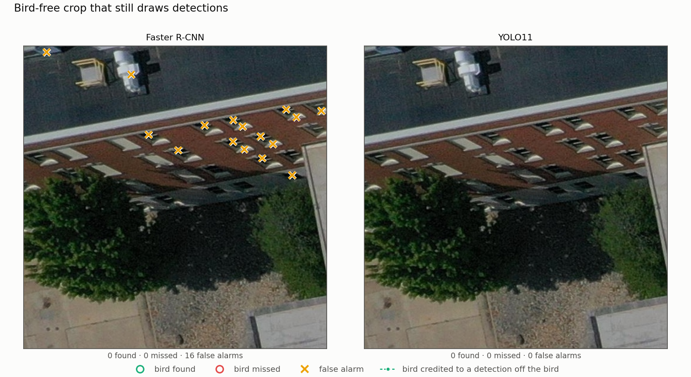
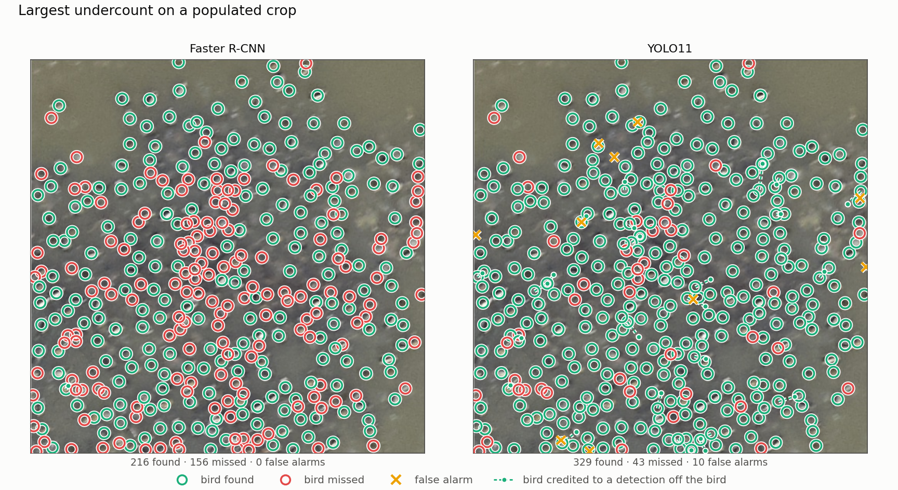
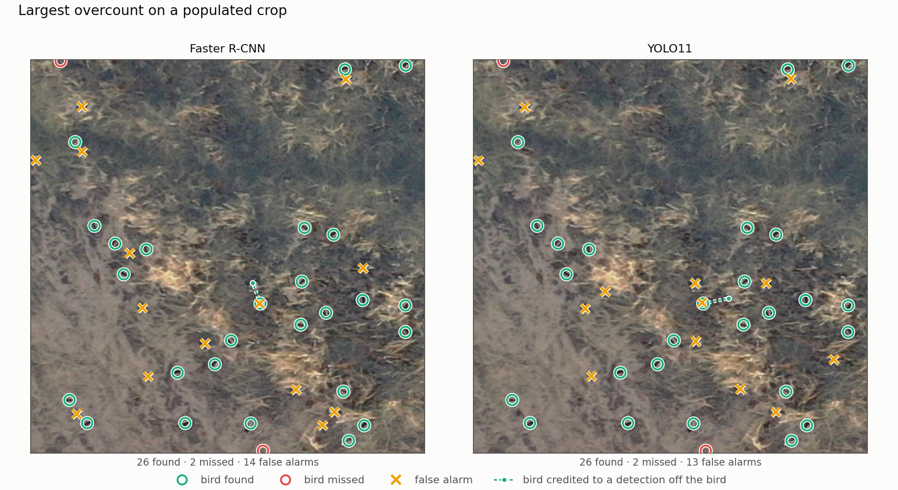
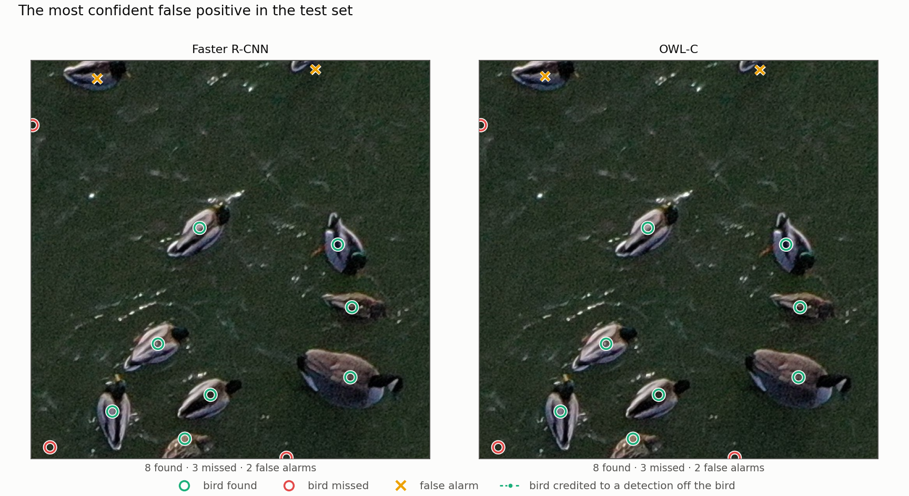
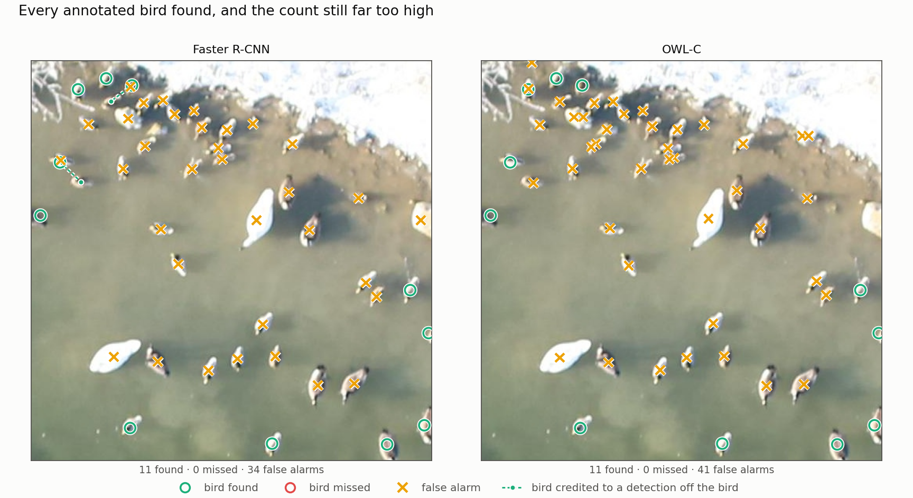
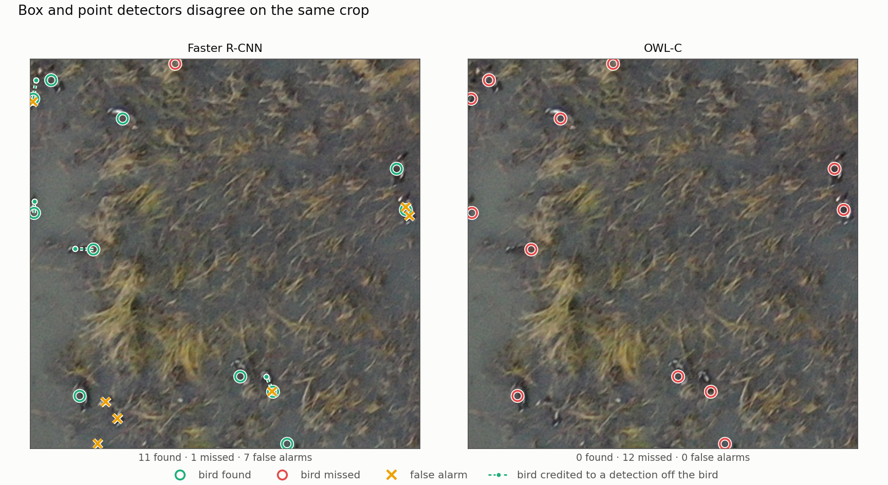

# Task 3.4 — Failure-case library

Each entry is one representative crop for one failure type, selected by a rule applied to the whole test split rather than chosen by eye. The rule and the number of crops that satisfied it are recorded with every case, so the library is reproducible and rebuilds itself against new runs.

Panels show ground truth as circles (green found, red missed) and unmatched detections as amber crosses, at each model's own operating threshold.

| # | Failure type | Crop | Birds | Median size | Habitat | Altitude |
|---|---|---|--:|--:|---|--:|
| 1 | Missed very small birds | `J_Cloud_Land_90m_DJI_0837_460_4960.JPG` | 58 | 11.4 px | Land | 90 m |
| 2 | Dense groups | `G_Cloud_Ice_90m_test_1840_3680.JPG` | 422 | 12.8 px | Ice | 90 m |
| 3 | Complex background | `H_EagleBluffs_03082022_Trees_Spot3_90meters_DJI_0126_1840_1840.JPG` | 9 | 17.7 px | Trees | 90 m |
| 4 | False positives | `A_3_120_5_460_460.JPG` | 0 | — | — | 120 m |
| 5 | Systematic undercounting | `E_mar2019_clipped_MODOC1214_0015GSD_LINE03B1558_0_0.JPG` | 372 | 15.5 px | — | 90 m |
| 6 | Systematic overcounting | `G_Cloud_WaterVegetation_90m_test_920_0.JPG` | 28 | 17.1 px | WaterVegetation | 89 m |
| 7 | High-confidence mistake | `I_DJI_0316_0_4600.JPG` | 11 | 98.1 px | — | 15 m |
| 8 | Probable annotation error | `D_G281_6Jan2017_0106_1380_2760.JPG` | 11 | 25.8 px | — | 90 m |
| 9 | Model families behave differently | `G_Cloud_WaterVegetation_60m_test2_2760_460.JPG` | 12 | 36.8 px | WaterVegetation | 59 m |

## 1. Missed very small birds

**Very small birds — the dominant failure mode**

| | |
|---|---|
| **Crop** | `Bird_J/J_Cloud_Land_90m_DJI_0837_460_4960.JPG` (COCO image id 27589) |
| **Ground truth** | 58 birds, median apparent size 11.4 px |
| **Metadata** | Bird_J · habitat Land · 90 m · Cloud |
| **Selected by** | crop with >= 8 birds and median apparent size < 13 px; lowest Faster R-CNN recall (78 crops eligible) |

| Model | Kind | t* | Found | Missed | False pos | Predicted count | Count error | Confidence (min/mean/max) | Top FP confidence |
|---|---|--:|--:|--:|--:|--:|--:|---|--:|
| Faster R-CNN | box | 0.571 | 3 | 55 | 0 | 3 | -55 | 0.846 / 0.876 / 0.905 | — |
| OWL-C | point | 0.285 | 0 | 58 | 0 | 0 | -58 | — | — |

**What this shows.** 58 birds at a median of 11.4 px across the diagonal. Faster R-CNN recovers 3 and misses 55. At this scale a bird occupies fewer pixels than the stride of the detector's coarsest feature map, so the miss is a resolution limit rather than a classification error — the evidence is not present to score. Recorded at habitat Land, 90 m, cloud, Bird_J.

## 2. Dense groups

**Dense flock — overlapping birds in one crop**

| | |
|---|---|
| **Crop** | `Bird_G/G_Cloud_Ice_90m_test_1840_3680.JPG` (COCO image id 14659) |
| **Ground truth** | 422 birds, median apparent size 12.8 px |
| **Metadata** | Bird_G · habitat Ice · 90 m · Cloud |
| **Selected by** | crop with >= 150 birds; the densest of them (101 crops eligible) |

| Model | Kind | t* | Found | Missed | False pos | Predicted count | Count error | Confidence (min/mean/max) | Top FP confidence |
|---|---|--:|--:|--:|--:|--:|--:|---|--:|
| Faster R-CNN | box | 0.571 | 294 | 128 | 0 | 294 | -128 | 0.582 / 0.780 / 0.959 | — |
| YOLO11 | box | 0.203 | 410 | 12 | 6 | 416 | -6 | 0.209 / 0.598 / 0.744 | 0.605 |

**What this shows.** 422 birds in a single 512x512 crop. Faster R-CNN counts 294 (-128); YOLO11 counts 416 (-6). Errors here are dominated by merging and splitting neighbours rather than by finding the flock: the birds are visible, the boundaries between them are not. Recorded at habitat Ice, 90 m, cloud, Bird_G.

## 3. Complex background

**Birds against vegetation and structure**

| | |
|---|---|
| **Crop** | `Bird_H/H_EagleBluffs_03082022_Trees_Spot3_90meters_DJI_0126_1840_1840.JPG` (COCO image id 17295) |
| **Ground truth** | 9 birds, median apparent size 17.7 px |
| **Metadata** | Bird_H · habitat Trees · 90 m · site EagleBluffs |
| **Selected by** | crop in a structurally complex habitat (Trees, Wooded, ShrubScrub, WaterVegetation, Lotus) with >= 5 birds; lowest Faster R-CNN recall (500 crops eligible) |

| Model | Kind | t* | Found | Missed | False pos | Predicted count | Count error | Confidence (min/mean/max) | Top FP confidence |
|---|---|--:|--:|--:|--:|--:|--:|---|--:|
| Faster R-CNN | box | 0.571 | 2 | 7 | 0 | 2 | -7 | 0.830 / 0.863 / 0.896 | — |
| OWL-C | point | 0.285 | 0 | 9 | 0 | 0 | -9 | — | — |

**What this shows.** 9 birds against structurally broken background. Faster R-CNN finds 2 of 9 and adds 0 false positives — the characteristic signature of a cluttered scene, where the model both misses birds and promotes background texture. Task 3.1 measured this habitat class as the worst-scoring group overall. Recorded at habitat Trees, 90 m, Bird_H.

## 4. False positives

**Bird-free crop that still draws detections**

| | |
|---|---|
| **Crop** | `Bird_A/A_3_120_5_460_460.JPG` (COCO image id 1166) |
| **Ground truth** | 0 birds |
| **Metadata** | Bird_A · 120 m |
| **Selected by** | crop with zero birds; most Faster R-CNN detections (19,700 crops eligible) |

| Model | Kind | t* | Found | Missed | False pos | Predicted count | Count error | Confidence (min/mean/max) | Top FP confidence |
|---|---|--:|--:|--:|--:|--:|--:|---|--:|
| Faster R-CNN | box | 0.571 | 0 | 0 | 16 | 16 | +16 | 0.581 / 0.813 / 0.968 | 0.968 |
| YOLO11 | box | 0.203 | 0 | 0 | 0 | 0 | +0 | — | — |

**What this shows.** No birds are present. Faster R-CNN still reports 16 (max confidence 0.968); YOLO11 reports 0. Background crops are the majority of any survey mosaic, so a small per-crop false-positive rate multiplies into a large absolute overcount. Recorded at 120 m, Bird_A.

## 5. Systematic undercounting

**Largest undercount on a populated crop**

| | |
|---|---|
| **Crop** | `Bird_E/E_mar2019_clipped_MODOC1214_0015GSD_LINE03B1558_0_0.JPG` (COCO image id 13932) |
| **Ground truth** | 372 birds, median apparent size 15.5 px |
| **Metadata** | Bird_E · 90 m · site MODOC1214 |
| **Selected by** | crop with >= 20 birds; most negative Faster R-CNN count error (839 crops eligible) |

| Model | Kind | t* | Found | Missed | False pos | Predicted count | Count error | Confidence (min/mean/max) | Top FP confidence |
|---|---|--:|--:|--:|--:|--:|--:|---|--:|
| Faster R-CNN | box | 0.571 | 216 | 156 | 0 | 216 | -156 | 0.572 / 0.868 / 0.996 | — |
| YOLO11 | box | 0.203 | 329 | 43 | 10 | 339 | -33 | 0.204 / 0.559 / 0.785 | 0.390 |

**What this shows.** 372 birds present, Faster R-CNN reports 216 (-156). Recall on this crop is 58%. Undercounts of this size come from dense clusters where several birds resolve into one detection, and they bias a population estimate downward in exactly the places holding the most birds. Recorded at 90 m, Bird_E.

## 6. Systematic overcounting

**Largest overcount on a populated crop**

| | |
|---|---|
| **Crop** | `Bird_G/G_Cloud_WaterVegetation_90m_test_920_0.JPG` (COCO image id 16091) |
| **Ground truth** | 28 birds, median apparent size 17.1 px |
| **Metadata** | Bird_G · habitat WaterVegetation · 89 m · Cloud |
| **Selected by** | crop with >= 20 birds; most positive Faster R-CNN count error (839 crops eligible) |

| Model | Kind | t* | Found | Missed | False pos | Predicted count | Count error | Confidence (min/mean/max) | Top FP confidence |
|---|---|--:|--:|--:|--:|--:|--:|---|--:|
| Faster R-CNN | box | 0.571 | 26 | 2 | 14 | 40 | +12 | 0.586 / 0.882 / 0.996 | 0.979 |
| YOLO11 | box | 0.203 | 26 | 2 | 13 | 39 | +11 | 0.207 / 0.542 / 0.713 | 0.692 |

**What this shows.** 28 birds are annotated and Faster R-CNN reports 40, an overcount of +12, of which 14 are false alarms. Classified by cause, 0 overlap the box of a bird already found, 1 sits on a bird whose credit went to a detection further away, 6 sit on no annotated bird but are reported by all 8 models, and 7 are reported by no other model. The swapped case is what appears in the panel as one bird detected twice. The model placed a detection on the bird, and placed a second, higher-scoring detection on something else nearby. Matching proceeds in order of confidence and accepts any bird within 40 px, which is about 2.3 times the width of a bird here, so the higher-scoring detection claimed the bird first and the detection sitting on it was left as the false alarm. The dashed line in the panel joins the bird to the detection that received the credit. No false alarm overlaps a detection of the same bird, so non-maximum suppression is not the cause of the overcount. Recorded at habitat WaterVegetation, 89 m, cloud, Bird_G.

## 7. High-confidence mistake

**The most confident false positive in the test set**

| | |
|---|---|
| **Crop** | `Bird_I/I_DJI_0316_0_4600.JPG` (COCO image id 21573) |
| **Ground truth** | 11 birds, median apparent size 98.1 px |
| **Metadata** | Bird_I · 15 m |
| **Selected by** | highest-scoring false positive produced by Faster R-CNN anywhere in the split (confidence 0.999) (6,279 crops eligible) |

| Model | Kind | t* | Found | Missed | False pos | Predicted count | Count error | Confidence (min/mean/max) | Top FP confidence |
|---|---|--:|--:|--:|--:|--:|--:|---|--:|
| Faster R-CNN | box | 0.571 | 8 | 3 | 2 | 10 | -1 | 0.934 / 0.989 / 0.999 | 0.999 |
| OWL-C | point | 0.285 | 8 | 3 | 2 | 10 | -1 | 0.312 / 0.501 / 0.564 | 0.446 |

**What this shows.** Faster R-CNN produces a false positive at confidence 0.999 — its single most confident error anywhere in the test set, above the confidence of most of its correct detections. Errors like this are the dangerous kind: no threshold that keeps the model useful will remove them, so they cannot be tuned away. Recorded at 15 m, Bird_I.

## 8. Probable annotation error

**Every annotated bird found, and the count still far too high**

| | |
|---|---|
| **Crop** | `Bird_D/D_G281_6Jan2017_0106_1380_2760.JPG` (COCO image id 9328) |
| **Ground truth** | 11 birds, median apparent size 25.8 px |
| **Metadata** | Bird_D · 90 m · site G281 |
| **Selected by** | crop with >= 5 birds where Faster R-CNN found every annotated bird; largest count overshoot (418 crops eligible) |

| Model | Kind | t* | Found | Missed | False pos | Predicted count | Count error | Confidence (min/mean/max) | Top FP confidence |
|---|---|--:|--:|--:|--:|--:|--:|---|--:|
| Faster R-CNN | box | 0.571 | 11 | 0 | 34 | 45 | +34 | 0.637 / 0.957 / 0.998 | 0.998 |
| OWL-C | point | 0.285 | 11 | 0 | 41 | 52 | +41 | 0.287 / 0.568 / 0.694 | 0.679 |

**What this shows.** 11 birds are annotated in this crop and Faster R-CNN finds every one of them, yet it reports 45 detections in total, an overcount of +34. Of the 34 detections matching no annotated bird, 33 fall within the matching radius of a detection from every one of the 8 models, at a median confidence of 0.994. Those models differ in architecture, in training regime and in whether they predict boxes or points. Agreement of that kind is not readily explained by eight independent false positives landing on the same coordinates, and the more economical reading is that the crop is under-annotated: the birds are present and were not labelled. The consequence is that precision is understated wherever this occurs, for every model, because a correct detection of an unlabelled bird is scored as an error. Section 7.5 reports how often the pattern appears across the test split. Recorded at 90 m, Bird_D.

## 9. Model families behave differently

**Box and point detectors disagree on the same crop**

| | |
|---|---|
| **Crop** | `Bird_G/G_Cloud_WaterVegetation_60m_test2_2760_460.JPG` (COCO image id 14760) |
| **Ground truth** | 12 birds, median apparent size 36.8 px |
| **Metadata** | Bird_G · habitat WaterVegetation · 59 m · Cloud |
| **Selected by** | crop with >= 10 birds; largest recall gap between Faster R-CNN (box) and OWL-C (point) (1,879 crops eligible) |

| Model | Kind | t* | Found | Missed | False pos | Predicted count | Count error | Confidence (min/mean/max) | Top FP confidence |
|---|---|--:|--:|--:|--:|--:|--:|---|--:|
| Faster R-CNN | box | 0.571 | 11 | 1 | 7 | 18 | +6 | 0.654 / 0.820 / 0.990 | 0.970 |
| OWL-C | point | 0.285 | 0 | 12 | 0 | 0 | -12 | — | — |

**What this shows.** 12 birds. Faster R-CNN (box) recovers 11; OWL-C (point) recovers 0. The two families fail on different crops rather than the same ones by different amounts, which is the case for an ensemble or for routing by scene type rather than picking one architecture outright. Recorded at habitat WaterVegetation, 59 m, cloud, Bird_G.
