<!-- Display equations are LaTeX-typeset images produced by code/step6_equations.py (source LaTeX there). -->

# Summary

This report gives drone operators an equation for choosing the flight height of a waterfowl survey from two things they know before take-off: the camera on the drone and the smallest bird species they need to count. Flying higher covers more ground per photo and disturbs birds less, but birds look smaller in the photo and the detector misses more of them. The equation gives the flight height at which the birds appear in the photo at the optimum size for detection:

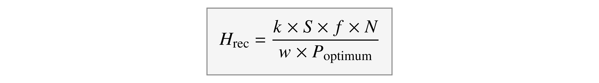{width=6.5in}

{width=6.5in}

- *S*: bird size in metres, from Table 4 (green-winged teal 0.211 m, drake mallard 0.301 m).
- *f*, *N*, *w*: the camera's focal length (mm), image width (pixels) and sensor width (mm), from its specification. For the DJI Mavic 2 Pro they are 10.26 mm, 5,472 pixels and 13.2 mm.
- *P*~optimum~: the optimum bird size in the photo for detection, measured like the earlier size analysis (Task 2.3) as the square root of the bounding-box area. The detection rate peaks at **18 pixels** for YOLOv5.
- *k* = 1.09: a fixed correction for blur, which makes a bird's box slightly larger than the bird. Nothing about it has to be measured in the field (Section 2.3).

The equation is derived in one place, Section 2; Section 3 shows how to use it.

**Main results**

1. **The optimum bird size for detection is 18 pixels.** This agrees with the project's earlier analyses: the highest recall was in the 17–19 pixel bin for 7 of 8 detectors (Task 2.3), and the best flight height in the altitude analysis was 90 m, where the median bird measured 17.3 pixels.
2. **Recommended heights.** Green-winged teal 55 m with a Mavic 2 Pro and 36 m with a Mavic Air 2; gadwall 72 m and 48 m; drake mallard 78 m and 51 m (Table 4).
3. **The optimum is flat.** Flying between 0.68 and 1.10 times the recommended height keeps detection within 1 point of the best, so the heights need not be flown exactly.
4. **The geometry is confirmed.** On decoys, doubling the flight height halves a bird's size in pixels, to within 2.3%. Using only decoy photos taken at 15 m, the equation predicts decoy box sizes at 15–90 m to within 1.4 pixels on average.

**Main limitations.** The Mavic Air 2 heights are untested (only three photos exist), bird sizes come from one site and season, and *P*~optimum~ must be re-measured whenever the detectors are retrained.

# 1. Problem and scope

A drone operator planning a waterfowl survey must choose a flight height. Flying higher covers more ground per photo (the area grows with the square of the height), shortens the survey and disturbs birds less. But each bird covers fewer pixels and becomes harder for a detector to find. The operator needs one number that accounts for the camera and for the smallest species to be counted.

This report answers three questions:

1. What is the equation, and why does it hold? (Section 2)
2. What height does it give for each camera and species? (Section 3)
3. Where do its constants come from, and how accurate are they? (Sections 4–8)

The report covers photos taken straight down and the task of counting birds (detection). Identifying species needs lower flights and is discussed briefly in Section 3.5. Disturbance of birds and aviation rules are treated as limits on the result, not modelled.

# 2. The equation

## 2.1 The result

The recommended flight height above the birds is

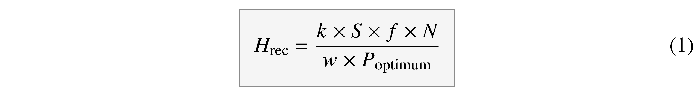{width=6.5in}

or, in words,

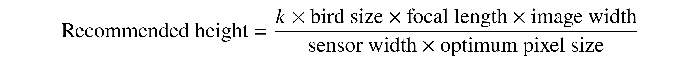{width=6.5in}

| Symbol | Meaning | Unit | Where to find it | Example: teal, Mavic 2 Pro |
|---|---|---|---|--:|
| *H*~rec~ | Recommended flight height above the birds | m | Result of Equation (1) | 54.5 |
| *S* | Bird size: the side of a square with the same area as the bird's bounding box, measured on the ground | m | Table 4 (divide the centimetres by 100) | 0.211 |
| *f* | Focal length of the camera lens | mm | Camera specification, or the photo's EXIF data | 10.26 |
| *N* | Image width: number of pixels along the long side of the photo | pixels | Camera specification | 5,472 |
| *w* | Sensor width: length of the long side of the sensor | mm | Camera specification | 13.2 |
| *P*~optimum~ | Optimum bird size in the photo for detection: square root of the box area | pixels | 18 (Section 6.3) | 18 |
| *k* | Blur correction | — | 1.09 (Section 2.3) | 1.09 |

Table: Table 1. Inputs of the flight-height equation. *N* and *w* must both refer to the long side.

Everything in the equation is geometry except two constants, and both are already measured: the optimum pixel size *P*~optimum~ = 18 pixels (Section 6.3) and the blur correction *k* = 1.09 (Section 2.3). Neither is measured in the field. Bird sizes *S* are listed in Table 4 and measured in Section 7.

## 2.2 Derivation

**One pixel on the ground.** Figure 1 shows a camera pointing straight down. One pixel on the sensor is *w* ÷ *N* millimetres wide, and the lens projects it onto the ground enlarged by *H* ÷ *f* (similar triangles), so one pixel covers a ground distance of

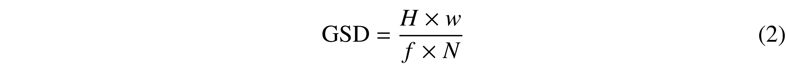{width=6.5in}

This is the ground sampling distance (GSD).

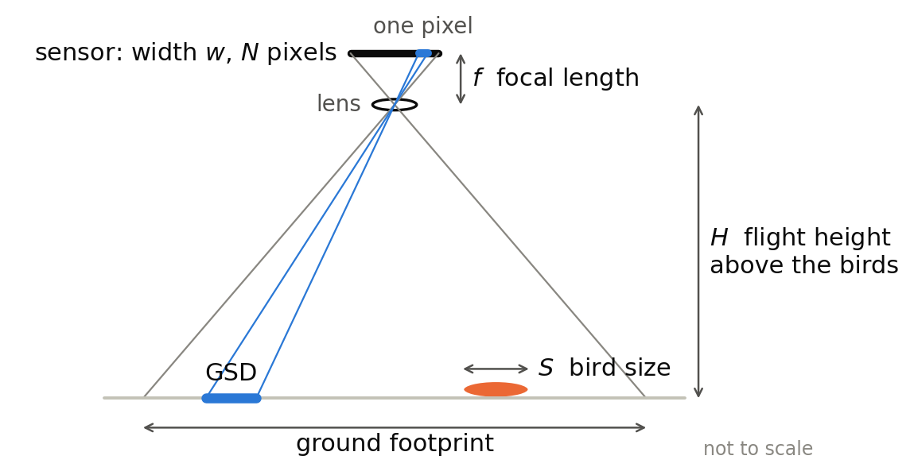{width=6.5in}

**The camera factor.** The camera's three numbers always appear together, so they are collected into one constant, the focal length expressed in pixels:

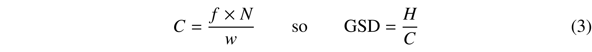{width=6.5in}

**The bird in pixels.** A bird of size *S* on the ground therefore spans

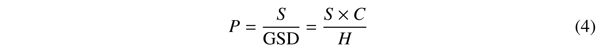{width=6.5in}

pixels in the photo. This is the geometric size: doubling the flight height halves it.

**What the detector sees.** The box drawn around a bird, by an annotator or by the detector, is slightly larger than the bird itself. Blur, image compression and the bird's soft outline widen it by an amount *b* that is fixed in pixels, so the two widths add in quadrature:

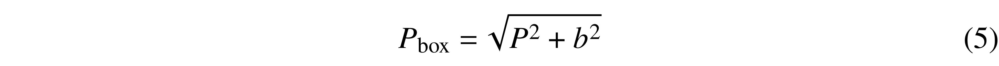{width=6.5in}

Because they add in quadrature, the margin matters only when the bird is small: it adds 2.0 pixels to a bird of 12 geometric pixels and 0.7 pixels to one of 40. Section 2.3 obtains *b* from the optimum itself, so it never has to be measured before a flight.

**The condition for the optimum.** The detector finds the largest share of birds when the box measures *P*~optimum~ pixels (Section 6.3). Writing that condition at the recommended height gives

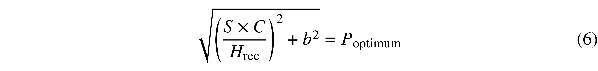{width=6.5in}

**Solving for the height.**

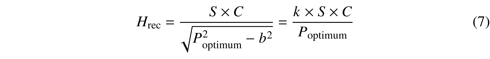{width=6.5in}

where the blur correction is

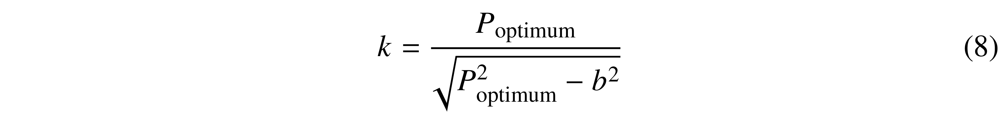{width=6.5in}

Substituting the camera factor from Equation (3) gives Equation (1). Ignoring blur (*k* = 1) would put the birds at 19.4 pixels instead of 18 and the drone 9% too low.

## 2.3 The blur correction, without measuring anything

Equation (8) appears to need *b*, but it does not. Section 6.4 shows that the optimum size and the blur margin move together: a sharper photo or a tighter box makes both smaller. Only their ratio enters Equation (8), and that ratio is what this corpus measures:

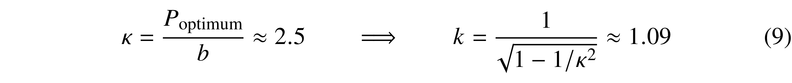{width=6.5in}

So one number serves every camera: *k* = 1.09. Even a large error in the ratio changes little, because *k* is bounded — κ = 2 gives 1.16, κ = 3 gives 1.06, and a perfectly sharp system gives 1.00, a span of 6% in flight height either side of the value used here. If *b* itself is ever wanted, it follows as *P*~optimum~ ÷ κ, about 7 pixels at an optimum of 18.

**What sets the margin.** Two things widen a box by a fixed number of pixels, whatever the height:

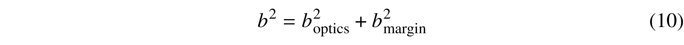{width=6.5in}

The optical term belongs to the camera — diffraction alone spreads a point over 1.6 pixels at f/2.8 on the Mavic 2 Pro — and the annotation term belongs to whoever, or whatever, draws the boxes. Neither depends on how high the drone flies.

**Motion blur is not part of it.** A drone moving at speed *v* during an exposure *t*~exp~ smears the image by *v* × *t*~exp~ on the ground. In pixels that smear shrinks with height exactly as the bird does, so it acts as a slightly larger bird rather than as a margin:

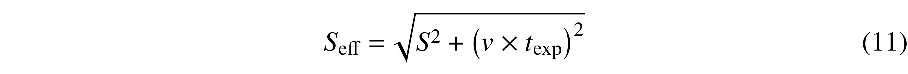{width=6.5in}

At survey settings this is negligible: 5 m/s at 1/500 s adds 1 cm, which enlarges a teal by 0.1%. It matters only with slow shutters — 8 m/s at 1/125 s adds 6.4 cm, or 4.5% — where *S*~eff~ should replace *S*.

## 2.4 Other forms of the same equation

**As a ground resolution.** Flight-planning software often takes a target GSD instead of a height. The bird and the detector fix it,

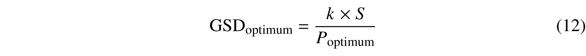{width=6.5in}

and the camera turns it into a height:

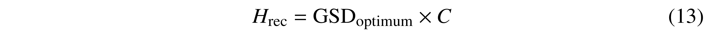{width=6.5in}

**As a setting on the controller.** DJI drones measure height from the take-off point, not from the water. If the drone takes off from a point *h*~takeoff~ metres above the water, such as a levee or a bank, enter

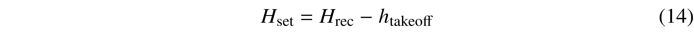{width=6.5in}

**When the camera specification is not at hand.** The EXIF data of any photo from the camera records the 35 mm-equivalent focal length *f*~35~, and

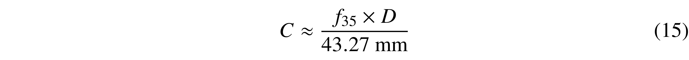{width=6.5in}

where *D* is the image diagonal in pixels and 43.27 mm is the diagonal of a 35 mm film frame.

Two limits apply to the result of Equation (1). The height must not exceed 122 m (400 ft), the limit for small drones under US rules (14 CFR §107.51), and it should not fall below the height at which the species is disturbed, which biologists should set.

## 2.5 Assumptions

| Assumption | Check against the data |
|---|---|
| The camera points straight down | Gimbal pitch is −89.9° to −90.0° in all 191 photos that retain EXIF data. |
| The lens does not distort the image | Not tested. Lens distortion changes bird size most at the corners of a photo. |
| *H* is the height above the birds | DJI records height relative to the take-off point (XMP `RelativeAltitude`). The `height` column of `image_info.csv` equals this value truncated or rounded to the planned height (differences −0.3 to +0.9 m). A take-off point above the water adds to the true height, which Equation (14) corrects. |
| The birds lie in one horizontal plane | Holds for birds on water; not for birds in flight or on uneven ground. |
| The blur margin *b* is fixed in pixels, whatever the height | Confirmed on decoys from 15 to 90 m (Section 5.2): one shared value fits 38 groups to within 1.4 pixels. Motion blur, which is not fixed in pixels, is handled separately by Equation (11). |
| The ratio κ carries over to other cameras | Measured once, on this corpus (Section 6.4). It only sets *k*, which lies between 1.00 and 1.16 for any plausible ratio, so an error here moves the height by at most 6%. |

Table: Table 2. Assumptions of the equation.

# 3. Using the equation

## 3.1 Camera constants

Two cameras are identified by the EXIF data of the photos. Their camera factors are given in Table 3.

| Quantity | DJI Mavic 2 Pro (Hasselblad L1D-20c) | DJI Mavic Air 2 (FC3170, 12 MP) | Source |
|---|--:|--:|---|
| Focal length *f* (mm) | 10.26 | 4.5 | EXIF |
| 35 mm-equivalent focal length *f*~35~ (mm) | 28 | 24 | EXIF |
| Sensor width *w* (mm) | 13.2 | 6.4 | Manufacturer specification |
| Image width *N* (pixels) | 5,472 | 4,000 | Photo |
| Pixel size on the sensor, *w* ÷ *N* (µm) | 2.41 | 1.60 | Calculated |
| **Camera factor *C*** | **4,253** | **2,812** | Equation (3) |
| GSD at 15 / 30 / 60 / 90 m (cm per pixel) | 0.35 / 0.71 / 1.41 / 2.12 | 0.53 / 1.07 / 2.13 / 3.20 | Equation (2) |

Table: Table 3. Constants of the two cameras found in the photos.

For the same bird at the same height, the Mavic 2 Pro records 1.51 times as many pixels across as the Mavic Air 2: the Air 2 at 15 m gives the same bird size in pixels as the Mavic 2 Pro at 23 m. The Mavic 2 Pro's horizontal field of view computed from Table 3, 65.5°, matches the 66° quoted by Zhang et al. (2024).

## 3.2 Recommended heights

| Species | Bird size *S* (cm) | Optimum GSD (cm per pixel) | Mavic 2 Pro (*C* = 4,253) | Mavic Air 2, 12 MP (*C* = 2,812) |
|---|--:|--:|--:|--:|
| Green-winged teal | 21.1 | 1.28 | **55 m** | **36 m** |
| American wigeon ♂ | 26.5 | 1.61 | 68 m | 45 m |
| Gadwall | 27.9 | 1.70 | 72 m | 48 m |
| Mallard ♀ | 27.9 | 1.70 | 72 m | 48 m |
| Northern pintail ♀ | 28.2 | 1.72 | 73 m | 48 m |
| Northern pintail ♂ | 29.4 | 1.78 | 76 m | 50 m |
| Mallard ♂ | 30.1 | 1.83 | 78 m | 51 m |

Table: Table 4. Recommended flight height above the birds at the optimum pixel size of 18 pixels (YOLOv5), with the optimum GSD from Equation (12). Heights from 0.68 to 1.10 times these values keep detection within 1 point of the best (Section 6.3).

For a mixed flock, the smallest species that must be counted sets the height; for dabbling ducks this is usually green-winged teal. Figure 2 gives the recommended height for any bird size.

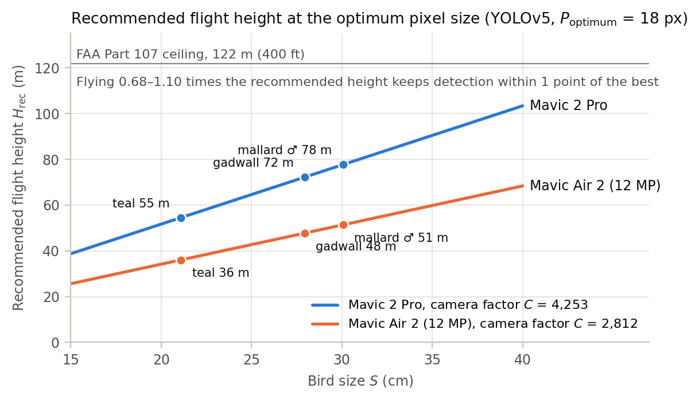{width=6.5in}

## 3.3 Worked example

*A mixed flock of dabbling ducks is surveyed with a Mavic 2 Pro launched from a levee 3 m above the water.*

1. **Bird size.** The smallest species to count is green-winged teal: *S* = 21.1 cm = 0.211 m (Table 4).
2. **Constants.** For YOLOv5, *P*~optimum~ = 18 pixels and *k* = 1.094 (Equation 9).
3. **Optimum ground resolution, Equation (12).** GSD~optimum~ = 1.094 × 21.1 cm ÷ 18 = 1.28 cm per pixel.
4. **Camera factor, Equation (3).** *C* = 10.26 × 5,472 ÷ 13.2 = 4,253.
5. **Recommended height, Equation (13).** *H*~rec~ = 0.01282 m × 4,253 = 54.5 m.
6. **Controller setting, Equation (14).** *H*~set~ = 54.5 − 3 = 51 m (rounded down).

Each photo then covers 70.1 m × 46.7 m on the ground (0.33 ha), 13 times the area of a photo taken from 15 m (19.3 m × 12.9 m).

## 3.4 Cameras not listed

For any other camera, *C* follows from its specification sheet through Equation (3). From a sample photo instead, Equation (15) gives 4,256 for the Mavic 2 Pro (+0.1% against Table 3) and 2,773 for the Mavic Air 2 (−1.4%, because EXIF rounds *f*~35~ to a whole millimetre).

The camera also decides how much ground each photo covers. At the same GSD, coverage grows with the number of megapixels: for teal at the optimum GSD, one photo covers 3,278 m² with the 20 MP Mavic 2 Pro and 1,971 m² with the 12 MP Mavic Air 2, so the Air 2 needs 1.66 times as many photos for the same detection quality.

## 3.5 Counting versus identifying species

Identifying species needs a much larger bird in the photo than detecting it. In the decoy classification experiments of Zhang et al. (2024, Table 8), accuracy across four classifiers was 87.5–91.6% at 15 m, 76.7–81.3% at 30 m and 40.7–48.8% at 60 m, where decoys measured 88.6, 43.9 and 23.5 pixels. Using 45 pixels in place of *P*~optimum~, for roughly 80% identification accuracy, Equation (1) gives 20 m for teal and 29 m for drake mallards with the Mavic 2 Pro, and 13 m for teal with the Mavic Air 2. This estimate rests on four heights, one decoy dataset and classifiers from the earlier study, and is indicative only.

# 4. Data

**Photos and detectors.** Every size in this report is measured on the project's own dataset — the 512-pixel crops the detectors are trained and scored on — mapped back to the coordinates of the photograph each crop came from. That is 317,386 annotated boxes over 1,823 photos in the ten sub-datasets, reassembled from the crops they were cut into, so no bird is counted twice where crops overlap and none is measured as the fragment a tile edge left of it. The detector analysis uses the benchmark test split: 28,588 tiles of 512 × 512 pixels from 426 photos, holding 89,884 annotated birds. The project's eight trained detectors (Faster R-CNN, OWL-C, OWL-D, OWL-T, YOLO11, YOLO26, YOLO-NAS and YOLOv5) are each scored at their own operating threshold under the benchmark matching rule (greedy, one-to-one, within 40 pixels). No detector resizes its input, so the pixels in the photo are the pixels the detector sees.

**Cameras.** EXIF data survives in 191 photos: 188 from the Mavic 2 Pro (Bird_B 36, Bird_G 125, Bird_I 27) and 3 from the Mavic Air 2 (Bird_I). Zhang et al. (2024) state that the Bird-G to Bird-J datasets were collected with a DJI Mavic 2 Pro (written "Mavic Pro 2" in the paper). The three Mavic Air 2 photos in Bird_I show that a second drone was also used; five Bird_J photos without EXIF data share its 4000 × 3000 pixel size.

**Decoys.** Table 1 of Zhang et al. (2024) identifies Bird-H as a decoy dataset (177 photos, 16,738 labels; the copy in `dataset_full` holds 171 photos and 16,560 boxes). Its species file labels each decoy as one of ten types or "unknown", photographed from 15, 30, 60 and 90 m. Because decoys do not change size or posture between flights, they are used to calibrate the size model (Section 5).

**Exclusions.**

- Boxes cut by the edge of a 512-pixel tile do not measure the whole bird. The 15,145 cut boxes (16.8% of test birds) are excluded from every size analysis, leaving 74,739.
- Boxes cut by the edge of the photograph itself stop at the image border, so they measure the visible part of the bird and not the bird. All 5,261 of them (1.7%, four fifths in Bird_E) are excluded from the size statistics, leaving 312,125.
- In Bird_I, the 140 photos without EXIF data show the same species larger than the 27 photos whose height is confirmed by XMP data (median ratio 1.36 over 11 species, range 0.98–1.92), although both are recorded at 15 m. Their true height cannot be verified, so they are not used for bird sizes.
- The 3 Mavic Air 2 photos are not used for bird sizes because they were annotated in a markedly different style (Section 5.3).

| Part of the study | Data | Sample |
|---|---|---|
| Camera constants (Table 3) | EXIF and DJI XMP data | 191 photos |
| Blur margin *b* (Section 5.2) | Bird_H decoys, ten named types × 4 heights, all splits | 12,944 boxes, 38 type × height groups |
| Optimum pixel size (Section 6) | Benchmark test split, 8 detectors, uncut boxes | 74,739 birds |
| Bird sizes *S* (Section 7) | Bird_I real birds, 27 Mavic 2 Pro photos at 14.7–15.8 m (XMP) | 1,896 boxes |
| Validation (Section 8) | Bird_H test-split decoys (named types, uncut); sizes from decoys at 15 m outside the test split | 2,605 test birds; 5,570 boxes |

Table: Table 5. Data used for each constant of the equation.

# 5. Bird size in the photo versus flight height

This section checks Equation (4) and measures the blur margin *b* of Equation (5).

## 5.1 Test on decoys

For each decoy type and flight height with at least 10 boxes, the median box size *P*~box~ was computed, and the product *P*~box~ × *H* was compared with its value at 15 m. By Equation (4), this product should not change with height.

| Flight height | *P*~box~ × *H* relative to 15 m, range over decoy types | Mean |
|--:|---|--:|
| 15 m | 1.000 | 1.000 |
| 30 m | 0.977 – 1.002 | 0.992 |
| 60 m | 1.000 – 1.079 | 1.050 |
| 90 m | 1.106 – 1.199 | 1.146 |

Table: Table 6. Departure of decoy box sizes from Equation (4).

From 15 m to 30 m, where decoys measure 34–102 pixels, Equation (4) holds for all ten types. At 60 m and 90 m, where they measure 13–27 pixels, boxes are 5% and 15% larger on average than it predicts (Figure 3). This is the blur margin: a fixed number of pixels, so it matters only when the bird is small.

The pattern also rules out a sizeable error in the recorded height. If the decoys were Δ metres further from the camera than recorded, for example because the drone took off from a bank above the water, the ratio at 30 m would be 2(15 + Δ)/(30 + Δ): 1.03 for Δ = 1 m and 1.14 for Δ = 5 m, against the observed 0.977–1.002.

## 5.2 The blur margin

Pooling all decoys, the measured box is 0.5 pixels larger than geometry predicts at 15 m and 0.2 pixels smaller at 30 m, but 1.5 pixels larger at 60 m and 2.3 pixels larger at 90 m. The excess is not proportional to the bird, so it is not a scaling error.

*b* was estimated by weighted least squares over the 38 decoy-type × height groups of Table 6, fitting one size constant per decoy type (ten parameters) plus one shared *b* (the eleventh), with each group weighted by √*n*. The fit gives **b = 7.29 pixels**, with an RMS error of 0.61 pixels and a largest error of 1.38 pixels.

**How *b* is measured from two heights.** Photographing the same objects from heights *H*~1~ and *H*~2~ and taking the median box size at each, *P*~1~ and *P*~2~, Equation (5) written at both heights gives the object's size constant *a* = *S* × *C*,

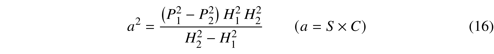{width=6.5in}

and then the margin, from either height:

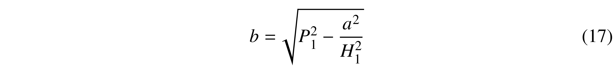{width=6.5in}

Applied to the ten decoy types, the heights 15 m and 90 m give 6.9–10.1 pixels (mean 8.5) and 15 m and 60 m give 5.5–9.4 pixels, both bracketing the least-squares value. The pair of heights matters: 15 m and 30 m give only 2.2–3.9 pixels, and seven of the ten types give no solution at all, because both boxes are large and *b* is then a small difference between large numbers. This is calibration work, not flight planning: an operator uses *k* from Equation (9) instead.

**What the margin is made of.** Of the two parts in Equation (10), the optical one accounts for about 2 pixels on this camera (1.6 pixels of diffraction at f/2.8, plus lens softness). The remaining 7 pixels are the margin left around the visible outline when the boxes are drawn, which is why the value differs so much between batches.

| Fit | Blur margin *b* (px) | RMS error (px) |
|---|--:|--:|
| Bird_H decoys, per type, all splits (used in this report) | 7.29 | 0.61 |
| Bird_H decoys, per type, train and validation splits only | 7.18 | 0.67 |
| Bird_H decoys, additive margin *P* + *c* instead | 1.32 | 0.81 |
| Bird_H decoys, separate margin per decoy type | 0 – 9.0 | 0.50 |
| Bird_A ladder (12 heights, 40–150 m) | 4.14 | 0.35 |
| Bird_C ladder (4 heights, 30–120 m) | 1.30 | 0.28 |

Table: Table 7. How well the blur margin is determined. The ladders are datasets in which the same scene was photographed from several heights, so a departure from geometry cannot come from a change of birds.

*b* is therefore a property of a particular camera and annotation batch, not a constant of nature: sharper photos and tighter boxes give a smaller margin. That does not make the flight height uncertain, because *b* never enters it alone. The optimum moves with the margin (Section 6.4), so only their ratio reaches the equation, through *k*, and *k* stays within 6% of 1.09 for any plausible ratio.

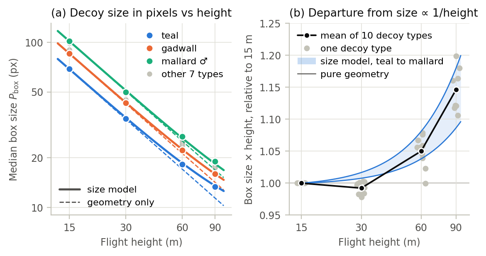{width=6.5in}

## 5.3 Camera comparison

Equation (4) predicts that, at the same height, the same bird spans 4,253 ÷ 2,812 = 1.51 times as many pixels with the Mavic 2 Pro as with the Mavic Air 2. Two comparisons are available, and they disagree:

- **Bird_J, 15 m, no species control.** Photos of 4000 × 3000 pixels (511 birds) have a median box size of 44.2 pixels against 68.1 pixels for photos of 5472 × 3648 pixels (7,293 birds). The ratio is 1.54, close to the prediction.
- **Bird_I, 15 m, same species.** For the eight labels present in both cameras' photos, the ratio is only 1.11–1.19.

Figure 4 explains the disagreement. Shown at one common ground scale, drakes of the same species are of similar size in both cameras' photos, but the Mavic Air 2 boxes carry a wide margin around each bird while the Mavic 2 Pro boxes follow the body. The Mavic Air 2 photos were also exposed for 1/12.5 s, against 1/1000 s for the Mavic 2 Pro photos, and are visibly softer. The Bird_I comparison therefore measures a difference in annotation, not in optics. The camera factor is supported by the Bird_J comparison, but no test with the same species exists in the data.

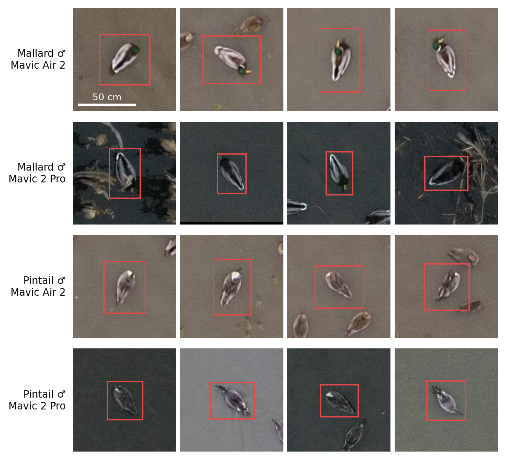{width=6.5in}

## 5.4 Why decoys, not real birds, calibrate the size model

With the same camera, real-bird photos depart from Equation (4) far more than decoys do. In Bird_G (Mavic 2 Pro), *P*~box~ × *H* rises from 863–920 pixel·m at 14–15 m to 1,338–1,424 pixel·m at 89–90 m, an increase of 45–65%. In Bird_B (Mavic 2 Pro) it rises from 1,087–1,140 pixel·m at 28–30 m to 1,408–1,484 pixel·m at 119–120 m. Different flocks, species mixes and postures were photographed at each height, and these differences cannot be separated from the effect of height. Decoys hold all of them fixed.

# 6. Optimum pixel size for detection

This section measures *P*~optimum~, the constant that Equation (6) sets the height by.

## 6.1 Method

Each test bird was marked as found or missed by each detector at its operating threshold. The probability of finding a bird was modelled by logistic regression, with a separate constant for each sub-dataset and a smooth curve *g* (cubic spline, seven knots) of the log box size:

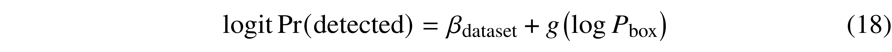{width=6.5in}

The detection rate *R*(*P*~box~) is the predicted share of birds found, averaged over the mix of sub-datasets in the test split. It therefore describes the effect of bird size alone, with differences in site, habitat, annotation and camera between sub-datasets held fixed. Precision (the share of detections that are real birds) was computed per box-size bin and averaged over sub-datasets in the same way.

## 6.2 Results

| Detector | *R* at 12 px | *R* at 14 px | *R* at 16 px | *R* at 18 px | *R* at 20 px | *R* at 30 px | *R* at 100 px |
|---|--:|--:|--:|--:|--:|--:|--:|
| Faster R-CNN | 60.4 | 77.1 | 87.9 | 92.6 | 93.4 | 92.5 | 98.8 |
| OWL-C | 77.8 | 85.7 | 90.4 | 92.9 | 93.7 | 90.1 | 95.3 |
| OWL-D | 75.0 | 84.3 | 90.5 | 92.9 | 93.1 | 91.9 | 98.0 |
| OWL-T | 78.8 | 86.9 | 92.5 | 94.6 | 94.7 | 91.8 | 95.7 |
| YOLO11 | 78.7 | 87.4 | 92.9 | 94.4 | 93.9 | 91.9 | 98.8 |
| YOLO26 | 78.1 | 86.5 | 91.4 | 93.3 | 93.7 | 92.5 | 98.6 |
| YOLO-NAS | 79.8 | 88.3 | 93.0 | 94.4 | 94.2 | 91.2 | 99.0 |
| **YOLOv5** | **77.3** | **86.7** | **92.7** | **94.6** | **94.4** | **92.3** | **98.8** |

Table: Table 8. Detection rate (%) against box size.

- **The detection rate rises steeply up to about 18 pixels** for every detector (Figure 5a). Faster R-CNN rises more slowly than the other seven.
- **It peaks at 18–22 pixels, then dips** by about 3 points at 30–40 pixels. It rises again only for birds of 60 pixels and more, which are photographed from under 0.3 of the optimum height.
- **Precision is best in the same range.** For YOLOv5, precision is 76.6% for detections below 10 pixels, 76.3% at 10–12 pixels and 85.1% at 12–14 pixels, against 92.3–92.8% at 14–25 pixels (Figure 5b). Small birds cause both misses and false detections.
- **Cut boxes lower the earlier small-size results.** For YOLOv5, the detection rate at 8–10 pixels is 60.6% when cut boxes are included, as in Task 2.3, and 74.6% when they are excluded. Removing them does not move the peak: with uncut boxes, the 14–17 and 17–19 pixel bins of Task 2.3 both give 94.7%, against 94.2% at 19–23 pixels.

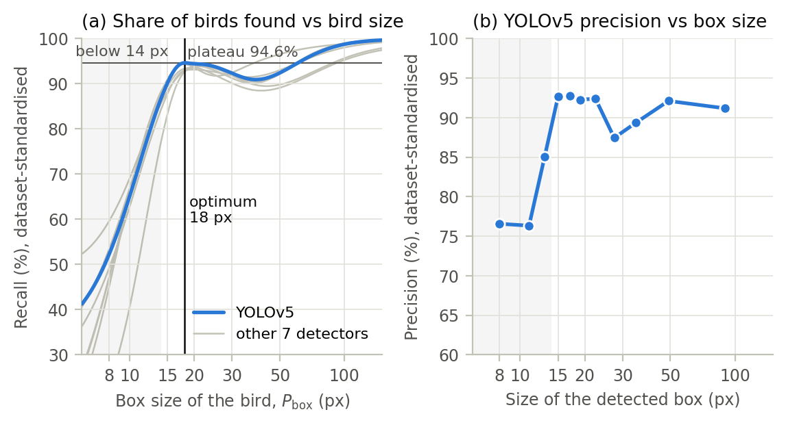{width=6.5in}

## 6.3 The optimum pixel size

The optimum pixel size is the box size at which the detection rate reaches its first peak, where it stops rising:

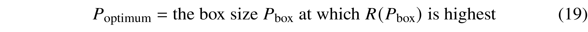{width=6.5in}

The peak is searched between 10 and 30 pixels. Above that range the rate first dips and then rises again only for very large birds, which survey flights do not produce. Table 9 shows the trade-off behind the choice: below the optimum the detector misses many more birds; above it, it finds no more until about 60 pixels, while each photo covers much less ground.

| Bird size in the photo (pixels) | Birds found (%) | Flight height (× optimum) | Ground area per photo (× optimum) |
|--:|--:|--:|--:|
| 14 | 86.7 | 1.38 | 1.90 |
| 16 | 92.7 | 1.16 | 1.34 |
| **18 (optimum)** | **94.6** | **1.00** | **1.00** |
| 20 | 94.4 | 0.88 | 0.78 |
| 25 | 93.8 | 0.69 | 0.47 |
| 30 | 92.3 | 0.57 | 0.32 |
| 40 | 91.0 | 0.42 | 0.18 |
| 60 | 94.5 | 0.28 | 0.08 |
| 100 | 98.8 | 0.17 | 0.03 |

Table: Table 9. Why 18 pixels is the optimum (YOLOv5). Only birds of 100 pixels, photographed from 17% of the optimum height, are found clearly more often.

| Detector | *P*~optimum~ (px) | Rate at optimum (%) | Sizes within 1 point of optimum (px) | Task 2.3: best recall bin | Task 2.3: best F1 bin |
|---|--:|--:|--:|:-:|:-:|
| **YOLOv5** | **18.1** [17.2, 26.8] | **94.6** | **16.6–25.4** | **17–19** | **17–19** |
| YOLO11 | 17.7 [16.7, 26.2] | 94.4 | 16.4–25.0 | 17–19 | 17–19 |
| YOLO-NAS | 18.1 | 94.4 | 16.4–23.2 | 17–19 | 17–19 |
| OWL-T | 18.9 [16.5, 22.9] | 94.7 | 16.8–24.1 | 17–19 | — |
| Faster R-CNN | 19.5 | 93.5 | 17.9–30.0 | 38–306 | 17–19 |
| OWL-C | 19.8 | 93.7 | 17.8–23.0 | 17–19 | — |
| OWL-D | 19.8 | 93.1 | 17.0–27.9 | 17–19 | — |
| YOLO26 | 22.4 | 94.0 | 17.3–28.1 | 17–19 | 17–19 |

Table: Table 10. Optimum pixel size per detector, with 95% bootstrap intervals for three detectors, compared with the best bins of the earlier Task 2.3 analysis. OWL models detect points, so Task 2.3 reports no F1 for them.

The optimum is consistent across detectors (17.7–22.4 pixels) and with the earlier analyses, which found the highest recall at 17–19 pixels (Task 2.3) and at 90 m, where the median bird measured 17.3 pixels (altitude analysis). The YOLOv5 estimate of 18.1 pixels is rounded to 18 pixels for the recommendations. Confidence intervals come from a bootstrap that resamples whole photos (100 replicates), because birds in one photo share a flock, light and annotator. They are tight below the optimum and wide above it, because the rate is nearly flat from 17 to 25 pixels; the YOLOv5 interval, 17.2–26.8 pixels, corresponds to heights of 0.64–1.06 times the recommended height.

## 6.4 The optimum and the blur margin are linked

The two constants of the equation are not independent. In this corpus the optimum box size is 2.5 times the blur margin (18.1 against 7.29 pixels), and the bird inside that box is 2.3 times it. That ratio is the κ of Equation (9), which is how the flight-height equation gets its blur correction without anyone measuring *b*. It is also what one would expect if the detector needs a bird to stand out from the blur by a fixed factor, rather than needing a fixed number of pixels.

A direct test supports it. YOLOv5 was re-run on the same 4,000 test crops with extra Gaussian blur, and the detection rate was refitted against the unchanged annotated box sizes. If the requirement came only from the sizes the detector was trained on, extra blur would lower the whole curve but leave it in place; if blur sets the requirement, the curve moves towards larger boxes. It moves (Table 11).

| Extra blur (σ, px) | Mean detection rate (%) | Size reaching 95% of its own best (px) | *R* at 12 px | *R* at 18 px |
|--:|--:|--:|--:|--:|
| none | 93.3 | 15.0 | 79.6 | 95.3 |
| 1 | 90.5 | 15.9 | 70.3 | 91.6 |
| 2 | 69.1 | 31.0 | 34.5 | 66.7 |
| 3 | 37.5 | 34.3 | 4.3 | 29.3 |

Table: Table 11. The size a bird needs moves with the blur of the photo (YOLOv5, 4,000 test crops, 38,370 uncut birds). Without extra blur the fit reproduces the optimum of Section 6.3 (peak at 18.5 pixels).

The shift is much larger than proportional at σ = 2 and 3 pixels, where the detector also collapses (mean rate 69% and 37%): such photos are far outside anything it was trained on, so those two rows show the direction, not the scaling. The mild step, σ = 1 pixel, is the informative one: it raises the effective margin by about a tenth and moves the size requirement by about a tenth, from 15.0 to 15.9 pixels.

Two consequences follow. First, *b* and *P*~optimum~ must come from the same imagery and annotation style; mixing a margin from one survey with an optimum from another biases the height. Second, a sharper setup — a better lens, a shorter exposure, tighter boxes — should need fewer pixels on a bird, so it can be flown higher. How much higher cannot be read from this corpus, which supplies only one pairing of the two constants.

# 7. Bird sizes by species

For each annotated bird *i*, the size on the ground *S*~i~ was recovered from its box size by inverting Equations (4) and (5), using the photo's own flight height *H*~i~ from its XMP data:

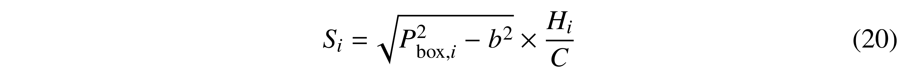{width=6.5in}

| Species | Real birds, *S* (cm) | Interquartile range (cm) | Birds | Decoys, *S* (cm) | Decoy ÷ real |
|---|--:|--:|--:|--:|--:|
| Green-winged teal | 21.1 | 19.6–23.0 | 383 | 24.2 | 1.15 |
| American wigeon ♂ | 26.5 | 25.4–28.0 | 39 | 31.6 | 1.19 |
| Gadwall | 27.9 | 26.0–29.6 | 148 | 30.1 | 1.08 |
| Mallard ♀ | 27.9 | 26.7–29.3 | 38 | 35.1 | 1.26 |
| Northern pintail ♀ | 28.2 | 26.3–29.7 | 305 | 34.8 | 1.23 |
| Northern pintail ♂ | 29.4 | 27.5–31.2 | 477 | 35.1 | 1.20 |
| Mallard ♂ | 30.1 | 28.4–32.5 | 176 | 35.8 | 1.19 |

Table: Table 12. Bird size by species. Real birds: 27 Mavic 2 Pro photos of Bird_I at 14.7–15.8 m. Decoys: Bird_H at 15 m. Species with fewer than 30 real birds (American wigeon ♀ 25.2 cm, 22 birds; American coot 23.8 cm, 23 birds; northern shoveler ♀ 28.7 cm, 14 birds; ♂ 28.2 cm, 16 birds) are not tabulated.

Decoys measure 8–26% larger than real birds of the same species. The recommended heights therefore use the real-bird sizes; decoys serve only to calibrate the size model, where their fixed size is what matters.

# 8. Validation

## 8.1 Bird size in pixels, out of sample

The size distribution of each decoy type was taken from photos at 15 m outside the test split (5,570 boxes from 62 photos). Equations (4) and (5) then predicted the median box size of test-split decoys at every height. Across 38 decoy-type × height groups, with observed sizes from 13 to 102 pixels, the mean absolute error is **1.36 pixels** (Figure 6a).

## 8.2 The recommended height for real birds of varying size

The birds of one species are not all the same size, so at the recommended height they do not all measure exactly 18 pixels. For each species with at least 30 real birds, the average detection rate over its own birds was computed at every height. At the height given by Equation (1), the average is 94.0–94.4%, within 0.35 points of the best average, which occurs slightly lower (0.88–0.95 times that height). Heights between 0.65 and 1.10 times it keep the average within 1 point of the best.

## 8.3 Detection rate, out of sample

The detection-rate curve was refitted without any Bird_H bird. One scaling factor for Bird_H was set from its test birds at 15 m and 30 m, where size does not limit detection, and the detection rate was then predicted for each decoy type and height.

| Flight height | Test birds | Observed rate (%) | Predicted rate (%) | Mean absolute error per group (points) |
|--:|--:|--:|--:|--:|
| 15 m | 1,365 | 96.6 | 97.6 | 2.2 |
| 30 m | 430 | 95.1 | 91.7 | 4.2 |
| 60 m | 458 | 90.2 | 93.9 | 4.1 |
| 90 m | 352 | 92.3 | 90.4 | 3.9 |

Table: Table 13. Out-of-sample prediction of the detection rate for Bird_H test decoys, YOLOv5.

Green-winged teal at 90 m (predicted median 13.5 pixels, observed 13.0 pixels, 97 birds) is the only group predicted to fall below 15 pixels, where the detection rate drops steeply. Its predicted rate is 84.3% and its observed rate 86.6%, the lowest of any decoy type at that height (the others, with 16–72 birds each, range from 89.5% to 100%). The remaining errors are within sampling error; with 16–256 birds per group, the standard error of an observed rate reaches about ±7 points (Figure 6b). This test supports the equation but does not strongly confirm it, because only one group falls below 15 pixels. The under-prediction at 30 m comes from the dip in the pooled curve at 30–40 pixels, which Bird_H does not show; it lies above the optimum and does not affect *P*~optimum~.

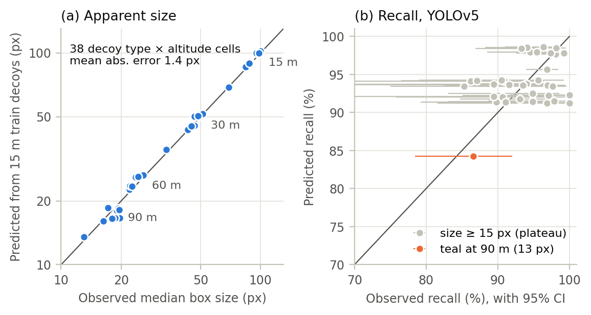{width=6.5in}

# 9. Limitations

- **Mavic Air 2 heights.** Its column in Table 4 applies the geometry and assumes the detector behaves the same at equal pixel size. A smaller sensor with 1.6 µm pixels, shooting at 1/12.5 s, may have a different optimum pixel size. Its three photos were annotated differently and cannot test this.
- **Bird sizes.** They come from 27 photos of one site, season (October 2021) and annotation batch, with 38–477 birds per species. Geese, diving ducks, coots and shovelers are not calibrated.
- **Detector dependence.** *P*~optimum~ describes the current detectors and their training data, in which birds of 15–25 pixels are common. Retraining, particularly with scale augmentation, may move it.
- **Flat optimum.** The detection rate varies by less than 1 point between 17 and 25 pixels, so the optimum is better read as a range; the heights in Table 4 sit at its lower-size, higher-flight end.
- **The two constants are batch-specific and linked.** *b* = 7.29 pixels comes from the Bird_H decoys; the same fit gives 4.14 pixels on Bird_A and 1.30 pixels on Bird_C (Table 7), and 0–9 pixels across decoy types. Only the ratio κ reaches the equation, and it was measured once, on this corpus. A sharper camera or tighter boxes should lower *P*~optimum~ as well, which would allow flying higher; how much cannot be read from this corpus, so a new camera or annotation team still needs its own *P*~optimum~ (Recommendation 2).
- **Recorded height.** DJI height is barometric and measured from the take-off point; it drifts during a flight and ignores differences between take-off elevation and water level.
- **Not modelled.** Disturbance of birds, sun glint, weather, birds in flight and photos not taken straight down. Motion blur is covered only as an increase in apparent bird size (Equation 11).
- **Detection rate only.** Precision was checked (Section 6.2) but is not part of the definition of *P*~optimum~; counting error depends on both.
- **Unresolved data question.** Bird_I's 140 photos without EXIF data show the same species a median 1.36 times larger than photos verified at the same recorded height.

# 10. Recommendations

1. **Plan count surveys with Equation (1) at the optimum pixel size of 18 pixels**, using the smallest species that must be counted and subtracting the take-off height (Equation 14). For mixed dabbling-duck flocks with a Mavic 2 Pro this gives about 55 m above the birds (51 m on the controller after a take-off 3 m above the water), in place of the current 15–90 m ladder.
2. **Calibrate each new camera before operational use.** One flight over a decoy spread at three heights (for example 30, 60 and 90 m) gives both the camera factor and, with the detector run on those photos, its own *P*~optimum~.
3. **Re-measure *P*~optimum~ whenever the detectors are retrained**, by re-running steps 2–4b of the analysis code (Appendix A).
4. **Correct the Task 2.3 size analysis** by excluding cut boxes and averaging over sub-datasets; this raises its small-size recall without moving the peak.
5. **Correct the dataset documentation.** `DATASET_INVENTORY.md` and `metadata_analysis.md` state that decoy status is not recorded, but Bird_H is a decoy dataset; Bird_J also contains five photos of 4000 × 3000 pixels. Bird_H should be analysed separately from real birds in the altitude analysis.
6. **Ask MDC about Bird_I's photos without EXIF data**, to establish their true flight height.
7. **Extend the bird-size table** with annotated photos of verified height for geese, diving ducks, coots and shovelers.

# Appendix A. Reproduction

All numbers, tables, figures and equation images in this report are produced by the scripts in `code/`, run from the repository root in the `waterfowl` environment. Large intermediate files are written to `$FA_WORK` (by default a temporary directory), not to the repository; small result tables are written to `results/`.

| Step | Script | Output |
|---|---|---|
| 1 | `step1_sizes.py` | Box sizes from the COCO crop annotations, rebuilt on the source photos (`coco_boxes.py`), species boxes, `results/camera_exif.csv` |
| 2 | `step2_outcomes.py` | Whether each detector found each test bird |
| 3 | `step3_calibrate.py` | Blur margin, detection-rate curves, bird sizes, validation (`results/*.csv`) |
| 3b | `step3b_optimum.py` | Optimum pixel size, comparison with Task 2.3, Tables 9 and 10 |
| 3c | `step3c_blur_experiment.py` | Blur test of the optimum (`results/blur_experiment.csv`; needs a GPU) |
| 4 | `step4_bootstrap.py` | Bootstrap of the size thresholds (`results/nstar_bootstrap.csv`) |
| 4b | `step4b_optimum_bootstrap.py` | Bootstrap of the optimum pixel size (`results/optimum_bootstrap.csv`) |
| 5 | `step5_figures.py` | Figures 1–6 |
| 6 | `step6_equations.py` | Equation images (LaTeX) |
| 7 | `build_report.py` | This report as a Word document |
| — | `flight_altitude.py` | Flight-height calculator |

Table: Table 14. Analysis pipeline. Steps 1–2 reproduce the study's intermediate data exactly; the bootstraps use fixed random seeds.

Example use of the calculator:

```
python flight_altitude.py --species teal --focal-mm 10.26 --sensor-mm 13.2 --width 5472 --takeoff 3
python flight_altitude.py --species mallard_m --f35 24 --width 4000 --height 3000
```

# Appendix B. Symbols

| Symbol | Meaning | Unit | First used |
|---|---|---|:-:|
| *H*~rec~ | Recommended flight height above the birds | m | Eq. (1) |
| *S* | Bird size on the ground: side of a square with the same area as the bird's bounding box | m or cm | Eq. (1) |
| *f* | Focal length of the lens | mm | Eq. (1) |
| *N* | Image width: pixels along the long side of the photo | pixels | Eq. (1) |
| *w* | Sensor width: long side of the sensor | mm | Eq. (1) |
| *P*~optimum~ | Optimum bird size in the photo for detection: the box size at which the detection rate peaks | pixels | Eq. (1) |
| *k* | Blur correction, 1.09, obtained from the ratio κ | — | Eq. (1) |
| *H* | Flight height above the birds | m | Eq. (2) |
| GSD | Ground sampling distance: ground size of one pixel | cm per pixel | Eq. (2) |
| *C* | Camera factor, *f* × *N* ÷ *w* | pixels | Eq. (3) |
| *P* | Bird size in the photo, from geometry | pixels | Eq. (4) |
| *P*~box~ | Size of the bird's box in the photo: square root of the box area | pixels | Eq. (5) |
| *b* | Blur and annotation margin, 7.29 | pixels | Eq. (5) |
| κ | Ratio *P*~optimum~ ÷ *b*, about 2.5 | — | Eq. (9) |
| *b*~optics~, *b*~margin~ | The camera and annotation parts of the margin | pixels | Eq. (10) |
| *S*~eff~ | Bird size enlarged by motion blur | m or cm | Eq. (11) |
| *v*, *t*~exp~ | Ground speed and exposure time | m/s, s | Eq. (11) |
| GSD~optimum~ | GSD at which a bird's box measures *P*~optimum~ pixels | cm per pixel | Eq. (12) |
| *H*~set~ | Height entered on the controller (measured from the take-off point) | m | Eq. (14) |
| *h*~takeoff~ | Height of the take-off point above the water | m | Eq. (14) |
| *f*~35~ | 35 mm-equivalent focal length | mm | Eq. (15) |
| *D* | Image diagonal | pixels | Eq. (15) |
| *a* | Size constant of an object, *S* × *C* | pixel·m | Eq. (16) |
| *R* | Detection rate: share of birds found | % | Eq. (18) |

Table: Table 15. Symbols, in the order they first appear.

# References

Federal Aviation Administration. *Small Unmanned Aircraft Systems*, 14 CFR Part 107, §107.51 Operating limitations for small unmanned aircraft.

Zhang, Y., Feng, Y., Wang, S., Tang, Z., Zhai, Z., Viegut, R., Webb, L., Raedeke, A., & Shang, Y. (2024). Deep learning models for waterfowl detection and classification in aerial images. *Information*, 15, 157.
