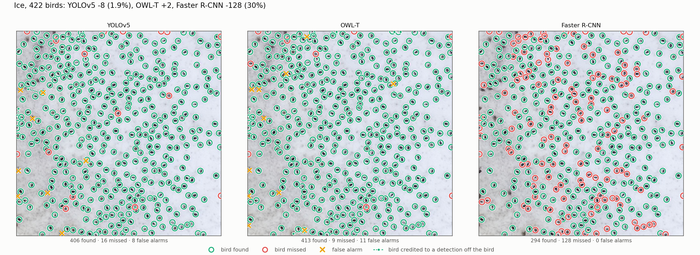
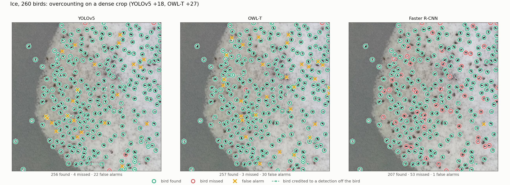
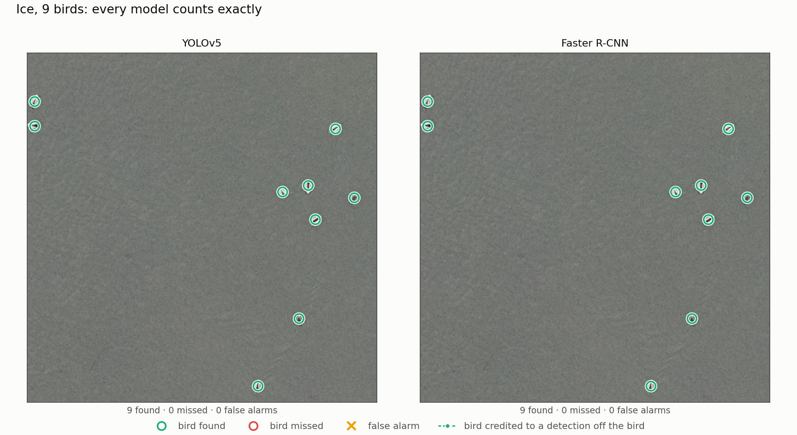
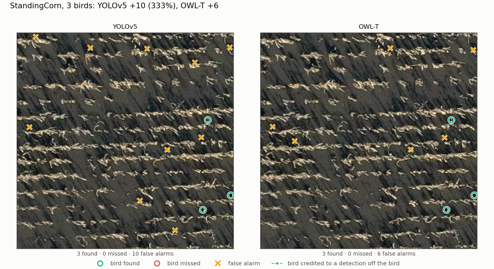

# Summary

In the habitat table, Ice has among the best detection scores (AP 92.0–97.7%, F1 89.0–95.7%) but the highest counting error (mean MAE 1.969 birds per crop, twice MoistSoil's 0.931). This looks contradictory, but it is not. Three effects explain it, and none of them means Ice is hard to count:

1. **MAE is measured in birds, and Ice crops hold far more birds.** An Ice crop holds 29.4 birds on average, against 2.6–8.2 in every other habitat. Scaled by that density, Ice has the *lowest* counting error of the seven habitats: 6.7% of the birds in a typical crop, against 11.4–23.7% elsewhere.
2. **The error sits in a small number of very dense flocks.** 53 crops holding more than 100 birds (10.5% of Ice crops) contain 67% of Ice's birds and 65.5% of its total counting error. All 53 come from three photographs.
3. **Faster R-CNN inflates the average.** Its Ice MAE is 5.56, against 1.27–1.69 for the other seven models. Without it, Ice's mean MAE is 1.46. It does detect 96.8% of the birds in dense flocks, but many of those detections score below its unusually high operating threshold, so its recall there falls to 76.7% and it undercounts.

**Recommendation.** MAE should not be compared across habitats whose crop densities differ this much. The habitat table should also report a relative MAE (MAE divided by mean birds per crop), and counting error should be broken down by density, as it already is in the Task 2.4 analysis.

# 1. The observation

All values are averaged over the eight models, at each model's global operating threshold t\*, on the 28,588-crop test split.

| Habitat | Photos | Crops | Birds | F1 range (%) | Mean MAE | Mean bias (%) |
|---|--:|--:|--:|---|--:|--:|
| MoistSoil | 21 | 2,016 | 16,521 | 89.2 to 91.9 | 0.931 | −8.3 |
| **Ice** | **6** | **504** | **14,820** | **89.0 to 95.7** | **1.969** | **−3.1** |
| StandingCorn | 18 | 1,728 | 8,419 | 81.1 to 85.3 | 0.986 | +2.0 |
| WaterVegetation | 9 | 804 | 5,744 | 86.6 to 89.5 | 1.064 | +0.3 |
| OpenWater | 13 | 1,158 | 4,442 | 88.8 to 92.7 | 0.585 | −12.0 |
| Land | 11 | 996 | 2,867 | 80.0 to 88.4 | 0.682 | −16.6 |
| HarvestedCrop | 9 | 864 | 2,283 | 81.7 to 86.1 | 0.555 | −4.9 |

# 2. Why the metrics disagree

AP, F1, precision and recall are **ratios**: the share of birds found, or the share of detections that are correct. Missing 16 of 422 birds costs the same 3.8% of recall as missing 1 of 26.

MAE is an **absolute count**: the average, over crops, of |predicted count − true count|. Its size grows with the number of birds in a crop. A model that is 5% wrong on a 400-bird crop contributes 20 birds of error. The same model on a 4-bird crop contributes 0.2.

Bias and MAE also measure different things. Bias is computed on the habitat's *total* count, so over-counts on some crops cancel under-counts on others. MAE takes the error per crop before averaging, so nothing cancels. This is why Ice can have a small bias (−3.1%) and a large MAE together.

# 3. Finding 1: Ice is the densest habitat, and relative to density its counting error is the lowest

| Habitat | Birds per crop | Largest crop | Mean MAE | MAE ÷ birds per crop | Mean per-crop relative error\* |
|---|--:|--:|--:|--:|--:|
| **Ice** | **29.4** | **422** | 1.969 | **6.7%** | **8.5%** |
| MoistSoil | 8.2 | 272 | 0.931 | 11.4% | 18.3% |
| WaterVegetation | 7.1 | 63 | 1.064 | 14.9% | 22.7% |
| OpenWater | 3.8 | 228 | 0.585 | 15.3% | 19.2% |
| StandingCorn | 4.9 | 127 | 0.986 | 20.2% | 32.4% |
| HarvestedCrop | 2.6 | 82 | 0.555 | 21.0% | 25.1% |
| Land | 2.9 | 114 | 0.682 | 23.7% | 21.5% |

\* |predicted − true| ÷ true count for each crop that contains birds, averaged over crops and over the seven models other than Faster R-CNN (Section 5).

Both normalisations give the same order: once density is accounted for, Ice is the easiest habitat to count in.

# 4. Finding 2: two-thirds of Ice's error comes from a few very dense flocks

Ice crops grouped by their true bird count, with the counting error averaged over all eight models:

| Birds in crop | Crops | Share of crops | Mean \|error\| (birds) | Mean signed error | Share of Ice's total error |
|---|--:|--:|--:|--:|--:|
| 0 | 128 | 25.4% | 0.12 | +0.12 | 1.6% |
| 1–10 | 189 | 37.5% | 0.50 | −0.14 | 9.4% |
| 11–30 | 99 | 19.6% | 1.01 | −0.31 | 10.1% |
| 31–60 | 20 | 4.0% | 2.54 | −1.03 | 5.1% |
| 61–100 | 15 | 3.0% | 5.48 | −3.68 | 8.3% |
| **> 100** | **53** | **10.5%** | **12.26** | **−6.42** | **65.5%** |

- On the 317 crops with 10 birds or fewer (63% of Ice crops), the models are off by half a bird or less.
- The 53 crops with more than 100 birds (mean 189 birds, maximum 422) hold 9,997 of Ice's 14,820 birds. The models are off by about 12 birds on each of them, mostly by undercounting. That is a 6.5% error on a typical dense crop, but it is what drives the average.
- The 10% of Ice crops with the largest error hold 66.2% of the total error.

**This rests on very few photographs.** The whole Ice group is 6 source photographs, all from Bird_G, cut into 84 crops each. All 53 dense crops come from three of them: `G_Cloud_Ice_90m_test` (21 crops), `G_Cloud_Ice_60m_train2` (16) and `G_Cloud_Ice_90m_test2` (16). Ice's MAE is therefore mostly a measurement of three dense flocks, not of ice as a background.

# 5. Finding 3: Faster R-CNN's operating threshold drops birds it has detected

Per-model counting on all 504 Ice crops:

| Model | Ice MAE | Birds over-counted | Birds under-counted | Net | Count bias |
|---|--:|--:|--:|--:|--:|
| **Faster R-CNN** | **5.562** | 89 | **2,714** | **−2,625** | **−17.7%** |
| OWL-D | 1.694 | 130 | 724 | −594 | −4.0% |
| YOLO26 | 1.593 | 508 | 295 | +213 | +1.4% |
| OWL-T | 1.437 | 474 | 250 | +224 | +1.5% |
| YOLO-NAS | 1.425 | 220 | 498 | −278 | −1.9% |
| OWL-C | 1.401 | 262 | 444 | −182 | −1.2% |
| YOLO11 | 1.371 | 270 | 421 | −151 | −1.0% |
| YOLOv5 | 1.272 | 184 | 457 | −273 | −1.8% |

Without Faster R-CNN, Ice's mean MAE falls from 1.969 to **1.456**. That is still the highest in absolute birds, but its relative MAE falls to 5.0%, the lowest of the seven habitats.

**The cause is the threshold, not detection capacity.** On the 53 dense Ice crops:

| Model | Operating threshold t\* | Recall using every detection | Recall at t\* |
|---|--:|--:|--:|
| **Faster R-CNN** | **0.571** | **96.8%** | **76.7%** |
| YOLO-NAS | 0.411 | 98.3% | 95.0% |
| OWL-D | 0.316 | 92.6% | 92.1% |
| OWL-C | 0.285 | 96.2% | 95.2% |
| OWL-T | 0.261 | 97.9% | 97.3% |
| YOLOv5 | 0.218 | 98.6% | 95.0% |
| YOLO11 | 0.203 | 98.7% | 95.6% |
| YOLO26 | 0.200 | 98.8% | 96.1% |

Faster R-CNN does produce a detection for 96.8% of the birds in these flocks, close to the other models. But t\* is chosen once for each model over the whole test split, and Faster R-CNN's is much higher than the others'. In dense flocks many of its correct detections score below 0.571, so a fifth of the birds are dropped from the count.

The same pattern holds across the whole test split, not only on Ice. In crops with 1–10 birds, 6.8% of Faster R-CNN's correct detections score below its threshold. In crops with more than 100 birds, 15% do. YOLOv5 shows the opposite: 8.2% in sparse crops and 3.3% in dense ones. Faster R-CNN becomes less confident as a scene gets more crowded, and the single-stage and point models do not.

Faster R-CNN is not limited by a detection cap: the project raises Detectron2's default of 100 detections per image to 500, and at most 377 detections were produced on any crop.

# 6. Examples

Every panel shows one test crop at each model's own operating threshold. Green circles are birds the model found, red circles are birds it missed, and orange crosses are false alarms (detections matching no annotated bird).

## Example 1: very dense Ice crop, small relative error but many birds

`Bird_G/G_Cloud_Ice_90m_test_1840_3680.JPG`, 422 birds, the densest crop in the Ice group.

| Model | Found | Missed | False alarms | Count error |
|---|--:|--:|--:|--:|
| YOLOv5 | 406 | 16 | 8 | −8 (1.9%) |
| OWL-T | 413 | 9 | 11 | +2 (0.5%) |
| Faster R-CNN | 294 | 128 | 0 | −128 (30%) |

YOLOv5 finds 96% of the birds, so its F1 on this crop is excellent, yet this one crop adds 8 birds to its error average. Faster R-CNN's misses are spread evenly across the flock. It produced 377 detections here, but only 294 were at or above its threshold.

## Example 2: dense Ice crop, errors in both directions

`Bird_G/G_Cloud_Ice_90m_test_1840_3220.JPG`, 260 birds.

| Model | Found | Missed | False alarms | Count error |
|---|--:|--:|--:|--:|
| YOLOv5 | 256 | 4 | 22 | +18 |
| OWL-T | 257 | 3 | 30 | +27 |
| Faster R-CNN | 207 | 53 | 1 | −52 |

YOLOv5 and OWL-T find almost every bird (recall ≈ 99%) but are still 18–27 birds off, because of false alarms. Several of these false alarms sit on dark, bird-shaped spots near the ice edge. They may be birds that were not annotated: the failure-case library already found 1,639 detections, across all ten sub-datasets, that all eight models agree on but that match no label. If so, the true error on this crop is smaller than measured. This crop has not been checked by hand.

## Example 3: sparse Ice crop, no error

`Bird_G/G_Cloud_Ice_90m_test2_1380_1840.JPG`, 9 birds on plain ice. Every model finds all nine birds with no false alarms. Crops like this make up most of the Ice group, which is why its AP and F1 are high.

## Example 4 (contrast): sparse StandingCorn crop, large relative error but few birds

`Bird_J/J_Sun_StandingCorn_90m_DJI_0058_920_460.JPG`, 3 birds.

| Model | Found | Missed | False alarms | Count error |
|---|--:|--:|--:|--:|
| YOLOv5 | 3 | 0 | 10 | +10 (333%) |
| OWL-T | 3 | 0 | 6 | +6 (200%) |

Both models find all three birds, but corn stubble triggers false alarms. Relative to the true count, this crop is worse than anything on Ice. Because StandingCorn crops average only 4.9 birds, the habitat's mean MAE (0.986) is still half of Ice's.

# 7. Limitations

- **Small sample.** Ice comes from 6 photographs from one sub-dataset (Bird_G), and its dense crops from 3 of them. The findings describe those flocks and should not be generalised to ice as a habitat.
- **Crops from one photograph are not independent.** Neighbouring crops share a flock, lighting and annotator, so the 53 dense crops carry less evidence than 53 separate scenes would.
- **Possible missing annotations.** Some false alarms in dense crops may be unlabelled birds (Example 2). That would inflate both MAE and the over-count, and would lower measured precision.
- **One threshold per model.** Operating thresholds are fixed per model over the whole split, as the benchmark protocol requires. A threshold tuned for dense scenes would probably lower Faster R-CNN's Ice MAE (this has not been tested), but it would no longer be a like-for-like comparison.

# 8. Recommendations

1. **Report relative MAE next to MAE** in every habitat and altitude table (MAE ÷ mean birds per crop), so that density does not look like difficulty.
2. **Read counting error by density band, not by habitat.** The Task 2.4 density breakdown already separates these effects, and it is the right place to compare counting across scenes.
3. **Look into Faster R-CNN's scores in dense scenes.** Its correct detections in crowded crops score lower than in sparse ones, and its global threshold (0.571) cuts them. Score calibration, or a density-aware threshold, could recover much of the 20-point gap between its recall using every detection and its recall at t\*.
4. **Hand-check the dense Ice crops for missing labels** before drawing conclusions about over-counting there.
