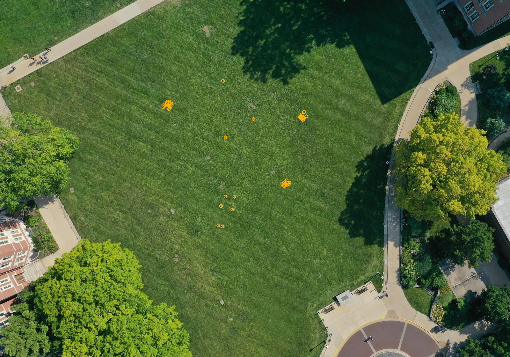
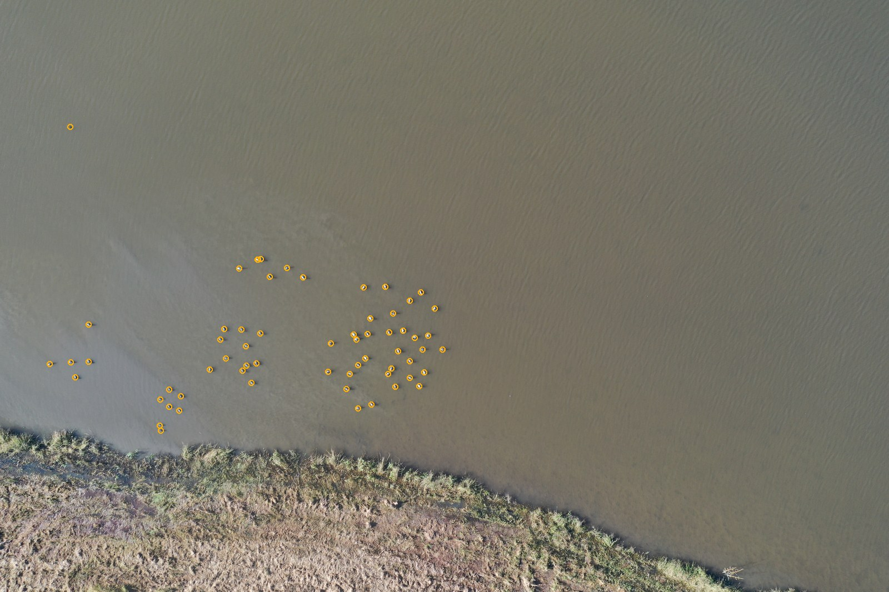
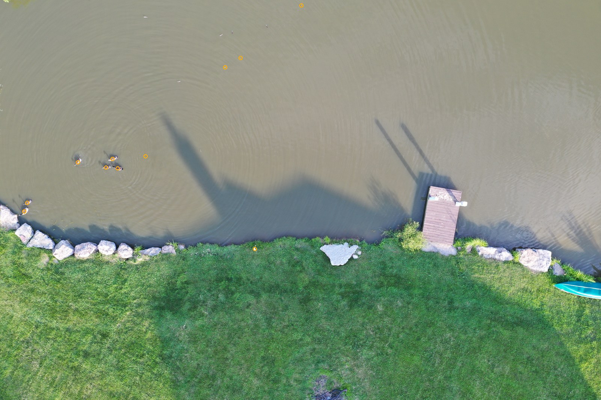

# Bird counts — heldout_sample_3

Waterfowl Workbench · generated 2026-09-30 12:16

## Summary

|  |  |
| --- | --- |
| Photographs | 3 |
| **Birds counted** | **128** |
| Model count before review | 128 |
| Changed by review | +0 |
| Reviewed by a person | 0 of 288 cells (0%) |
| Model | YOLOv5, run `2026-08-27_00-57-30` — on the test split: point AP 93.0%, F1 91.4%, counting MAE 0.368 birds per 512 px crop |
| Threshold | 0.237 — the run's t*, the score cut that minimised counting error on the test split |
| Notes | held-out test photographs with their labels, sampled by the workbench |

## Accuracy against the survey's labels

This survey came with label files for 3 photograph(s), holding 113 annotated birds.  Detections were matched to annotated birds one-to-one within 40 px, highest score first (the project's point protocol).

|  | Model | After review |
| --- | ---: | ---: |
| Birds counted | 128 | 128 |
| Annotated birds | 113 | 113 |
| Mean absolute error per photograph | 5.00 | 5.00 |
| Precision at the threshold | 88.3% |  |
| Recall at the threshold | 100.0% |  |
| F1 at the threshold | 93.8% |  |
| Point AP (threshold-free) | 98.4% |  |

Annotations can be incomplete: the project found 1,639 detections that all eight models agree on but no label covers.  A "false positive" here may be an unlabelled bird — the reviewed column is the one to trust.

## Per photograph

| Photograph | Model | Reviewed | Change | Cells reviewed | Annotated |
| --- | ---: | ---: | ---: | ---: | ---: |
| Bird_A_80_5.jpg | 54 | 54 | +0 | 0/96 | 46 |
| Bird_B_DJI_0328.JPG | 63 | 63 | +0 | 0/96 | 61 |
| Bird_C_DJI_0056_30m.JPG | 11 | 11 | +0 | 0/96 | 6 |

Full table: `counts_heldout_sample_3.csv`; every detection with its score and decision: `detections.csv`.

## Photographs

Amber: counted by the model, not reviewed · green: confirmed · red cross: rejected · cyan: added by the reviewer.

**Bird_A_80_5.jpg** — 54 birds

**Bird_B_DJI_0328.JPG** — 63 birds

**Bird_C_DJI_0056_30m.JPG** — 11 birds

## How these numbers were made

- Each photograph was cut into 512 × 512 px tiles at a 460 px stride — the same tiling as the training and test crops — and every tile was scored the way the model's own evaluation scores a crop.
- Neighbouring tiles overlap, so each bird was counted once: a tile keeps only the detections in the part of the photograph it owns (bounded by the middle of each overlap), and a bird seen by two tiles near that boundary is merged.
- A detection counts when its score is at least the threshold (0.237), unless a reviewer marked it otherwise.  Birds a reviewer added count too.  Cells no one reviewed keep the model's verdict.
- The model's accuracy figures above were measured on 512 px test crops, and are a guide to — not a guarantee of — its accuracy on these photographs.
